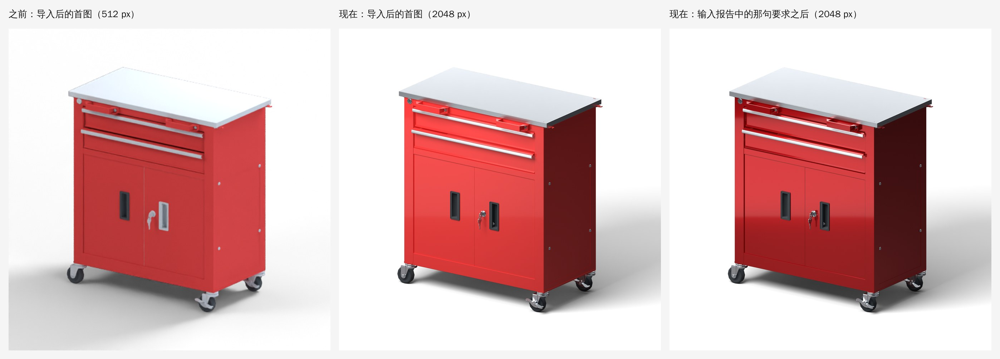

# 展示级首图与指令智能体 v21

日期：2026-11-12。

本次更新解决两件事：输入要求后不再被“仍需确认”卡住，以及导入模型后的第一张图要有成品感。

同一模型（`validation/cabinet-material-check.zip`）、同一机位，均为本次验证中的真实渲染。右图的修改参数来自脚本代替的模型，见“验证”。

## 解决了什么

| 之前 | 现在 |
| --- | --- |
| 输入「柜体是红色喷漆金属带反光，钥匙和钥匙孔是不锈钢会反光」，两项都返回“已定位部件的数量与要求不一致，本次未应用”，要求人工点选部件。 | 同一句话一次模型调用即应用，无需任何确认。用户没有写数量时，数量不再参与校验。 |
| 模型选对了部件，但修改范围与定位范围有出入（例如改了整个共用材质），整项被拒绝。 | 只有一种安全读法时由程序直接修正：共用材质只改所指部件、同组部件补齐同样的参数。 |
| 校验失败后只给模型一个错误代码重试一次，仍失败就交还给用户。 | 重试时附上实测数据；仍未完成的要求交给专职的「定位」「质感」智能体继续处理，全部结果仍经同一套校验。 |
| 模型把轮子支架、刹车片也当成“轮子”选中时，数量恰好仍是 4 组，会被直接应用。 | 应用前由独立的「核对」智能体复查每组定位，把确信不属于所指部位的部件去掉。 |
| OBJ 只带纯色占位材质时，首图是一个哑光的“塑料模型”：不锈钢台面是白的，螺丝、拉手、轮子全是同一种漫反射灰。 | 分析完成后按材质名与部件名补全质感（金属、拉丝不锈钢、亮面塑料、橡胶……），颜色保持不变，依据逐条可查。 |
| 首图只有 512 px、24 采样，布光均匀，没有明暗与轮廓。 | 新项目使用展示级布光；512 px 草稿出来后，后台自动补渲一张 2048 px 高清图，期间可以继续操作。 |

## 指令为什么会卡住

报告里的两项失败是同一个原因。规划模型每定位一组部件，都要填一个“这是几个部件”的数字；服务端把选中的部件按空间位置分组，两个数字不相等就整项拒绝。

在真实的柜子模型上（117 个网格、部件图中 120 个目标）：

- 「柜体」对应 28 个红色部件，在空间上是 7 组互不相连的几何。模型认为这是 1 个柜体。
- 「钥匙孔」对应锁芯和转舌锁 2 个部件，是 2 组几何。模型认为这是 1 个钥匙孔。

用户并没有说“一个”“两个”。数字是模型自己数的，而“一个柜体由几块板组成”本来就没有标准答案。重试时服务端只告诉模型“数量不一致”，不告诉它量出来是几，所以第二次仍然失败，然后界面请用户点选部件。

## 现在的处理方式

一条指令由下面几个角色依次处理。只有前四个会调用模型。

| 角色 | 负责 | 何时运行 |
| --- | --- | --- |
| 规划器 | 读整句话，拆成逐项要求，给出每项的参数修改和所指部件 | 每条指令，1–2 次调用（与此前相同） |
| 核对智能体 | 只回答一个问题：规划器选中的部件里，有哪些不属于用户所指的部位 | 有一组定位包含两个以上部件时，1 次调用 |
| 定位智能体 | 只回答一个问题：这一项要求指的是部件图里的哪些部件 | 规划器两轮之后仍有材质要求未能执行时 |
| 质感智能体 | 只回答一个问题：已定位的部件要呈现这段描述，表面参数应是多少 | 定位之后缺少可用参数时 |
| 执行器（程序，不调用模型） | 把以上结果组装成一项普通的要求，修正范围，交给校验 | 始终 |
| 校验（程序） | 权限出处、保留条件、部件范围、实测参数变化 | 始终，任何来源的结果都要通过 |

**数量。** 模型现在必须给出数量的出处：`count_quote` 是要求原文中写明数量的那几个字。原文里确实有（「四个轮子」里的「四个」），数量仍然严格核对；没有出处，或给出的出处不在原文里，这个数字只记入回执的 `inferred_instances`，不影响是否执行。

**范围修正。** 模型会把同一批部件说两遍：一次在定位里，一次在修改参数里。两者不一致时：

- 修改了一个共用材质，但只定位了其中一部分使用者 → 改为只修改已定位的部件（范围只会收窄，不会扩大）；
- 已定位的部件有几个没出现在修改里，而修改给所有部件的参数完全相同 → 把同样的参数补到这几个部件上；参数不一致时不猜；
- 修改了没有定位的部件 → 第一轮先把具体是哪些部件告诉模型让它自己改；第二轮仍然如此，才去掉这些多出来的修改。

**重试信息。** 数量不符时，反馈里带上要求的数量、实测的组数、每组包含哪些目标；范围不符时，带上多改了哪些、漏改了哪些。只包含服务端自己的测量值和目标编号。

**部件图提示。** 部件图给模型的数据里，三角面数与包围盒尺寸都相同的目标标为同一个 `similar_group`（四个脚轮、一排螺丝），用于在用户写明数量时找全同款部件。这是测量结果，不是按名称猜测。

**核对。** 数量核对只能发现“组数不对”，发现不了“选多了”。四个脚轮各自连着支架和刹车片，把它们一起选中，量出来仍然是 4 组。因此规划器的结果在应用前会交给核对智能体看一遍：它拿到的是要求原文、用户的说法和选中的部件，逐个判断是否属于所指部位。它确信（把握不低于 0.7）不属于的部件从定位中去掉，对应的修改随之去掉；它不能增加部件，不能把一组定位清空，去掉之后如果与用户写明的数量对不上，则保持规划器原来的选择。

**专职智能体。** 规划器两轮之后仍未能执行的材质要求（定位无效、写明的数量对不上、权限出处缺失、参数无变化，或规划器自己标为待确认），逐项交给定位智能体；它返回每个名词对应的目标、把握程度（低于 0.55 不采用）以及找不到时的原因。原有参数可用就沿用，否则再请质感智能体给出参数与权限出处。执行器据此组装出一项要求，重新走一遍完整校验；通过才替换，不通过则保持原状并记录原因。

智能体不能做的事：不能给自己授权（改颜色、换材质类型仍须引用用户原话，否则校验拒绝）；不能修改未定位的部件；不能越过保留条件；不能处理被其他要求或保留条件挂起的项。任何一次调用失败或超出预算，都只是结束这一阶段，规划器已得到的结果照常应用。

**仍未完成时。** 已能执行的部分照常应用（与此前相同，一步可撤销）；剩下的要求留在输入框，原因换成智能体给出的具体说明，例如“已自动查找，模型的部件中没有找到这项要求所指的部位”或“有多个相似部件无法区分”。手动点选部件仍然可用，但不再是第一步。

**回执。** 「查看详情」底部多一行，例如“自动处理：理解要求 2 轮 · 自动定位部件 1 项 · 补全待定要求 1/1 项 · 共用材质只改所指部件”。

**设置。** `.env` 中 `AI_AGENT_TEAM=0` 关闭核对与专职智能体；`AI_AGENT_VERIFY=0` 只关闭核对；`AI_AGENT_MAX_CALLS`（默认 6，上限 12）限制每条指令里它们的调用次数。规划器的两轮调用不受影响。未配置模型时，以上都不生效，指令仍按内置规则处理。

另外，规划器与质感智能体可以设置清漆层 `coat`（0–1）。喷漆、烤漆、釉面的“反光”主要来自这一层。

## 第一张图

### 质感推断

很多 CAD 导出的 OBJ 只带一个纯色。`lookdev.py` 在分析完成后、第一次渲染之前，根据名称为这些占位材质补全质感，写入方案的材质覆盖：

| 名称中包含（节选） | 质感 | 粗糙度 / 金属度 / 清漆 |
| --- | --- | --- |
| 镜面、抛光、镀铬、chrome | 抛光金属 | 0.10 / 1 / — |
| 不锈钢、拉丝、铝、stainless | 拉丝金属 | 0.30 / 1 / — |
| 亮光金属、镀锌；金属、钢、铁（颜色鲜艳时改判为喷涂） | 亮面金属 | 0.20 / 1 / — |
| 喷漆、烤漆、喷塑、paint | 亮面喷涂 | 0.24 / 0 / 0.6 |
| 塑料、尼龙、ABS | 亮面塑料 | 0.22 / 0 / 0.3 |
| 哑光、磨砂 | 缎面塑料 | 0.42 / 0 / — |
| 橡胶、硅胶、轮胎 | 橡胶 | 0.78 / 0 / — |
| 玻璃、木、皮革、布、陶瓷 | 对应预设 | — |

规则：

- 只处理没有贴图、没有金属度或透射设置的占位材质。glTF 材质和带贴图的材质一律不动。
- 颜色始终保留，只改质感。
- 部件名比材质名更具体时以部件名为准：与螺丝共用「亮光金属」的「不锈钢台面」单独设为拉丝金属；「轮子」是橡胶，但「轮子支架」「刹车片」仍是金属；螺丝、铰链、滑轨、锁、钥匙等五金件为亮面金属。
- 材质名只是颜色（「黑色」「default」）时，若使用它的所有部件名称指向同一种质感，按部件决定。
- 导入时落到灰色默认材质上的部件，如果同名部件（「左拉手」与「右拉手」、「加强筋_1」与「加强筋_2」）都用着同一种材质，沿用它的颜色与质感。
- 名称说明不了的，保留颜色，只给一个中性的缎面（粗糙度 0.46），不猜材质。
- 方案中已有任何材质设置时不介入。

每一条决定及其依据写入 `plan.lookdev`，显示在「模型检查与拍摄记录 → 质感推断 → 查看依据」。之后在「材质」里修改，或直接输入要求，都会覆盖它；对整个材质的明确修改会同时取代该材质上按部件猜测的质感。

示例柜子的结果：亮面金属 ×21、拉丝金属 ×2、橡胶 ×1、亮面塑料 ×8、中性缎面 ×3。右门把手原本是灰色默认材质，现在与左把手一致。

### 展示级布光

新项目的方案带 `look: "showcase"`。旧项目保持原样，可在「参数 → 出图质量 → 布光与质感」切换；切换时若方案里还没有材质设置，会补一次质感推断。

- **主光与补光拉开约两档。** 主光在镜头左前上方，距离更近；补光只负责不让暗面死黑。方盒子的两个可见面因此一明一暗。经典布光里两者接近，所以画面是平的。
- **两条后侧条形灯**勾出轮廓高光，**后方反光板**让水平的金属面（台面）映出亮的渐变，而不是一片灰或一片白。
- **正面扫光板**只参与反射、不参与漫反射照明，位置按离镜头最近的那个立面计算，在亮面漆的上半部扫出一道柔和的光泽过渡。
- **塑形灯只照产品，不照地面**（Cycles 灯光链接）。地面阴影只来自主光和顶光，更实，也不会在地面上留下灯板的边界。
- **白底镜头**的地面改为中灰。它是阴影捕捉面，画面里仍是纯白，但不再把大量反弹光打回产品、把颜色冲淡；并使用略高的对比度曲线。
- **棚拍镜头**加一盏只照背景的均匀顶光，低机位时远处地面不再出现暗带。
- **棱边高光。** 渲染时给每个材质接入 Cycles 倒角节点（半径为产品尺寸的 0.22%），CAD 模型的硬边会有一条细高光。不修改几何体；已有法线贴图或凹凸的材质不动。
- 选择喷涂金属、亮面塑料、陶瓷预设时，默认带清漆层。

灯的名称沿用「Key / Fill / Edge softbox」，主光、补光、轮廓光的强度与方向控制照常生效。

### 后台高清图

预览仍是 512 px 的草稿，十几秒可见，用来尽快确认方向。草稿完成、自动检查也结束后，后台自动为这个镜头补渲一张 2048 px、160 采样的高清图（画质 `showcase`），完成后替换显示。2048 px 满足大部分平台的主图尺寸，可直接用于「导出」。

这个任务不占用项目：状态栏显示“后台生成高清图 · 可继续操作”，所有按钮照常可用。提交预览、渲染、输入要求、修改参数、撤销等任何操作都会立刻取消它并正常执行，之后的下一次预览完成后会重新补渲。手动取消的不会自动重来。不需要时在「参数 → 出图质量」取消勾选「预览后在后台生成高清 2K」。

顶栏的「渲染 4K」不变。

## 验证

环境：Linux 容器，4 核 CPU，无显卡；Blender 5.0.1（PyPI 的 `bpy` 模块，通过与 `blender -b … --python` 参数兼容的测试用启动脚本调用，不是官方可执行文件）；Python 3.13；Node 22 + jsdom 26。**本环境没有可用的大模型接口，所有模型回复都是脚本给出的**；下面的结果证明的是程序在这些回复下的行为，不是某个真实模型的回答质量。

**自动化测试。**

- `python -m unittest discover -s tests`：1066 项全部通过，无跳过，其中包含需要真实 Blender 的运行时测试。新增 `tests/test_instruction_agents.py`（34 项）与 `tests/test_showcase_first_image.py`（31 项，其中 4 项用真实 Blender 构建展示级场景并检查灯光、纯白边缘、明暗对比和背景均匀度）；原有 1001 项中有 1 项的预期随行为改变而更新（共用材质的修改由“拒绝”改为“收窄到已定位的部件”）。
- `node --test tests/test_ui_state.cjs`：198 项中 197 项通过，新增 7 项全部通过。剩余 1 项文件级告警（“AI apply first previews the saved live camera…”测试结束后仍有异步活动）在改动前的代码上同样出现，与本次更新无关。
- `node --test tests/test_viewport_math.mjs`：9 项全部通过。
- 新增测试用一个小型柜体部件图复现了报告中的情形（三块互不相连的柜板、插在锁里的钥匙、四个相同的脚轮，其中一个连着支架），覆盖：未写数量时不再拒绝、写明数量时仍然核对并把实测值反馈给模型、三种范围修正及其先后次序、核对智能体只收窄不扩大、定位与质感智能体的补全、智能体不能自行授权改色、调用预算、调用失败时保留规划器结果，以及经由指令服务的真实提交与撤销记录。
- 上述测试中的一项是在端到端运行里发现问题后补上的：服务端在提交前会复核一次定位，最初不认识新增的 `inferred_instances` 字段，返回 409。已修复，去掉修复后该测试失败。

**真实流程。** 应用通过 HTTP 接口完整运行，Blender 为真实渲染，大模型由本机的脚本服务代替（Anthropic Messages 协议）。脚本按应用发来的真实部件图挑选部件，并故意保留两个习惯：给没有写数量的要求填上自己数的数量；把轮子的支架和刹车片也选进“轮子”。模型为示例柜子 `validation/cabinet-material-check.zip`。

| 步骤 | 结果 |
| --- | --- |
| 上传 → 分析 → 质感推断 → 512 px 草稿 | 12.3 秒后首图可见；质感推断 35 项 |
| 草稿完成后 | 后台高清图任务自动开始（`origin: auto_polish`） |
| 后台任务渲染中输入「柜体是红色喷漆金属带反光，钥匙和钥匙孔是不锈钢会反光」 | 5.0 秒返回 `applied`，无待确认项。规划器 1 次调用，核对智能体确认 3 组定位。柜体 28 个部件实测 7 组（模型估计 1），钥匙孔 2 个部件实测 2 组（模型估计 1），均不再阻止执行。后台任务被取消并标记 `yielded` |
| 预览新方案 | 约 11 秒 |
| 预览完成后 | 后台高清图重新开始，435 秒后完成，2048 × 2048 |
| 输入「四个轮子换成哑光黑色橡胶」（来源图为 2K 高清图） | 5.8 秒返回 `applied`。规划器选了 10 个部件（4 个轮子 + 4 个支架 + 2 个刹车片），实测正好 4 组，数量核对通过；核对智能体去掉 6 个，最终只修改 4 个轮子 |
| 在展示级场景上运行原有的「自动优化主图」 | 场景读取与候选渲染正常完成；因没有可用的视觉模型，按原有逻辑保留原图 |

每一步的图片都目视检查过：首图中金属件、拉丝台面、橡胶轮与亮面漆各自成立，右把手与左把手一致；第一条指令后柜体为带清漆反光的红色喷漆金属，钥匙与锁芯为金属；第二条指令后轮子为黑色橡胶，支架与刹车片仍是金属。

**画面对照。** 同一模型、同一机位，旧首图（512 px，经典布光，占位材质）与新的 2K 首图逐张比较；柜子的棚拍、侧面、背面、细节镜头与深色风格各渲染一次检查。仓库自带的四个 glTF 示例（瓶、托盘、玻璃杯、手提袋）用两种布光各渲染一次：前三者有真实材质，质感推断没有介入；玻璃杯最初在新布光下偏暗发灰，已改为透明材质保留明亮环境后重新渲染确认。

**耗时（4 核 CPU，无显卡）。** 512 px 草稿约 10 秒；2048 px 高清图 160 采样两次实测为 435 秒与 501 秒；256 采样时为 602 秒，目视无明显差别，因此采用 160。显卡上的耗时未测量。

## 边界与未验证

- **没有用真实的大模型运行过。** 核对、定位与质感智能体的提示词和把握程度阈值（0.7、0.55）是按经验设定的，实际效果需要在你配置的模型上观察。回执里的「自动处理」一行和项目诊断记录可以用来判断它们是否起作用。
- 没有在 Windows、官方 Blender 可执行文件或显卡上运行本次新增代码。灯光链接需要 Blender 4.0 及以上；更早的版本会跳过这一步，塑形灯仍会照到地面。
- 质感推断只看名称。名称不规范或与实际不符时会判断错（例如叫「塑料」的金属件）；这时在「材质」里修改或直接输入要求即可。它不看图，也不识别没有名称线索的材质。
- 布光数值是在示例柜子和仓库自带示例上目视调整的。很浅或很深的产品、大面积镜面、透明产品可能需要再调主光或曝光。
- 后台高清图在 4 核 CPU 上需要数分钟；显卡上的耗时未测量。它会被任何操作取消，频繁操作时可能一直没有机会完成。
- 核对多一次模型调用，带图片，会让每条涉及多个部件的材质指令慢一些。核对只能收窄：规划器漏选的部件它补不回来。
- 专职智能体只处理材质类要求。灯光、镜头类要求未能执行时，仍按原有方式返回。
- 范围修正中的“去掉未定位部件的修改”会让实际修改少于模型原本想改的范围；回执中会注明。
- 2048 px 的高清图不是 4K 成品，首页卡片与画面标签都标为「高清 2K」。
