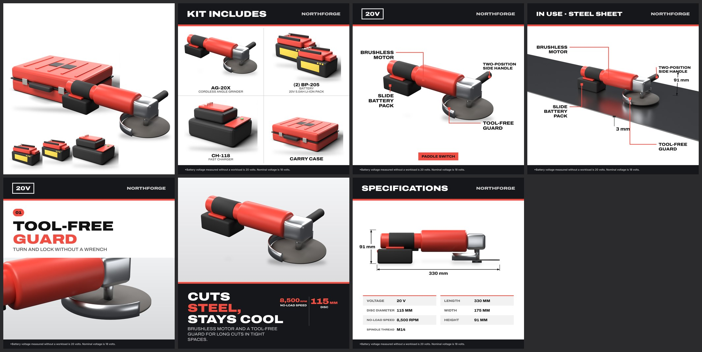
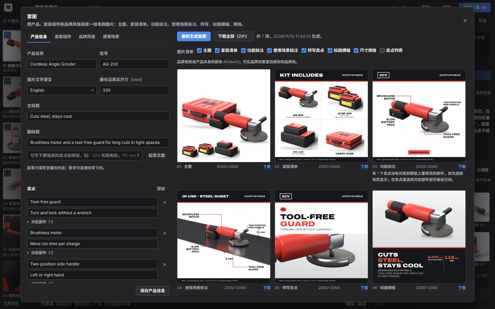
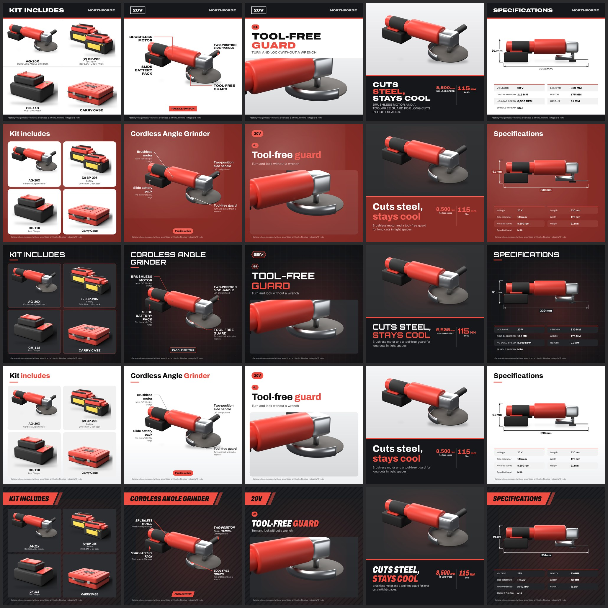
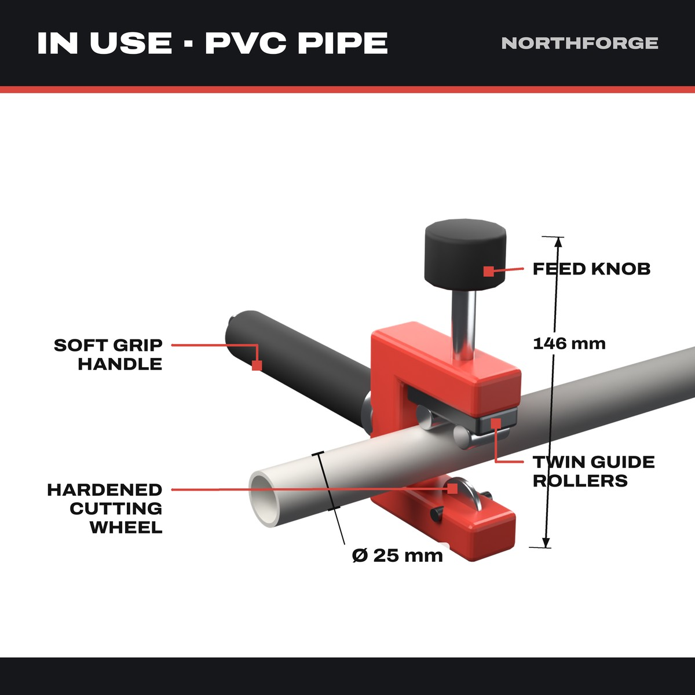
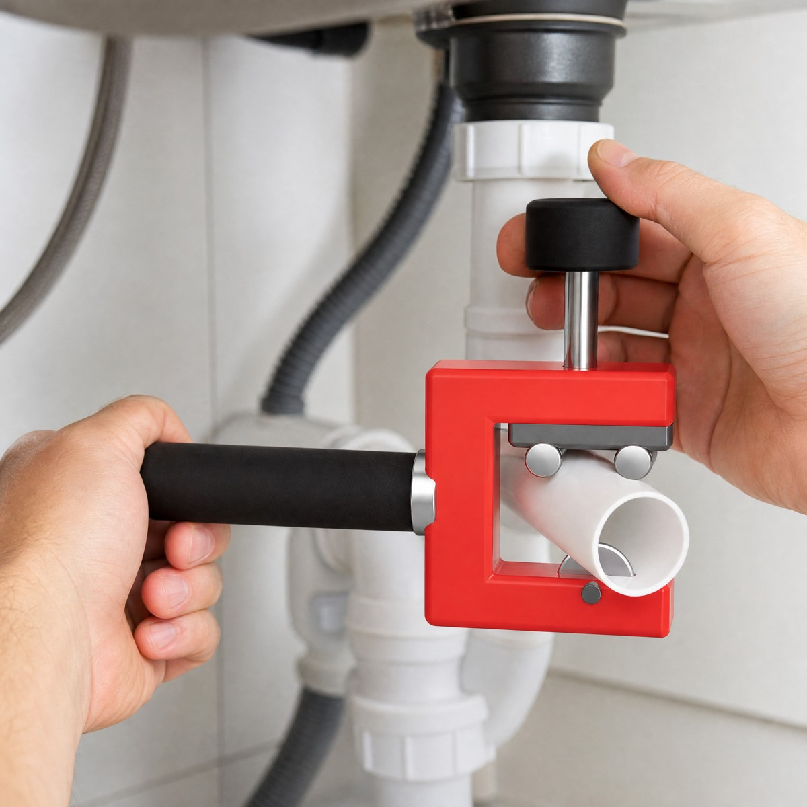

# 套图：组件、品牌风格、元素库与使用场景标注图 v29

这一版把“一个模型、一张图、一层文字”改成了“一个产品、一组图”。依据是对 82 张亚马逊工具类商品图的逐张研究，结论见 [LISTING_IMAGE_STUDY.md](LISTING_IMAGE_STUDY.md)。

同时修了两处：场景生成时状态栏显示“材质任务未完成”，以及 AI 场景图里的人物改为默认只拍手部。

| 内容 | 结果 |
| --- | --- |
| 组件 | 一个项目可以有多个组件（电池、充电器、工具箱……），每个上传一个模型或一张图片，自动处理成抠图 |
| 品牌风格 | 五种预设，品牌色默认取自产品本身，全套图片共用 |
| 元素库 | 21 种元素，三种字宽的粗体、斜体、描边、阴影、渐变 |
| 套图 | 八种图片：主图、套装清单、功能标注、使用场景标注、特写、标题横幅、卖点列表、尺寸规格 |
| 使用场景标注图 | 产品和工件放在一起，标出尺寸和功能，例如割管器套在白色塑料管上 |
| 手部特写 | AI 场景图里出现人时，默认只拍操作产品的手，不露脸 |
| 状态栏 | 场景生成显示自己的阶段和百分比 |

## 一、套图在哪里

顶栏新增「套图」按钮，打开一个窗口：左边是四组设置（产品信息、套装组件、品牌风格、使用场景），右边是图片清单和生成好的图片。

流程：

1. 填产品信息，或点「起草文案」让系统按模型的部件名称和你写的要点起草（配置了 AI 时由文案模型撰写）。
2. 在「套装组件」里添加随箱附带的东西。
3. 在「品牌风格」里选一种风格。
4. 点「生成套图」。渲染素材、排版、输出 2000×2000 的 PNG，可单张下载或打包下载。

图片上的数字只有两个来源：你填写的，或者从模型上量出来的。

## 二、组件

每个组件上传一个模型（OBJ / GLB / ZIP）或一张图片（PNG / JPG / WebP）。

**模型**走和产品一样的流程：分析结构，由朝向检查判断哪面朝上，按部件名称推断质感，渲染成透明背景的抠图。朝向不对时可以在组件上点「上下翻转」「左转 90°」「前翻 90°」。

**图片**用于模型做不出来的东西，例如布质工具包。带透明通道的直接使用；白底或纯色底的自动抠掉背景；背景不是纯色时会提示，不会硬抠。

每个组件有名称、类型、型号、数量、一行说明和最长边尺寸。尺寸没填时按模型文件的单位估计，并在组件上注明，因为它决定了套装图里各件东西的大小比例。

组件处理是排队进行的，状态和百分比显示在组件卡片上。

## 三、品牌风格

五种预设对应示例图片里的五类做法：

| 预设 | 样子 |
| --- | --- |
| 品牌边框 | 深色页眉页脚加白色主体，宽体粗大写标题，直角引线，不用图标 |
| 品牌色铺底 | 整页品牌色，白色文字，圆角卡片和胶囊标签 |
| 深色科技 | 深灰底加光晕与细网格，方形展示字体，描边面板 |
| 简洁白底 | 白底留白，黑色粗标题里一个词用品牌色，细灰引线 |
| 促销冲击 | 窄体粗斜大写，斜切色带，带阴影的标题 |

品牌色默认取自产品抠图里最主要的鲜艳颜色，也可以自己指定。文字和品牌色会按所在底色自动调整到读得清。整页铺品牌色而品牌色又取自产品时，底色会加深，免得产品和背景混在一起。

还可以填品牌名称、最多三个徽标文字、页脚说明文字，上传标志图片，选择尺寸单位（毫米或英寸）。

预设只是排版方式。系统里没有任何品牌的名称、标志或图形。

字体新增 Archivo（字宽 62 到 125、字重 100 到 900，含斜体）和 Orbitron，都是 SIL Open Font License，随程序附带。展示字体缺的字符由正文字体补上，中文用 Noto Sans SC。

## 四、八种图片

| 图片 | 内容 | 什么时候生成 |
| --- | --- | --- |
| 主图 | 白底、无文字。有组件时产品放大在前，箱包在后，小件排在前排 | 总是 |
| 套装清单 | 每件东西一格：抠图、型号、名称、说明，数量大于 1 时画两件 | 有处理好的组件 |
| 功能标注 | 产品居中，卖点在两侧，引线指到模型上对应部件看得见的位置 | 有卖点 |
| 使用场景标注 | 见下一节 | 启用了使用场景 |
| 特写 | 一个卖点的标题和说明，下面是该部件的近景 | 卖点选了对应部件 |
| 标题横幅 | 上面是图片，下面色带里是主标题、副标题和最多三个大数字。项目里有 AI 场景图时用场景图 | 总是 |
| 卖点列表 | 产品在左，卖点在右，带图标或色条 | 卖点不少于三条 |
| 尺寸规格 | 正侧视图加长度、高度尺寸线，下面是规格表 | 有规格，或填了真实尺寸 |

自动最多选七张。也可以在右侧的图片清单里自己勾选；缺内容而做不出的图片会说明原因。

卖点选了“对应部件”才会有引线和特写。没选的卖点在功能标注图里改成底部标签，并在图片下方提示。

排版由服务端用 Pillow 完成，按两倍尺寸绘制再缩小。你下载的文件就是系统渲染的那一张，浏览器里不再另画一遍。

## 五、使用场景标注图

这张图把产品和它加工的工件渲染在同一个画面里，再标注。

**工件**由程序按尺寸生成：管材、圆棒、板材、薄板、块料；材质有白色和灰色 PVC、铜、钢、铝、木、混凝土、石膏板、黑色塑料。

**位置**有四种：

- 穿过工具的开口。程序沿三个轴向透视模型的轮廓，找被工具三面以上包住的空隙，工件从中穿过。管径没填时按量到的开口选一个标准规格。
- 垫在工具下方。工具被抬高一个工件厚度，工件从画面两侧伸出去。
- 顶在工具前端。工件立在工具长轴的一端，可选哪一端。
- 手动。放在工具中心，用偏移和旋转调整。

**标注**：

- 工件的直径或厚度，是你选的或程序选的那个尺寸。
- 产品的长度和高度，只在填了真实尺寸时画。尺寸线可以跨过工件，但不会压在产品上；找不到干净的位置就不画这一条。
- 最多四个卖点，引线指到这个画面里看得见的部件。标签躲不开画面时加一块底色衬底。

按产品名称，割管器、扳手、夹具、压接钳这类“包住工件”的工具默认启用。电钻、锯、角磨机只给出建议的工件和位置，默认不启用，因为程序不知道钻头或锯片在模型的哪里，自动放的位置只是个起点。

## 六、手部特写

AI 场景图的「画面人物」多了一项，默认做法也变了：

| 选项 | 画面 |
| --- | --- |
| 自动 | 场景策划认为需要有人时，只拍手部特写 |
| 手部特写 | 一两只手握着并操作产品，加工的东西在画面里，不出现脸、头和整个人 |
| 包含人物 | 看得到使用者，上半身入镜 |
| 不含人物 | 只有产品和环境 |

核对画面时多看一项“有没有出现人脸”。要手部特写而出现了脸或整个人，或者根本没有手，都算不符，会重新生成一次。

实测一次（gpt-image-2，medium 质量）：一次通过，核对结果为“有手、没有脸”，产品的形状、部件和颜色与参考图一致，用时 193 秒。

## 七、状态栏里的“材质任务未完成”

原因：状态栏取阶段文字时，先看渲染任务，再看材质任务，然后才看场景任务。项目上保留着上一次自动材质任务的记录，这个记录结束后不会清除，于是只要它在，生成场景时显示的就一直是它最后的阶段文字。自动材质没有应用时，那段文字正是“材质任务未完成”。旁边的“等待任务阶段更新”是场景任务的占位文字，当时没有接上场景任务已有的进度。

现在：

- 只有材质任务真的在进行时才显示它的阶段，场景生成时显示场景任务自己的阶段。
- 场景生成显示“场景生成进度 54%”和进度条。
- 自动材质没有应用时，文字改为“自动材质优化未应用，已保留现有材质”。这一步本来就是可选的，没应用不影响出图。

## 接口

见 [API.md](API.md) 的「v29 套图」一节。

## 边界与未验证

- **产品只能和模型一样真实。** 模型上没有的印刷标签、布料褶皱、线缆，图上也没有。
- **不生成对比图。** “比别家好”这类说法无法从模型核实。应用场景九宫格、操作步骤图需要多张不同的照片，目前没有模板。
- **套装主图按规则摆放**，不如人工摆得讲究。
- **开口检测是几何判断。** 手枪形电钻握把前方的凹处也会被当成开口，所以这类产品默认不启用“穿过开口”。
- **测试模型是自己搭的**（角磨机套装、割管器、电池、充电器、工具箱），不是真实产品的模型，也没有复刻示例里的任何一款产品。
- **渲染在无 GPU 的机器上测的。** 一套七张图约 4 分钟，其中素材渲染占绝大部分；素材按请求缓存，只改文字或换风格时重排一套约 25 秒。有 GPU 时的耗时没有测。
- **4:5 等其他比例没有做**，套图目前都是 1:1。
- **图片组件的抠图只处理纯色背景。**
- **手部特写只实测了一次。** 图像模型不保证每次都把产品还原得同样准确，核对和重试机制与之前相同。

## 验证

- Python 测试 1350 项通过，其中新增 `tests/test_listing.py` 52 项，含 4 项用真实 Blender 运行 `blender/stage.py`。
- 界面测试：`tests/test_ui_state.cjs` 240 项，新增 `tests/test_listing_ui.cjs` 9 项，另两个文件 5 项，全部通过。
- 真实浏览器（Chromium）：打开套图窗口，通过文件选择添加一个图片组件，切换四个标签，点击生成并等到完成，无控制台错误。
- 真实模型服务：文案起草一次，场景图手部特写一次。
