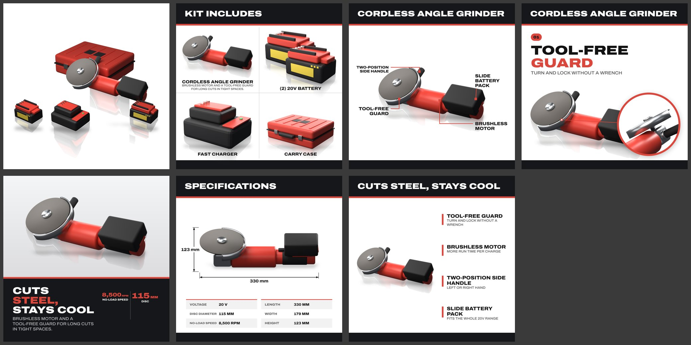
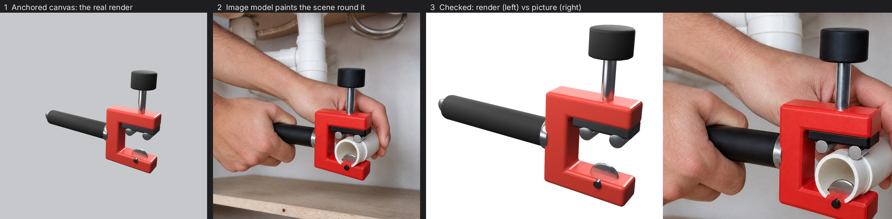
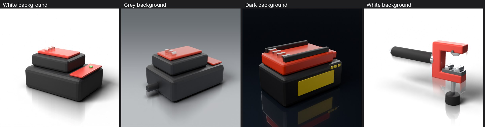

# 产品锁定的 AI 场景、地面倒影、组件随项目上传、套图取代图文 v30

| 内容 | 结果 |
| --- | --- |
| AI 场景图里产品变形 | 产品不再由图像模型画：模型渲染图先放进画面并被遮罩保护，图像模型只画周围的场景、手和影子；之后测量产品是否被移动、改画或挡住，不合格就带着具体问题重画 |
| 地面倒影 | 白底、灰底、深色底的渲染图都有清晰的地面倒影；套图里的抠图也有 |
| 组件 | 在新建项目时和主模型一起上传；套图主图里产品和组件在同一个 Blender 场景里一起渲染 |
| 图文 | 去掉了图文编辑器；它的标签页换成「套图」 |
| 你上传的套图结果 | 逐张看过后改了四处：长条工具放平展示、页眉不再空着、特写页改成整件产品加放大镜、副标题不再被「…」截断 |

## 一、AI 场景图里产品变形

**原因。** 以前的做法是：把产品从三个角度渲染成参考图交给图像模型，让它把这件产品画进场景。图像模型是重新画一遍产品，不是把参考图贴进去，所以每次都会走样：零件弯了、少了、比例变了。有人手拿着时更明显，因为手和产品交叠的地方模型最容易画错。

**现在的做法。**

1. 按场景的相机角度渲染一张透明背景的产品图（只渲染一次，之后复用）。
2. 把这张产品图放在画面里它最终的位置上，周围是灰底；同时给图像模型一张遮罩，遮罩只保护产品所在的区域。
3. 告诉图像模型：产品已经在图里，不准移动、转动、缩放或重画它，只把灰底替换成场景，并画出托住或握住它的东西、手和它投下的影子。
4. 生成后由程序测量，不靠模型自己说：
   - 在小范围的位移和缩放里找渲染图的轮廓；找不到，说明产品被移动或在别处重画了；
   - 把产品分成小块逐块比对边缘；被手或工件挡住的部分不算，其余小块对不上，说明零件被改画了；
   - 产品被挡住太多，也算不合格。
5. 测量合格后，视觉模型再看一遍：除整张图外，还会拿到一张「渲染图在左、生成图同一区域在右」的并排特写，逐个零件比对，同时检查手部、人脸。
6. 任何一项不合格，就带着具体问题（例如「产品被移动了」「产品右上部的零件被改画了」）重画一次。

**实测（gpt-image-2，medium，割管器，手部特写）：** 一次通过，用时 88 秒（产品渲染 + 生成 + 测量 + 视觉核对）。生成图里的产品与渲染图一致：旋钮、滚轮、刀轮、比例都没变，手握着手柄，管子穿过钳口。以前要渲染三张参考图，现在只渲染一张，前期准备也更快。

**试过但没有采用的做法：** 生成后把渲染图的像素直接贴回去。产品本身确实分毫不差，但只要图像模型把某个零件挪了几个像素，手指、穿过钳口的管子或产品边缘就会被切断或出现重影，整体看起来更假。所以现在只测量、不贴图。

**图像服务不支持遮罩时：** 去掉遮罩再试一次，画布上的产品仍然在原位，测量照常进行。

## 二、地面倒影

所有渲染图（预览、4K、缩略图）默认带倒影：

- **深色底：** 地面加了一层透明清漆，倒影由 Cycles 真实渲染。
- **白底和灰底：** 这两种地面原本是「阴影捕捉器」，只接收阴影，不会反射。所以改为在透明背景上渲染，再由渲染脚本把产品铺回白底或原来的灰色渐变底上，并在产品每一列与地面接触的位置向下镜像、逐渐淡出。白底仍然是纯白（255），满足主图要求。保存的 .blend 工程仍是不透明背景。
- **套图里的抠图：** 用同样的方法画倒影，分成竖条处理，所以倒影能贴合不水平的底边。尺寸规格页不加倒影，因为尺寸线画在产品下方。

灰底以前也试过真实的光滑地面，但地面反射的环境和产品一样暗，倒影几乎看不见，所以改成后期合成。用 3D 道具布置的使用场景，地面保持原样。

## 三、组件随项目一起上传，并和产品一起渲染

**上传。** 新建项目的窗口里多了「套装组件」：每个组件一个 GLB / OBJ（带贴图的打包成 ZIP），或一张白底 / 透明背景的图片；每个组件可以填写名称、类型（按文件名自动猜）、数量。组件会等主模型分析完、首张主图开始后再处理，不拖慢首图。

不支持的文件、错误的类型或数量，会在创建项目前直接拒绝整次上传，不会留下半个项目。

套图窗口里的组件页不再提供上传，只用来修改名称、型号、数量、朝向，或删除组件。

**一起渲染。** 套图主图不再把几张抠图拼在一起，而是把产品和所有有模型的组件放进同一个 Blender 场景，一次渲染，灯光、透视、阴影、倒影都一致：

- 工具箱、工具包放在产品后面，让产品压在它前面；
- 电池、充电器等小件放在左右两个前角，不遮挡产品；
- 数量为 2 的组件摆两个；
- 产品相对组件放大一些（组件按真实比例的 72% 摆放）。示例里的套装主图都是这样处理的。

只有图片、没有模型的组件，放在主图的角落。

## 四、去掉图文，换成套图

右侧面板的「图文」标签改成了「套图」，里面显示这个项目已经生成了几张图（附缩略图），以及「打开套图」按钮。逐镜头编辑图文的编辑器、它的接口、浏览器脚本和 PSD 导出都已删除。套图仍会用到起草文案、读取画面中各部件位置这两部分代码，所以这两部分保留了下来。

## 五、为什么你上传的套图还不像示例

逐张看了你上传的 6 张图（主图、功能标注、电池特写、标题横幅、尺寸规格、卖点列表），差距在下面这些地方。

| 问题 | 原因 | 处理 |
| --- | --- | --- |
| 角磨机在每一张里都竖着立在电池上 | 摆正检查判断它「靠电池底面立住」，套图直接沿用了这个姿态；示例里的角磨机都是平放、斜向展示 | **已改：** 明显比长宽高出很多的工具，在套图里改为平放展示：绕朝向相机的轴转 90°，原来朝向相机的一面仍然朝向相机，再对齐坐标轴，保证尺寸量得准。项目本身的姿态不变。瓶子这类本来就该立着的产品不受影响 |
| 黑色页眉、页脚里什么都没有 | 「品牌边框」风格的页眉需要品牌名称、徽标或标志，你没有填写 | **已改：** 页眉没有其他内容时显示产品名称。但示例的分量很大程度来自品牌素材，仍建议填写品牌名、20V 一类的徽标文字和页脚说明 |
| 电池特写只剩下一块被切掉的局部 | 特写页把部件近景铺满下半页，近景相机的角度又刚好是从下往上 | **已改：** 改为整件产品加一个圆形放大镜，放大镜里是该部件的近景，并用一条线指到部件位置 |
| 副标题被截成「…WITHOUT A...」 | 文案模型的字数上限把句子截断后补了省略号 | **已改：** 截断的句子会退回到最后一个完整的词或分句 |
| 规格页的产品又小又竖，表里只有长宽高 | 竖着的产品在侧视图里只占中间一窄条；规格表只有从模型量出的三项 | 产品放平后侧视图变大了。**要补的是信息：** 电压、转速、盘径等只能由你填写 |
| 卖点写成了「可拆卸电池为角磨机供电」「磨片装在主轴上」 | 起草文案时只有部件名称可用，模型只能把部件名称改写成句子 | 需要你在「产品信息」里写下真实卖点和数字，或在起草框里给出要点 |
| 没有套装清单、没有组件 | 这个项目没有上传组件 | 现在可以在新建项目时一起上传；主图里会和产品一起渲染 |
| 只有一张场景图 | 每个项目一张 AI 场景图 | 场景图里产品变形的问题已经解决（第一节）；每个项目多张场景图还没有做 |

改后的效果见本文开头的图：同一次上传（角磨机 + 两块电池 + 充电器 + 工具箱）、没有填写品牌名称、用「品牌边框」风格生成的七张图。

**仍然达不到示例的地方：**

- **产品的真实感取决于模型。** 示例是实物照片，有印刷标签、磨损和真实材质，模型没有这些就做不出来。
- **品牌素材和真实卖点要用户提供。** 系统不会编造数字，也不内置任何品牌的标志。
- **还没有对比图、应用场景宫格和操作步骤图。**

## 接口

见 [API.md](API.md) 的「v30」一节。

## 验证

- Python 测试 1358 项通过。新增 `tests/test_scene_lock.py`（锁定与测量，8 项）和 `tests/test_reflection.py`（倒影，2 项，其中一项在真实 Blender 的 Python 里运行），`tests/test_listing.py` 增加到 59 项（随项目上传组件、套装一起渲染（含一项真实 Blender 渲染）、平放展示、页眉兜底、特写页、截断处理）。
- 界面测试 236 项通过（含上传窗口的组件、套图标签页）。删除了图文编辑器的 22 项测试，其中两项与图文无关（标签顺序、渲染队列），已改写后保留。
- 真实 Blender 渲染：白底、灰底、深色底的倒影；套装（角磨机、两块电池、充电器、工具箱）一起渲染。
- 真实服务：锁定产品的手部特写场景图一次（gpt-image-2）。
- 端到端：通过接口新建一个带三个组件的项目，等待处理完成后生成套图，见本文开头的图。

## 边界与未验证

- **锁定产品后，产品姿态固定为渲染时的姿态。** 图像模型不能再让产品换个角度被握着；需要另一个角度，就改场景的相机角度。
- **遮罩是否严格遵守取决于图像服务。** 目前只在 HAI 的 gpt-image-2 上测过；遇到不接受遮罩的服务会自动去掉遮罩重试，但这条路径没有用真实服务验证过。
- **测量的阈值来自 4 张真实生成图和合成测试图。** 细微的改动（例如字样消失）主要靠视觉模型并排比对发现，不一定能全部抓到。
- **白底、灰底的倒影是二维近似：** 逐列镜像，看到的是产品的侧面，而不是真实倒影里的底面；对悬空的部件（例如角磨机的磨片）不准确。
- **「平放展示」的判断规则：** 名称中含有工具类词语，并且高度至少是长宽中较大者的 1.45 倍。别的情况仍按项目原来的姿态展示。
- **套装的摆放是规则式的，** 比不上摄影师的摆放；只有图片的组件不参与 3D 渲染。
- **你自己的角磨机模型没有重新跑过**，验证用的是自己搭的角磨机套装。
