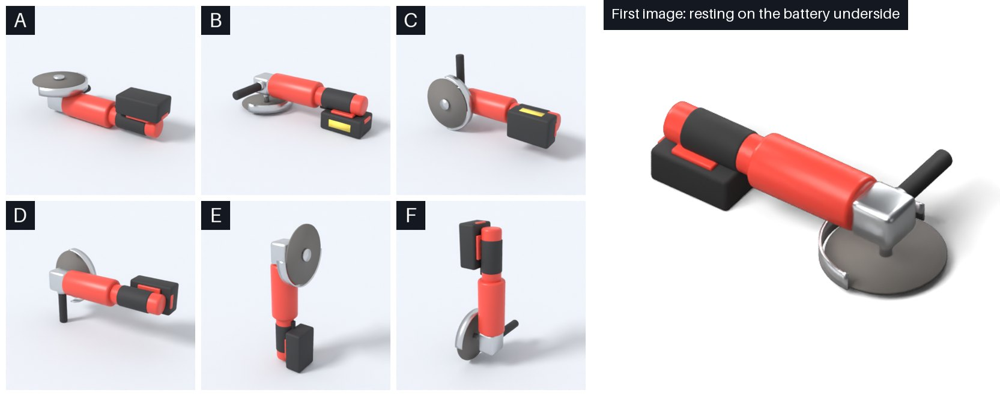

# 姿态判断 agent、进度百分比与耗时分析 v28

日期：2026-11-16。

三件事：

1. v27 的自动摆正在锂电角磨机上选错了姿态（竖着立在电池尾端）。现在由一个专门的姿态 agent 判断：先说出这类产品应该怎么放，再逐个看候选，并参考从模型量出的数据。
2. 状态栏不显示进度百分比。原因是 Blender 5 不再在后台渲染时输出采样计数，现在由渲染脚本自己报告。
3. 给整条流程逐阶段计时，找出最耗时的环节，并消除其中一处重复渲染。



左：一把倒着导出的锂电角磨机的六个候选姿态。正确的是 B（平放，电池底面着地，砂轮朝下）。旧的判断在这张图上三次选了 C、C、D。右：新的姿态 agent 选 B 之后的首图。

## 一、姿态判断 agent

### 旧判断为什么会错

旧的做法是把六格图发给视觉模型，让它直接回答一个字母。对工具来说这不够：「电池在下面」这句话，对平放在电池底面上的角磨机成立，对竖着立在电池尾端的角磨机也成立。模型知道电钻是立在电池上的，就把角磨机也立了起来。

### 新的判断过程

姿态 agent 按固定顺序回答，后面的答案建立在前面的答案上：

1. **这是什么产品。**
2. **这类产品应该怎么放**：哪个部位着地、什么朝上、长轴水平还是竖直，以及靠什么承托（平整底面、脚或轮子、侧躺）。这一步在看候选之前写出。
3. **每一格里是什么着地**，是否符合第 2 步。六格都要写，不能只写选中的那格。
4. **选哪一格**，有没有同样正常的其他格，是否有把握。

提示里写明了几条通用规则：产品靠为承托而设计的面着地（底座、脚、轮子、电池包的平整底面），不会立在边、尖、手柄、锯片或零件的窄端上；电钻立在电池底面上，而机身在使用时保持水平的工具（角磨机、圆锯、曲线锯、砂光机）平放，电池底面着地、工作面朝下。

### 从模型量出的数据

每个候选姿态除了图片，还附带三项测量，由 Blender 脚本在渲染候选时一并算出（不到 1 秒）：

| 数据 | 含义 |
| --- | --- |
| 站姿 | 平放、竖立，或介于两者之间（按高度与最长边之比） |
| 着地与在上的部件 | 模型自己的部件名称中，哪些碰到地面、哪些在最高处。只有一个网格或部件多于 80 个时不给 |
| 平面着地比例 | 占地面积中有多少是贴地的平面。接近 0 表示只有边、点或曲面着地 |

部件名称有含义时（`Battery_Pack`、`Cutting_Disc`），这些数据让小模型也能分清一个姿态和它上下颠倒的镜像，这正是小图上最容易看错的地方。

### 两道保险

- **与测量矛盾的选择不采用。** agent 说产品靠平整底面承托，而测量显示平面贴地的是它所选姿态的上下颠倒版本时，这次选择不算有把握，模型保持原样。这条规则只会阻止改动，不会替 agent 选姿态：带脚轮的柜子正立时本来就没有平面贴地，所以只在 agent 自己说「靠平整底面」时才检查。
- **改动之前再看一次。** 要改姿态时，把选中的姿态从四个方向各渲染一张，连同第 2 步那句话再问一次「它是这样放的吗」。回答否定时不改，并在界面写明原因。这次查看同时决定哪一面朝向镜头，不多花一次调用。

### 为这个 agent 单独指定模型

判断姿态比描述一张图更吃模型能力。`.env` 里的 `AI_POSE_MODEL` 可以只为姿态 agent 指定一个更强的模型，接口地址和 Key 沿用视觉模型的：

```
AI_POSE_MODEL=gpt-6.1-sol
```

不设置时使用视觉模型本身。「摆放朝向」的记录里会写明这次是哪个模型判断的。

### 实测结果

测试模型：一把按真实结构搭的锂电角磨机（机身、齿轮箱、砂轮、护罩、侧手柄、电池包，共 15 个部件），以五种朝向导出；同一模型合并成一个没有部件名称的网格，四种朝向；v27 用过的电钻三种朝向和正立的工具柜。

| 判断方式 | 角磨机（有部件名） | 角磨机（无部件名） | 电钻、工具柜 |
| --- | --- | --- | --- |
| v27 的旧判断，`gpt-5.4-mini` | 同一张图 3 次全错 | 未测 | v27 实测 4 例全对 |
| 新 agent，`gpt-5.4-mini` | 5 / 5 | 5 次中 4 次对，1 次保持原样未改 | 3 / 3 |
| 新 agent，`AI_POSE_MODEL=gpt-6.1-sol` | 5 / 5 | 4 / 4 | 4 / 4 |

没有部件名称时，小模型仍会看错：加上「与测量矛盾不采用」之前，它两次把本来放对的模型翻了过去；加上之后，5 次里 4 次正确，1 次被第二次查看误拒而保持原样。换用更强的模型后 13 例全对。所以主模型较小时，建议设置 `AI_POSE_MODEL`。

每次判断的耗时：姿态不变时 12 到 24 秒（一次渲染、一次调用），需要改姿态时 18 到 33 秒（两次渲染、两次调用）。

## 二、进度百分比

**原因。** 应用从 Blender 的输出里读「Sample 12/128」这样的行来计算采样进度。Blender 4 及更早版本在后台渲染时自己打印这些行；Blender 5 把这部分输出改走日志系统，默认不再显示。于是状态栏一直停在「采样 0%」。

**修复。** 渲染脚本注册 Blender 的渲染统计回调，自己把采样计数打印出来。这个回调在各版本都会收到每次更新，所以不再依赖 Blender 自己打印什么。


**现在显示什么。**

- 渲染和预览任务：阶段名后面显示一个总百分比，进度条同步。它等于已完成的镜头数加上当前镜头的采样比例，再除以镜头总数。采样结束但任务还在保存或检查时停在 99%。
- 模型分析：按步骤报告（导入与分析、检查朝向、姿态判断、复核）。
- 场景任务和「自动摆正」：阶段文字后面带百分比，例如「渲染产品参考角度 2 / 3 · 28%」。这是按阶段给出的大致位置，不是精确计量。
- 排队中的任务、还没有任何进度信息的任务不显示数字。

## 三、时间花在哪里

环境：4 核 CPU，没有 GPU。有 GPU 的机器上渲染部分会快很多，模型调用部分不变。

**从上传到首图（角磨机，共 70 秒）：**

| 阶段 | 秒 | 占比 |
| --- | --- | --- |
| 导入与分析模型 | 0.9 | 1% |
| 渲染六个候选姿态 | 7.8 | 11% |
| 姿态 agent 判断 | 7.3 | 10% |
| 四个方向复核（渲染加判断） | 11.9 | 17% |
| 首张预览渲染 | 7.9 | 11% |
| 视觉模型诊断预览 | 10.6 | 15% |
| 自动修正后重新渲染 | 8.3 | 12% |
| 再次诊断 | 15.2 | 22% |

模型调用合计约 39 秒，占一半以上；Blender 合计约 31 秒。之后其余 5 个镜头的缩略图共 7 秒。

**最耗时的是高质量渲染。** 一张标准质量（128 采样）的图在这台机器上约 6 分钟：实测 225 秒完成 62.5%。上传后自动进行的「后台生成高清图」也属于这一类，这次测到 228 秒时仍未完成。它在后台进行，不阻塞操作。

**AI 生成场景图（v27 测得，电钻，共 244 秒）：**

| 阶段 | 秒 |
| --- | --- |
| 策划 | 6 |
| 渲染三张产品参考图 | 180 |
| 图像模型生成 | 22 到 30，网关切断一次时再加 30 |
| 核对 | 4 |

**消除的一处重复渲染。** 三张参考图占了生成场景四分之三的时间。它们本来按「产品外观加角度」缓存，但策划每次给的镜头角度略有不同（一次 35°，一次 30°），缓存就对不上，同一件产品第二次生成又渲染了一遍。现在参考图的角度取整到 15° 和 10° 的网格，相近的角度共用同一组渲染。图像模型不需要精确到度的角度。

## 接口

见 [API.md](API.md) 的「v28 姿态 agent 与进度」。

## 边界与未验证

- **角磨机是自己搭的测试模型，不是你的那个。** 你截图里的模型不在这台机器上。测试模型的结构和你的相近（电池在后下方、砂轮在前下方、侧手柄），但更简单。
- **没有部件名称、主模型又较小时，仍可能判断不了。** 这时多半是保持原样而不是改错，需要手动点选姿态，或设置 `AI_POSE_MODEL`。
- **提示里写了工具的摆放规则。** 电钻、角磨机、圆锯这些是明确写进去的；没有写到的产品类型靠模型自己的常识和通用规则。
- **Claude 模型没有实测。** 与 v27 相同，验证环境的凭据只能用于 HAI 的 OpenAI 路由，实测用的是 `gpt-5.4-mini` 和 `gpt-6.1-sol`。
- **进度修复只在 Blender 5.0.1 上实测。** Blender 4 上回调同样存在，脚本的输出与 Blender 自己的输出会各出现一次，解析结果相同；这一点没有在 Blender 4 上运行确认。
- **场景任务的百分比是阶段位置。** 参考图渲染和图像模型生成这两段时间长，期间数字不动。
- **参考图角度取整没有在真实生成中验证画面影响。** 目标视角最多偏 7.5°；只跑了自动测试，没有为此再调用图像模型。
- **计时只在一台无 GPU 的机器上做了一次。** 各阶段占比在有 GPU 的机器上会不同：渲染变快，模型调用的占比更高。

## 验证

环境：Linux，4 核 CPU，无 GPU；Python 3.13 与 Blender 5.0.1（`bpy` 模块）；HAI 网关为真实联网访问。

| 范围 | 结果 |
| --- | --- |
| `python -m unittest discover -s tests`，Blender 可用 | 1280 项通过 |
| `tests/test_orientation.py`（由 33 项增至 39 项，其中 2 项在真实 Blender 中运行） | 回答的顺序、六格逐一描述、自相矛盾的回答、与测量矛盾的选择、测量数据的文字化、单独指定模型、第二次查看否定后不改；真实 Blender 中的部件高度与平面着地比例 |
| `tests/test_render_progress.py`（新增 4 项，其中 1 项在真实 Blender 中运行） | 渲染脚本打印的行与引擎读取的格式一致；场景任务与朝向检查的阶段进度；真实渲染中采样计数逐步上报且不重复 |
| `tests/test_scene_audience.py` | 相近角度共用参考图 |
| `node --test tests/test_ui_state.cjs`（由 235 项增至 237 项，jsdom 31.0.0） | 237 项通过 |
| `node --test tests/test_viewport_math.mjs` | 9 项通过 |

真实运行：角磨机经应用完整上传一次，姿态 agent（`gpt-6.1-sol`）选 B，首图平放在电池底面上；之后渲染一个镜头，采样百分比从 0.8% 逐步升到 68.8%，状态栏显示「正在渲染 69%」。上表的 13 加 13 例判断是直接调用判断函数完成的。
