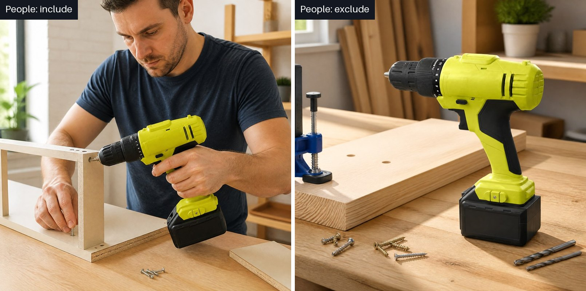
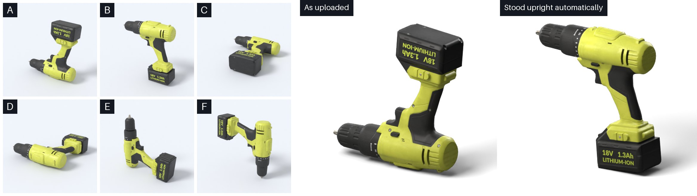
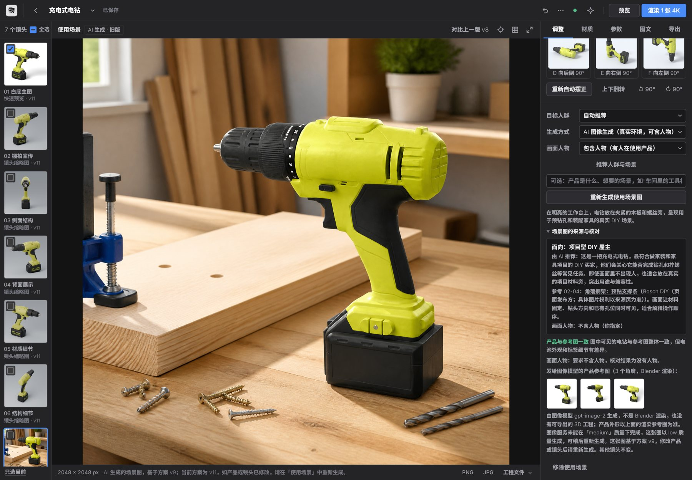
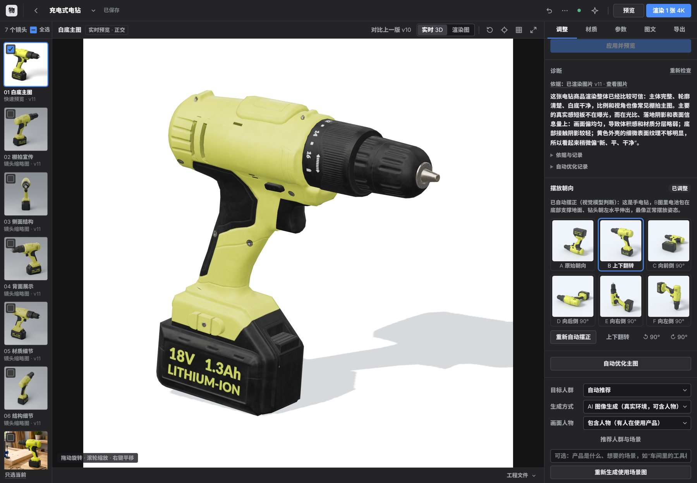

# 画面人物选项与模型自动摆正 v26

日期：2026-11-15。

这次更新修两个问题：

1. 生成场景图时选了「AI 图像生成」，成图里却没有人。现在「使用场景」多了「画面人物」选项，选「包含人物」后，策划、图像请求和成图核对三处都按这个要求执行。
2. 工具模型导入时是倒着的，所有图就都是倒着的。现在导入时会先判断哪一面朝上并摆正；判断不了或判断错了，可以点选其他姿态、上下翻转或转向。

同一把电钻、同一套设置，只改「画面人物」：左为「包含人物」，右为「不含人物」。两张都由 `gpt-image-2` 依据三张产品渲染图生成。

左：应用为倒置的电钻渲染的六个候选姿态（A 是文件原始朝向）。视觉模型选了 B。右：按文件原样出的首图，和自动摆正后的首图。

## 一、画面里要不要有人

### 之前为什么没有人

v25 里，画面有没有人只由策划 agent 一个人判断。「生成方式」选「AI 图像生成」只决定用哪种方式出图，并不要求有人：策划认为“需要真实环境、不需要人”时，照样走图像模型，出的是无人场景。图像请求里没有关于人物的硬性要求，生成后的核对也只看产品，不看有没有人。

### 现在怎么做

「使用场景」新增一行：

| 画面人物 | 含义 |
| --- | --- |
| 自动：由场景策划决定 | 与之前相同，但策划的判断依据改了（见下） |
| 包含人物（有人在使用产品） | 画面里必须有人在使用或拿着产品 |
| 不含人物（只有产品与环境） | 画面里不出现人，包括手 |

选了「包含」或「不含」之后：

- **策划**被告知这是硬性要求，按它写计划画面；它自己的判断与要求不一致时，以你的选择为准。
- **图像请求**里多一段固定文字。包含人物：必须有人在使用或拿着产品，手在产品上，至少手臂和上半身在画面内，产品仍是主体、不被人挡住。不含人物：不出现任何人、手、身体局部、人影或倒影。
- **成图核对**多看一项“画面里有没有人”。与要求不符时，和产品走样一样处理：把问题写进请求再生成一次。一次任务仍然最多生成两张；两张都不符合时，优先保留人物符合要求的那张，并在「场景图的来源与核对」里写明“要求包含人物，核对结果为没有人物”。

选「自动」时，策划的判断依据改为：手持或用手操作的产品（手动工具、电动工具、园林机械、仪表）倾向于画出有人在使用；自己立着的产品（柜子、收纳、家具）往往不需要人。本次用电钻实测一次，自动推荐的画面是“一只手握着电钻对准木板预钻孔”。

### 不能同时成立的组合

3D 道具场景由现成模型布置，里面没有人。所以：

- 「生成方式」选「3D 道具场景」时，「包含人物」不可选，下方说明原因。
- 图像模型未配置或已关闭时，「包含人物」不可选。
- 直接调用接口提交这类组合时，服务端拒绝并说明原因，不会悄悄去掉人物后照常生成。

方案卡片和「场景图的来源与核对」都会写出这张图的人物设定，以及它是你指定的还是策划判断的。

### 其他相关改动

- 「生成方式」的第三项由「AI 图像生成（人物 / 真实环境）」改名为「AI 图像生成（真实环境，可含人物）」，避免被理解成“选了就有人”。
- 没有配置文字模型时，按规则推荐的人群各有两段固定画面：有人的和没人的。指定用图像模型生成而人物为「自动」时用有人的那段，「不含人物」时用没人的那段。
- **网关超时后的重试。** 本次验证时，HAI 网关会在约 30 秒处切断还没有返回数据的图像请求（HTTP 502），`medium` 质量加三张参考图的请求每次都超过这个时间，`low` 质量约 22 秒可以完成。现在图像请求遇到 502 或 504 时，会以 `low` 质量再试一次；成功后在场景说明里写明“图像服务未能在「medium」质量下完成，这张图以 low 质量生成，可稍后重新生成”。已经是 `low` 质量、或是其他错误（额度、权限、内容审核）时不重试。
- 模型服务返回 HTTP 418（当前网络地址被屏蔽）时，给出对应说明。

## 二、模型自动摆正

### 为什么会倒

模型文件的坐标轴由导出它的软件决定。应用之前直接按文件的朝向摆放，所以文件是倒的，白底主图、其他镜头、3D 道具场景和发给图像模型的参考图就都是倒的。

### 导入时做什么

模型分析完成后、出第一张图之前：

1. **渲染六个候选姿态。** 文件原始朝向，加上另外五个轴向朝上的姿态（上下翻转，向前、后、左、右各倒 90°）。每个姿态一张 320 px 的小图，同一台相机、同一块地面。同时记录每个姿态的外包尺寸、支撑面积和每个部件所在的高度。
2. **判断哪个姿态是正的。**
   - 启用了视觉模型：把六张图拼成一张带字母的图发给它，问哪一格是这件产品正常摆放的样子。
   - 没有视觉模型：看部件名称。名字里有轮、脚、底座的部件应该在下面，有顶盖、台面的应该在上面；这些部件明确地处在相反的一端时，改用符合名称的姿态。
   - 两者都判断不了：保持文件原始朝向。
3. **只在有把握时才改。** 视觉模型必须回答“有把握”，并且没有把原始朝向也列为正常姿态，才会改动。它不确定、调用失败或超时，都保持原样。
4. **摆正后再看朝向。** 文件连上下都不对时，它的“正面”也不可信。这时再渲染四张图（绕竖直方向各转 90°），问哪一张最适合作主图；只有某一张明显更好时才转，镜像或同样好的视角不转。
5. **写入方案。** 结果写进方案的 `rotation`。所有渲染、3D 道具场景的布置和 AI 场景图的参考渲染本来就读这个值，所以之后每一张图都是正的。首图的俯仰角按摆正后的比例选取。

朝向检查出任何问题都不会让导入失败：模型保持原样，界面说明原因。上传的模型文件本身不被修改。

### 界面

「调整」面板新增「摆放朝向」：

- 一行说明：是否自动摆正过、依据是什么（视觉模型的理由，或部件名称）。
- 六个候选姿态的缩略图，当前使用的那个有蓝框。点任意一个就改用它。
- 「自动摆正 / 重新自动摆正」：重新渲染候选并判断一次。旧项目（这次更新之前创建的）没有候选图，点它即可生成。
- 「上下翻转」「↺ 90°」「↻ 90°」：在当前姿态上翻转，或绕竖直方向转 90° 换一个面朝向镜头。

每次改姿态都是一个可撤销的版本，并立即预览正在看的镜头（看的是 AI 生成的场景图时，预览白底主图）。更精细的角度仍在「参数 → 高级参数 → 模型姿态」的 X/Y/Z 输入框里。

### 改姿态会带走什么

- 「自动优化主图」保存的场景快照是按旧姿态保存的，会被移除，需要重新优化。
- 手动设置的取景距离、正交缩放和画面平移会被清除，恢复自动取景；镜头的水平角和俯仰角保留。
- 3D 道具场景按旧姿态布置，渲染时不再放置道具并提示重新生成；AI 生成的场景图继续显示并注明它基于哪个方案版本，同样需要重新生成。这两项是 v22 和 v25 已有的行为。

## 接口

见 [API.md](API.md) 的「v26 画面人物选项与模型摆正」。

## 边界与未验证

**人物**

- **核对会漏看。** 有没有人由视觉模型判断，它可能看错；没有配置视觉模型或核对调用失败时不核对，界面写“未能自动核对，请自行查看”。
- **重做一次仍不符合时，图片照常保留。** 界面会写明与要求不符，需要你再生成一次或调整场景说明。本次两张实测图都是一次通过，“人物不符后带着纠正重做”这一步只由自动测试覆盖。
- **两张实测图都是 `low` 质量。** 原因见上面的网关超时。`medium` 质量下的人物表现这次没有测到。
- **产品上的文字仍可能丢失。** 含人物的那张图里，电池上的“18V 1.3Ah”没有被画出来，核对仍判为一致。这是 v25 就有的局限：图像请求要求不在产品上添加文字，核对对细小文字不敏感。
- **3D 道具场景里永远没有人。**

**摆正**

- **实测的模型很少。** 一把电钻（Poly Haven `Drill_01`，CC0），分别按倒置、仰躺、正立三种姿态导出：倒置和仰躺的被摆正，正立的没有被改动。一件正立的工具柜（10 MB 的多部件 OBJ）没有被改动。倒置电钻经应用的完整上传流程走了一遍，其余三例直接调用判断函数。你的角磨机模型不在这台机器上，没有测到。
- **判断会错。** 没有明显上下的产品（盒子、圆柱、可以躺着展示的手动工具），视觉模型可能保持原样，也可能选中另一个同样合理的姿态。这时用候选缩略图或翻转按钮改。
- **只考虑轴向姿态。** 候选都是 90° 的倍数。斜着导出的模型不能自动摆正，需要在「模型姿态」里填角度。
- **正面只在摆正时才判断。** 文件本来就是正立的、只是背面朝前，不会被自动转向，用「↺ 90°」「↻ 90°」。
- **没有视觉模型时能做的有限。** 只有部件名称明确时才会自动摆正；单个网格、名称不带含义的模型保持原样，靠候选缩略图手动选。测得的支撑面积和倾倒角度随候选一起记录，但不参与判断：在这把电钻上，它们指向的是错误的姿态。
- **每次导入多花一点时间和一两次调用。** 候选图在 CPU 上渲染，电钻约 8 秒；加上视觉模型，整个判断在四个实测例子里用时 11 到 20 秒。视觉模型调用 1 次，摆正时再加 1 次。
- **Claude 模型上没有实测。** 本次验证环境保存的 HAI 凭据只能用于网关的 OpenAI 路由，所以策划、摆正和核对都用 `gpt-5.4-mini` 实测。应用默认的 Anthropic 路由上，这些请求的格式由脚本代替的模型回复测试。
- **没有测试的环境。** GPU、Windows、macOS；百万面以上模型的候选图耗时。

## 验证

环境：Linux，4 核 CPU，无 GPU；Python 3.13 与 Blender 5.0.1（`bpy` 模块）；HAI 网关为真实联网访问，文字与视觉模型 `gpt-5.4-mini-2026-03-17`，图像模型 `gpt-image-2`。

**自动测试。**

| 范围 | 结果 |
| --- | --- |
| `python -m unittest discover -s tests`，Blender 可用 | 1225 项通过 |
| `tests/test_orientation.py`（新增 33 项，其中 2 项在真实 Blender 中运行） | 旋转与欧拉角换算、翻转与转向、按部件名称判断、视觉模型的四种回答、候选拼图、摆正与朝向两步、首次方案带着摆正结果建立、改姿态的版本与预览、冲突与错误请求、任务取消与中断恢复、接口；真实 Blender 中候选脚本的图片和测量值 |
| `tests/test_scene_audience.py`（由 43 项增至 54 项） | 人物要求进入策划、请求文字、核对与重做；不能成立的组合被拒绝；规则推荐的两段画面；另一种人物选择的旧方案不被复用；网关放弃后以 low 质量重试 |
| `node --test tests/test_ui_state.cjs`（由 219 项增至 225 项，jsdom 31.0.0） | 225 项通过 |
| `node --test tests/test_viewport_math.mjs` | 9 项通过 |

**真实运行。**

| 步骤 | 结果 |
| --- | --- |
| 上传倒置的电钻（启用视觉模型） | 视觉模型选 B「上下翻转」，理由“电池包在底部作为支撑”；方案 `rotation` 为 `[180, 0, 0]`；首张白底主图和各镜头缩略图都是正立的。从上传到首图 59 秒 |
| 浏览器中点候选 A、「上下翻转」、「↺ 90°」 | 每次生成一个新版本并自动预览，实时 3D 视图与渲染图一致；撤销可用 |
| 把姿态改回倒置后点「重新自动摆正」 | 任务完成，模型被翻回正立并预览；用时 57 秒 |
| 仰躺的电钻、正立的电钻、正立的工具柜（直接调用判断函数） | 分别为：改为向后倒 90°（即立起来）、不改、不改 |
| 推荐人群与场景，人物为「自动」 | 策划给出含人物的画面，生成方式为图像模型 |
| 生成场景，「AI 图像生成」+「包含人物」 | 画面中一人手持电钻装配板材；核对：有人物，产品一致。`medium` 质量被网关切断后以 `low` 质量完成 |
| 生成场景，「AI 图像生成」+「不含人物」 | 电钻立在工作台上，画面无人；核对：没有人物，产品一致 |

真实模型调用共约三十次文字与视觉请求（含每次预览后原有的画面诊断）、5 次完成的图像生成（其中 3 次是排查网关超时用的小图），另有 6 次被网关切断的图像请求。排查过程中还因为把占位 Key 发到了 Anthropic 路由，触发过该网关对这台机器地址的临时屏蔽（HTTP 418），改用凭据对应的 OpenAI 路由后恢复。
