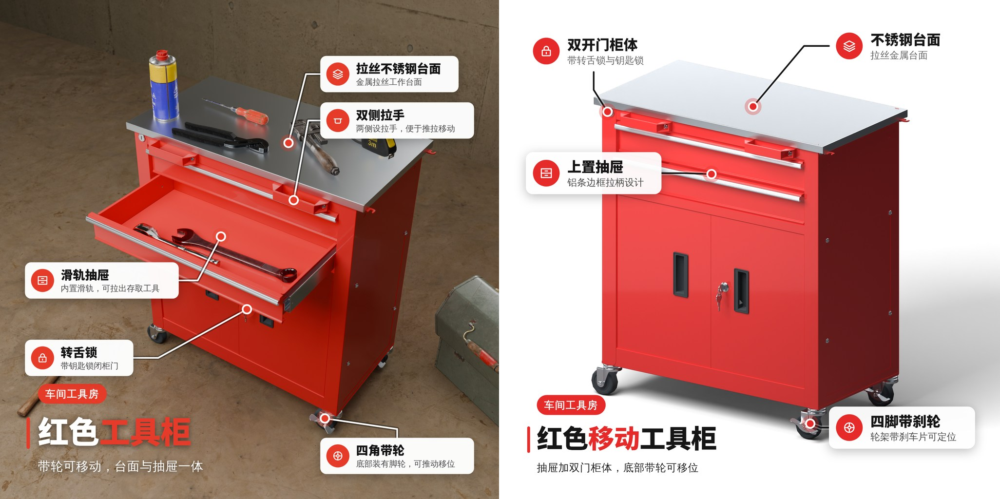
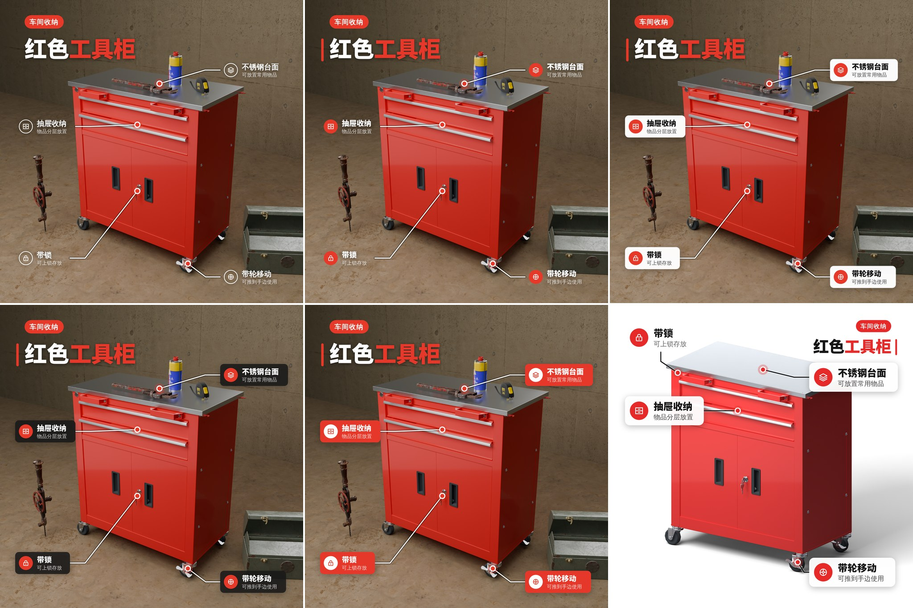
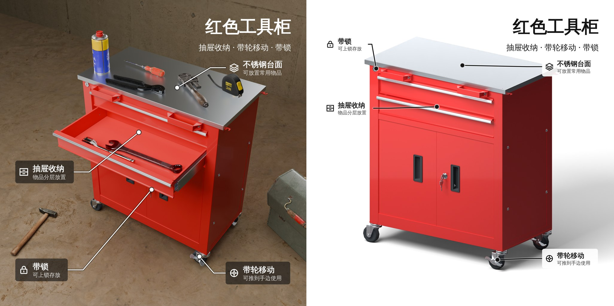
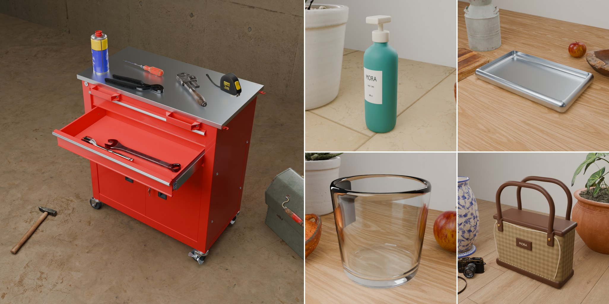

# 物影 Studio

在本机用 Blender Cycles 拍摄商品模型。中文浏览器界面，原始资源、任务、渲染结果均存储在本地 `data/`；不需要 Blender 操作经验。

## 图文图层的设计升级 v24

**图文不再像标注，而像设计过的卖点图。** 标题改用内置的重磅字体（Noto Sans SC Black），字号最大到画面的 10%，产品名里的关键词用主色强调，上方是一枚品类标签；每条标注是一张带投影的圆角卡片，图标放在主色圆形徽章里；指向线的终点是带光晕的主色圆点。主色自动取自产品本身的颜色。



**五种风格，一键切换。** 简洁、醒目、卡片、深色、色块——智能排版按画面自动选一种（白底主图用「醒目」，场景图用「卡片」），也可以在「图文」面板里随时换风格、换主色，位置不变。文字直接压在照片上时带柔影或光晕，不需要加框也能看清。



（前五格依次为简洁、醒目、卡片、深色、色块；最后一格是白底主图。）

**AI 路径已在 HAI 接口上实测。** 使用场景的导演与采购（18 秒，放入 5 件道具）和图文要点（每次约 12 秒）都完成了真实调用，请求与返回校验一次通过；图文要点先后跑了三轮，并按真实回复收紧了措辞要求、给图标补了含义。上面两张图的文案就是模型看图写的：品类标签、带强调词的标题，以及全部正确指向部件的 4–5 条要点。文案仍是草稿，发布前请核对。细节、字体许可与验证范围见 [TEXT_LAYER_STYLE_UPDATE.md](TEXT_LAYER_STYLE_UPDATE.md)。

## 图文图层 v23

**在渲染图上直接介绍产品。** 右侧新增「图文」面板：给任意镜头叠加一层可编辑的矢量图文——标题、正文、图标，以及带引线指向部件的标注。点「智能排版关键信息」，应用会提取这件产品值得说的几点（抽屉、脚轮、锁、不锈钢台面……），把标题放到画面最空的一角，把每条标注放在它所指部件的那一侧，用一条短引线连到部件在这张图里真正可见的位置；浅色背景用深色字，深色背景用浅色字，压到产品或杂乱背景时自动加底板。也可以逐行写下自己的要点，由应用来排。



**每一项都能改。** 在画面上拖动、拉角点缩放、连按两下直接改字；标注的圆点可以拖到别的部位。右侧可改文字、大小、粗细、对齐、颜色、底板和图标（内置 38 个线性图标），支持撤销、重做和键盘微调。图层自动保存，按镜头分别存放；它不属于拍摄方案，改图文不会让已有渲染图过期，也不需要重新渲染。

**导出。** PNG / JPG 按渲染图的原始分辨率合成；SVG 内含渲染图，文字仍是文字、图标仍是路径，可在 Illustrator、Figma 等软件里继续编辑；也可以只导出透明的图文层。

智能排版在启用 AI 时由模型看图写要点，未启用时按部件名称的规则提取。两种方式都只描述看得见的东西，不会编造尺寸、承重、认证之类的数字；生成的文案是草稿，发布前请核对。数据格式、排版规则与验证范围见 [TEXT_LAYER_UPDATE.md](TEXT_LAYER_UPDATE.md)。

## 使用场景图 v22

**产品放进它被使用的地方。**「调整」面板新增「生成使用场景图」：应用先判断产品是什么、用在哪里，再从 [Poly Haven](https://polyhaven.com/models) 的 CC0 模型库中搜集合适的现成模型，按真实尺寸布置到产品周围，换上相应的地面与背景，作为一个新的「使用场景」镜头出图。工具柜会拉开一层抽屉，扳手放进抽屉，钳子、卷尺、喷罐摆在台面上，锤子和旧工具箱放在旁边的水泥地上；洗护瓶放在浴室台面上，背后是盆栽；托盘、杯子在厨房的木台面上，旁边是水果和砧板。



**产品始终是主角。** 镜头只对准产品和放在它上面、里面的东西；旁边与后方的道具在镜头确定后才摆到画面边缘，可以被画框裁掉，不会挡住产品；浅景深对焦在产品上。道具摆在哪里由 Blender 实测决定——台面是量出来的平面，抽屉是量出来的内腔——互不重叠，放不下的不硬塞并记录原因。

**不依赖 AI 也能用。** 已启用 AI 时由模型看图决定场景与道具；未启用或调用失败时，使用内置的八类规则（工具存放、洗护美妆、餐厨、箱包、园艺、数码办公、家具、通用）。场景是方案里一个可撤销的版本，「换一组场景道具」重新摆放，「移除使用场景」恢复原样；白底主图和其他镜头不变。每件道具的来源页面与许可都列在界面和方案中。

生成场景需要能访问 `api.polyhaven.com` 与 `dl.polyhaven.org`；下载过的模型会缓存在 `data/props_cache/`。处理流程、尺寸与摆放规则、道具库的局限和验证范围见 [SCENE_IMAGES_UPDATE.md](SCENE_IMAGES_UPDATE.md)。本次没有在真实的大模型接口上运行。

## 展示级首图与指令智能体 v21

**输入要求后不再卡在“仍需确认”。** 此前像「柜体是红色喷漆金属带反光，钥匙和钥匙孔是不锈钢会反光」这样的要求会被拒绝并请你点选部件，原因是模型自己数的“部件个数”与几何分组对不上——而你并没有说过数量。现在只有你写明数量时才核对数量；模型的定位与修改范围有出入时，由程序按唯一安全的方式修正；应用前由独立的「核对」智能体复查选中的部件，去掉不属于所指部位的（例如把轮子支架也当成轮子）；规划器处理不了的要求，交给专职的「定位」与「质感」智能体继续完成，所有结果仍经过同一套权限、保留条件与范围校验。能执行的直接应用，一步可撤销；确实无法完成的，给出具体原因而不是让你先去点选。

**导入模型后的第一张图。** 只带纯色占位材质的 OBJ 会在分析完成后按材质名与部件名补全质感：金属件是金属，不锈钢台面是拉丝不锈钢，轮子是橡胶，颜色保持不变，每条依据都可查看。新项目使用展示级布光：主光与补光拉开明暗，后侧条形灯与反光板勾出轮廓和金属的渐变，硬边带一条细高光。512 px 草稿出来后，后台自动补渲一张 2048 px 的高清图；这期间可以照常操作，任何操作都会让它让路。

旧项目保持原有画面，可在「参数 → 出图质量 → 布光与质感」切换。规则、处理流程、设置项与验证范围见 [AUTOMATION_UPDATE.md](AUTOMATION_UPDATE.md)。本次没有在真实的大模型接口上运行，说明见该文档的“边界与未验证”。

## 工作台重新设计 v20

界面按专业工具的惯例重排：顶栏放项目名与全局操作（预览、渲染 4K），左侧是镜头栏，中间是尽量大的画面，右侧是「调整 / 材质 / 参数 / 导出」四个紧凑的属性面板。画面下方只有一条信息栏（尺寸、PNG、JPG、工程文件菜单）和一条只在有任务时出现的状态栏。次要操作收进菜单，说明文字改为悬停提示或默认折叠，桌面宽度下整个工作台在一屏内完成。

渲染、接口与数据不变。设计依据、前后对照与验证范围见 [UI_REDESIGN_V20.md](UI_REDESIGN_V20.md)。下文各版本说明中的旧面板名对应关系为：画面调整 → 调整，部件材质 → 材质，摄影方案 → 参数，电商出图 → 导出。

## 电商出图 v19

右侧新增第四个面板「电商出图」：选择销售平台（通用白底、淘宝／天猫、京东、拼多多、抖音电商、小红书、Amazon、Shopify、TikTok Shop、Temu、AliExpress、eBay），应用按该平台的主图要求逐项检查当前镜头的真实渲染图——分辨率、画幅、纯白背景、产品占比、格式与大小——并说明每一项是已通过、导出时自动处理，还是需要先渲染 4K。

点击「导出平台套图」后，后台为每个已出图镜头生成符合平台尺寸和文件大小的 JPG，并打包为 ZIP：主图背景清理为纯白 RGB 255，产品自动居中并构图到平台要求的占比，可保留产品附近的柔和阴影；可附带透明底 PNG；淘宝／天猫、抖音、速卖通另外输出独立的白底图。纯白底与透明底使用 Blender 从该图保存的场景重新渲染的产品蒙版合成，只替换产品以外的背景，不重新渲染也不修饰产品本身。尺寸、文件大小和纯白底结论来自对已写入文件的重新读取，记录在包内 `manifest.json`。

上传时可直接选择销售平台，首张主图即按该平台的画幅与占比构图。分析完成后，应用还会按实测比例选择首图视角：扁平产品抬高到俯视，细高产品降低视角；原因显示在「模型检查与拍摄记录」，角度之后仍可随意修改。

本版同时修复了镜头被重复渲染三次的问题：v17 改为正交镜头后，旧的取景复查仍用包围盒角点判断留白，常常不通过（示例瓶的主图即如此），随后两次“拉远相机重渲染”对正交镜头的画面没有任何影响。现在按真实顶点在实际出图镜头中的投影检查一次，每个镜头只渲染一次——示例瓶的预览任务在 CPU 上从约 25 秒降到约 10 秒，「已达到自动取景修正上限」的误报也随之消失。

平台规则数值、处理方式、接口和验证范围见 [ECOMMERCE_UPDATE.md](ECOMMERCE_UPDATE.md)。平台会调整规则，上传前请以商家后台提示为准。

## 深色工作室界面 v18

界面换用新的深色设计（设计稿「01 首页 · 上传与项目」）。首页不再显示侧栏与参数面板：上方是虚线上传区，可直接拖入模型或点击「选择文件」「选择资源文件夹」，选好后在原有上传窗口核对文件并补充产品信息；下方「我的摄影项目」以卡片显示每个项目最新的白底主图与状态——绿点表示已有 4K 成品，琥珀色进度条表示后台仍在渲染，警示图标表示分析中断可继续；最后一行是示例模型。卡片右上角可删除项目，删除前仍会确认。

打开项目后的工作台沿用同一套深色配色：浅色主按钮、琥珀色表示进行中、绿色表示完成。功能、接口和快捷操作不变。`/api/projects` 为每个项目附带 `active_job`（仅 id、类型、画质、状态、进度、来源），供首页卡片显示后台任务。Inter 字体随应用打包在 `static/vendor/fonts/inter/`（SIL OFL 1.1），中文使用系统字体，仍然没有前端 CDN 依赖。

## 实时主图视口与正交镜头 v17

白底主图默认打开实时 3D 画面。左键拖动旋转、滚轮缩放、右键拖动平移，可以复位或全屏查看。拖动由浏览器本地完成，不调用模型、不创建新版本，也不反复排队 Cycles 渲染。第一次打开会从当前项目准备独立 GLB，准备完成后重复进入可复用缓存。

新镜头默认使用正交投影；旧方案没有投影字段时，后续实时视图和新出图也采用正交投影。缩放使用真实正交取景范围，平移与角度可随镜头保存。预览和 4K 输出使用已采用的当前视角；原先的成图与工程继续按其历史版本查看。需要透视时，可在摄影方案中显式切换。

“实时 3D / 渲染图”保持在同一个画面区域。实时画面用于观察模型与构图，材质、反射和阴影采用 WebGL 近似；Cycles 正式成图与原始复杂材质保留。图片选点、画面诊断和版本对比继续对应明确的已渲染图片。实时查看不需要新 API Key，也没有前端 CDN 依赖。

安装方法、操作说明和验证边界见 [REALTIME_VIEWPORT_V17.md](REALTIME_VIEWPORT_V17.md)。以下版本章节保留各次升级记录。

## 完整语义规划与执行校验分离 v16

在线“画面调整”默认使用新的 `semantic_v2`：完整原句、当前预览、真实部件和可用的场景参数直接交给 LLM。要求如何拆分、目标部件、保留条件、需要调整的控制项及修改之间的依赖由模型理解；程序不再用关键词表提前决定可修改范围，也不再根据关键词补齐材质数值。

执行端只核验可追溯原句、真实目标、参数能力与范围、结构化保留条件、依赖、版本和源文件一致性。互不依赖的可完成项先应用；待处理项与保留条件继续保留。普通在线流程一次模型请求，需要纠正执行数据或读取参考图时最多再请求一次，沿用已有模型配置。

自然语言修改统一到“画面调整”，部件页保留手动材质操作。旧协议仅供兼容接口和明确标注的离线规则使用，在线解析失败不会偷偷切回关键词流程。

安装、验证结果和支持边界见 [SEMANTIC_UPGRADE_V16.md](SEMANTIC_UPGRADE_V16.md)。本节为当前入口行为，以下版本说明保留为历史记录。

## 优化后继续调整材质与灯光 v15

修复“柜体光泽不够，灯光再亮点”被误判为修改范围不一致的问题。后续修改读取当前保存工程的真实材质参数，已定位柜体可据此降低粗糙度，保持原色与原材质类型；灯光继续依据当前镜头调整。首次微调材质的保留标记不再被原生渲染器误当成材质替换。

已通过独立校验的灯光可以先完成，不再被可隔离的材质参数错误一起拦住。修改明细显示实际参数起点；剩余校验问题保留原要求，显示简短原因和“重试调整”，详细信息默认收起。沿用现有模型和最多两次解析／纠错请求的预算。

安装累计更新包、实际柜子连续两轮验证及测试边界见 [FOLLOWUP_INSTRUCTION_FIX_V15.md](FOLLOWUP_INSTRUCTION_FIX_V15.md)。本节保留 v15 的修复记录；在线语言理解已由 v16 替换。

## 高清结果校验与失败任务恢复 v14

修复高清图和工程已经生成后，因候选／高清阶段重复计算取景产生微小浮点差异而误报“场景状态不一致”。高清输出现在直接从已选候选工程渲染；校验区分有界舍入误差与真实场景变化，并记录差异字段。

对已有失败任务，点击“继续 / 重试”会优先核验旧文件与执行记录，证据完整且一致时直接恢复已有高清结果，避免重复模型请求和渲染。安装、恢复条件及验证结果见 [SCENE_CONSISTENCY_FIX_V14.md](SCENE_CONSISTENCY_FIX_V14.md)。

## 自动主图优化 v13

在已有白底主图上点击“自动优化主图”，系统自动读取真实 Blender 场景，结合当前图规划构图、柔光、反射与可编辑的表面参数，生成原场景和候选预览，再比较效果。通过检查后输出默认 2000 × 2000 主图及可独立下载的 `.blend`；后续调整继承优化后的场景，撤销同时恢复原图与原工程。

每次最多两次视觉模型请求，沿用已配置模型，不自动升级费用。任务阶段和渲染进度显示在原有状态卡中，原因与候选默认折叠。安装、实际支持范围、源工程对比和测试边界见 [HERO_WORKFLOW_UPDATE.md](HERO_WORKFLOW_UPDATE.md)。

## 独立场景下载、灯光方向与渲染反馈更新 v12

预览下方可直接下载当前镜头最新的 `.blend` 或 `.c4d`，无需下载项目归档。C4D 尚未生成时单独生成，来源按实际出图记录核对；历史对比图、其他镜头和转换 ZIP 不会误用为最新原生文件。

渲染中的任务在预览内显示动态状态卡、真实采样／图组进度，断连和终态会停止动效。AI 与手动方案可调整当前镜头的主光、补光、轮廓光方位角及俯仰角；读入当前场景确认实际灯位，渲染后再核验 PNG 对应的灯位和保存快照。

定性亮度与背光要求默认追求更明显的变化，保留明确数值、轻微调整和既有保护条件。安装、实际执行前提及测试边界见 [LIGHTING_AND_RENDER_UPDATE.md](LIGHTING_AND_RENDER_UPDATE.md)。

## LLM 语义理解更新 v11

“灯光再亮一些，不要让物体背光”现在会交给 LLM 结合原句、当前方案和预览解释为效果目标，再选择合适的灯光参数；不会因为不认识“不要……”而在模型调用前拒绝。明确的颜色、角度、数值要求仍逐项核验，模型解析出的保留条件也会延续到剩余要求。

语义理解和参数规划共用一次请求，包含纠错仍最多两次，不自动升级模型。沿用自动部分执行与现有简洁界面。安装累计更新包及验证边界见 [LLM_INTENT_UPDATE.md](LLM_INTENT_UPDATE.md)。

## 自动完成可执行项 v10

点击“应用并预览”后，已经核验的独立修改会直接保存并预览，输入框只保留未完成的要求。新流程省去“先应用可完成项”，结果集中为一条简短摘要，原因与参数明细默认折叠。

“钥匙孔、钥匙、轮子的支架都是不锈钢反光的”会按部位继承共同材质要求，已识别部位可以独立完成。“让整个物体更好看”按商品图摄影目标处理，使用现有灯光与镜头参数准备预览；已经完成的灯光不会在重试中重复叠加。安装、具体默认含义及验证边界见 [AUTO_PARTIAL_UPDATE.md](AUTO_PARTIAL_UPDATE.md)。

以下各版本记录说明历次更新；v10 起普通提交使用自动部分执行，旧提案和 API 显式 review 模式继续兼容确认流程。

## 修改决定与材质语义修复 v9

修复“待确认方案不能同时包含直接执行的修改”以及“AI 未给出一致的可执行决定”。模型统一返回逐项修改，服务器核验后决定直接应用或等待确认；重复的旧格式字段只有完全相容时才去重，冲突在原有两次请求预算内纠正。

“上表面是反光的拉丝不锈钢，箱体是红色金属有光泽”保留为两项材质要求。部件定位后核验红色色系，缺失光泽参数使用现有材质预设，防止旧哑光参数残留。返回结构仍失败时保留原文，主按钮显示“重新生成修改”，无需改写要求。安装、执行规则与验证边界见 [DECISION_CONTRACT_UPDATE.md](DECISION_CONTRACT_UPDATE.md)。

## 完整部件定位更新 v8

“四个轮子都要是黑色橡胶”等部位要求会检查当前预览保存的三维场景，生成真实材质表面的独立双视角部件图，让被主图遮挡的表面也能参与识别。数量按实际几何的空间分组核对，避免把拆开的网格数量当作轮胎数量。绑定缺漏进入现有的一次纠错；橡胶替换清除旧金属参数残留。

仍不确定时，点选一个示例部位并点击“用选点继续识别”，原要求与数量完整保留。示例点由服务器重新拾取，不会变成只修改选中轮子的局部操作。新检查不改原场景、项目版本或普通预览列表。安装与实际验证边界见 [SCENE_PARTS_UPDATE.md](SCENE_PARTS_UPDATE.md)。

## 摄影要求误拦截修复 v7

修复“要求中的灯光与镜头未完整包含在修改中”的过度拒绝。整体摄影目标允许按实际需要调整灯光或镜头，并说明未变部分；具体焦距、角度和曝光要求仍必须核验。已有规则可解析的参数缺项按原方案补齐，未完成的明确要求继续保留为原句。参数缺项不再引导用户进入部件点选。详见 [PHOTOGRAPHY_INTENT_FIX.md](PHOTOGRAPHY_INTENT_FIX.md)。

## 逐项调整更新 v6

复合要求按原文拆分核对。“改善材质反光”可使用现有灯光和镜头参数；AI 自己想到的微纹理、真实倒角或独立阴影控制不会被追加成用户必须完成的要求。对仍不能确认的部位，界面在同一输入区说明待确认内容，并列出已通过校验的可执行改动。初次分析只保存提案，不改方案、不增加版本、不启动预览；明确点击“先应用可完成项”后，才应用这份提案并预览。

应用后保留未完成的原始要求，已执行的相对灯光调整不会在下一次提交时被重复执行。确认不再次调用 AI；来源、版本或部件证据已变化时提案失效。不可见的轮胎仍不会靠对象名字猜测为已定位。详见 [COMPOUND_INSTRUCTION_UPDATE.md](COMPOUND_INSTRUCTION_UPDATE.md)。

## 部件理解与低成本模型更新 v5

“画面调整”现在把当前渲染中的真实采样点、对象与材质槽一并提供给模型，允许通过可核验的目标编号解释“轮子”“支架”等中文部位。材质修改必须匹配本次实际目标；旧版本、未知目标和不完整的数量要求会被阻止，原输入保留。完整拾取环境可用时会再次检查采样点；不可见或无法单独编辑的部位仍需补充视图或点选。

已阻止 `gpt-5.5-2026-04-23` 及 GPT-5.5 别名发出请求。AI 设置提供常用低成本与能力均衡的模型配置，独立视觉默认继承主模型，不再预填昂贵型号；不会自动升级到更贵模型。旧配置仍可查看，选择新配置并保存后生效，切换官方平台需要该平台自己的 Key。

模型选择、2026-11-10 官方价格及验证范围见 [MODEL_AND_PARTS_UPDATE.md](MODEL_AND_PARTS_UPDATE.md)。安装累计更新包见 [UX_UPDATE_GUIDE.md](UX_UPDATE_GUIDE.md)。

## 项目操作更新 v4（保留）

新上传的模型完成分析后，后台自动生成白底主图预览，无需再点击预览。主图完成后，其他尚无当前版本图片的镜头会在后台生成长边 256 像素、8 采样的真实渲染缩略图；打开符合条件的旧项目时也会补齐。缩略图用于浏览镜头，正式预览与 4K 成品仍按需生成。退出项目或关闭页面不会停止已提交的后台任务。分析失败或被取消时不生成主图，点击原来的继续／重试即可恢复流程。

左侧项目行可删除项目，删除前显示项目名称和关联文件范围。运行中的分析、渲染、材质或导出任务需要先取消并完成收尾，或等待完成。删除当前项目后返回上传首页；删除其他项目保留当前工作。标题旁“退出项目”返回首页并保留项目，有未保存参数时可选择保存、放弃或继续编辑。

更新说明及验证边界见 [PROJECT_WORKFLOW_UPDATE.md](PROJECT_WORKFLOW_UPDATE.md)。

## 智能调整更新 v3

“画面调整 → 应用并预览”现在可结合当前真实预览、当前镜头有效参数、项目资料、近期有效操作与诊断理解要求；明确要求对照参考图时，也会使用上传时保存的参考图。明确的保留要求会约束可修改字段，执行后用实际参数差异显示回执。曝光、柔光与灯光调整限定到当前镜头，相机调整不会连带改其他镜头；留白等共享参数会说明项目级影响。

本轮保留 v2 的精简界面与只读诊断。“重新检查”仍不会修改方案或启动渲染。网络重试使用持久执行回执避免重复应用；没有实际变化就不增加版本或发起预览。自动候选必须通过同源评分与实测退化检查才采用。安装见 [UX_UPDATE_GUIDE.md](UX_UPDATE_GUIDE.md)，能力、边界和验收见 [INTELLIGENCE_UPGRADE.md](INTELLIGENCE_UPGRADE.md)。

先点击“预览当前镜头”检查一张图；勾选镜头决定“渲染 N 张 4K”的范围。“下载项目归档”包含所有已生成图片、历史版本和工程，不跟随镜头勾选。

## 启动

需要 Windows / Python 3.9+ 和能读取当前工程格式的 Blender。原生主图流程使用 Blender 5.0.1 核验用户提供的 5.0 工程；旧格式合成测试使用 Blender 4.3.2。实际验证范围见 v13 更新说明。

```powershell
cd D:\模型渲染
python -m pip install -r requirements.txt
python app.py
```

也可以在 PowerShell 运行 `./start.ps1`。打开 <http://127.0.0.1:8765>。服务只绑定本机回环地址，无需账号。关闭终端即停止服务；再次启动会将未完成任务标为中断，可继续生成尚未完成的镜头。

自动搜索 PATH、`D:\blender\blender.exe` 和常见安装位置。找不到时复制 `.env.example` 为 `.env`，设置 `BLENDER_PATH` 为 Blender 可执行文件的绝对路径。可用 `STUDIO_PORT` 改端口。GPU 驱动需由系统正常安装；GPU 不可用时使用 CPU，任务中显示实际设备。

## 使用流程

1. 上传一个 GLB，或一个 OBJ 连同 MTL 和贴图。推荐把资源目录打成 ZIP，或者选择文件夹，以保持相对路径。不要同时放入多个模型。单次请求上限 512 MB、ZIP 解压上限 1 GB / 2000 个文件。上传时可选填写项目名称、产品类别、真实尺寸（毫米）与材质说明，并附上参考图。
2. 点击“上传并生成主图”，等待 Blender 导入分析。成功后自动生成白底主图预览；可以退出到首页，任务会在后台继续。检查材质、UV、部件和警告。
3. 查看自动生成的 512 像素 Cycles 主图预览，再按需调整浅色柔光或深色棚拍等镜头。主图固定为白底。新项目会在预览之后于后台补渲一张 2048 像素的高清图，完成后自动替换显示；这期间可以继续操作。预览后自动自查；已配置的AI发现需要补充同类材质的表面细节时，自动寻找资源、下载、应用并重新预览，无需另外点击寻找材质。预览旁显示真实进度与结果。画面诊断会展示结果；点击「重新检查」只更新诊断，不改方案或启动任务。参数更改生成新版本，旧图片仍保留并标明版本。
4. 点击产品或「选择部件 / 材质」，多选部件并查看实际渲染材质。勾选要修改的颜色、粗糙度、金属度、透射或预设，点击「应用材质并重新预览」；直接编辑不需要API Key，也可切换「描述所选部件」输入局部修改要求。恢复按钮仅移除所选部件的局部覆盖，全局设置保留。还可调整留白、比例、角度、姿态、纹理方向和灯光；法线与平滑修复为显式选项，可通过撤销回退。普通镜头渲染重新读取原始资产，不累计损坏原件；v13 已采用优化的镜头从保存的场景快照回放受支持的后续调整，保留优化布光。
5. 选择镜头，输出标准或精细 4K。方图 4096 × 4096，横图 4096 × 3072，竖图 3072 × 4096。PNG 与 JPG 来自同一渲染，下载前重新读取校验尺寸和格式。可单张下载或打包，包含 Blender 工程与参数。

精细模式可设置较长单张时间预算；预算是采样阶段的上限，导入、场景构建、降噪和文件写入另需时间。渲染耗时取决于网格、透射、采样、设备与显存，并非保证的完成时间。

工作台以预览为主：中央显示图片与镜头，右侧切换「画面调整」「部件材质」「摄影方案」。全局文字修改只在「画面调整」输入，点击「应用并预览」后保存参数，通常生成本次选定镜头的预览。在白底主图上把背景风格改为浅色柔光或深色时，如项目包含棚拍宣传镜头，执行回执会指定该宣传镜头作为预览目标；白底主图仍保持白底。诊断位于同一面板下方，显示结论，依据和执行记录按需展开；手动「重新检查」只更新诊断。渲染后的自动检查与自动修正仍遵循摄影方案设置。无项目时只显示上传与必要的运行提示。

AI 设置可单独配置视觉模型。新版全局调整在携带当前图或参考图时使用视觉配置；纯文字调整使用文字配置。未单独配置视觉模型时，沿用现有配置的继承规则。HAI 官方 Anthropic 与 OpenAI 路由可使用同一个本机 Access Token；其他域名需要单独填写视觉 Key。点击“保存并测试视觉分析”会发送最近一张真实预览，验证模型能否接收并描述图片。模型返回的修改仍须通过范围与保留要求校验；最终商品图由 Blender 生成。

## AI 和数据

未启用外部AI或未填写Key时，基础渲染与直接材质编辑可离线完成。内置规则支持“反光柔和一点”“换成俯拍”“突出表面纹理”“增加留白”“减少留白”“亮一点”“白底”“深色”等修改；不理解的指令会报出具体提示，不伪造 AI 理解。

右上角「AI 设置」支持现有 Anthropic Messages 与 OpenAI 兼容服务。沿用你的服务地址、模型和凭证；可用性以账户权限和实际连接测试为准。Key 仅存于本机 `.env`，不回传浏览器、不进入应用导出的项目归档。启用后，发送指令、必要模型信息及经裁剪的近期有效操作；有当前版本图片时发送缩小预览，明确要求对照参考图时额外发送该项目参考图。原模型与贴图文件不作为图片上传。结构化参数通过白名单、作用范围与保留要求校验后交给 Blender，不能执行模型返回的代码。参考图用于受限摄影调整的视觉参照，不等同于测量真实 PBR 数值、自动重建几何或无误匹配未命名部件。

预览后自动检查默认开启：无 Key 时只依据实际产品曝光采样和已有构图检查报告；有 Key 时结合真实图片分析灯光层次、反射、纹理、倒角、接地阴影与透射等逼真度因素，列出画面证据、推测、置信度和建议。曝光与光源柔和度最多自动修正两轮并真实重新渲染，保留各轮图片和最佳候选，采用的逐镜头参数写入新方案版本。图组完成后还会检查自动材质需求；材质流程独立最多执行两轮，每轮应用后重新渲染原选中图组。两项上限都受「最大修正次数」0–2控制。正式渲染使用已保存的材质与摄影参数。AI请求失败会明确显示，不能视为视觉检查通过。

「重新检查」读取当前选中图片和已保存参数快照，请求显式指定 diagnostic_only=true，只更新该图诊断记录。部件修改通过真实射线命中的网格与材质槽执行，共享材质先复制；单独调整粗糙度保留颜色与标签，显式改色可能覆盖该槽图案。复杂着色器仍需明确替换为内置预设，或导出工程人工编辑。详见 [AI_FEEDBACK.md](AI_FEEDBACK.md)。

外部 PBR 资源导入需填写来源和许可。内置程序材质不依赖外部下载；原有贴图和标识默认保留。不要对需要精确保留图案的材质盲目替换；先预览检查。

自动材质优化使用已配置的视觉LLM判断需求，再由LLM比较 Poly Haven 官方目录中的实际 CC0 资源。只有图中可见、能真实定位、材质类别已有明确依据的部件才可自动处理；类别未知、仅需调整灯光/数值/纹理尺度或需要建模的问题不会被当作下载需求。自动应用仅补充同类表面的粗糙度与 OpenGL 法线贴图，保留原色、标签、金属度和产品结构；已有外部贴图的部件不反复替换。AI不可用、资源不匹配或下载失败时保留现有材质，显示原因。

每次自动应用保存原方案与图片，并通过真实预览验证。只有同一评分来源、同一服务商和模型、同一评估版本的有效评分才可比较。曝光／灯光候选需评分提高超过 0.02；材质图组需可比较的平均分提高超过 0.02。新增完整产品裁切、适用不透明表面高光剪切明显增加，或丢失已有可靠测量时，即使 AI 分数变高也不自动采用。实际测量警告独立保留，不会被模型的乐观结论覆盖。失败或未改善时保留此前结果，材质流程在方案未被后续操作改动的前提下恢复原方案。0.02 是保守的采用阈值，不是统计显著性或真实感保证。预览旁可取消优化，候选与原因可展开查看。

需要主动指定另一种表面时，可展开「部件材质 → 高级：手动寻找其他材质」，点选部件并描述要求。此可选入口支持明确的关键词匹配作为AI失败后的退路；自动优化不使用这项退路猜测材质。只有手动勾选使用下载材质颜色才会替换颜色输入。来源、许可、文件校验与执行状态都保存在项目中。

首个联网来源限定为 [Poly Haven](https://polyhaven.com/textures)，不是任意网站抓取；[资源许可](https://polyhaven.com/license)与 [API 使用条款](https://github.com/Poly-Haven/Public-API/blob/master/ToS.md)分别记录。当前下载上限为每张贴图16MB，分辨率1K。没有UV的部件使用盒式投影处理适用通道，切线法线会跳过并提示；纹理接缝与重复尺度仍需查看真实预览。不会下载和运行第三方脚本、安装插件或购买素材。

## 实现

支持按已渲染镜头导出场景工程：图片下方点击「导出工程」，选择已渲染的场景版本。可直接下载该版本已有的 Blender 工程，也可选择 Blender 或 Cinema 4D 生成工程包。C4D 原生转换需要本机可用的 c4dpy 授权，未成功时提供明确标注的手动转换包。配置、兼容性与原项目的授权验收记录见 [SCENE_EXPORT.md](SCENE_EXPORT.md)；v13 的原生 Blender 场景验证范围见 [HERO_WORKFLOW_UPDATE.md](HERO_WORKFLOW_UPDATE.md)，未执行真实 C4D 转换验收。

- `app.py`：本地 HTTP API、上传资源、下载与计划版本。
- `studio_store.py`：SQLite WAL 事务存储；持久化项目和任务。
- `planner.py`：固定结构拍摄方案、数值校验、规则指令和可选 AI 服务。
- `instruction_service.py`：验证图片与镜头上下文、方案版本、重复请求、实际变更回执与最近有效意图。
- `target_evidence.py`：当前渲染的可信目标证据、中文部位绑定与提交前复核。
- `material_intent.py`：部件定位后的明确颜色、光泽及粗糙度核验，使用现有材质预设补齐缺项。
- `ai_model_policy.py`：模型停用规则、官方配置预设及请求参数兼容。
- `project_lifecycle.py`：项目操作预约、运行任务检查、删除事务及关联文件清理。
- `intelligence_rules.py`：明确指令、否定约束、可修改范围及有限离线规则。
- `quality_gate.py`：统一候选评分比较、测量退化阻止与本次自动流程的参数保护。
- `engine.py`：单任务队列、真实 Blender 子进程、日志、取消、重试、恢复、结果校验。
- `lookdev.py`：按名称为占位材质推断质感；`blender/worker.py` 中的 `showcase_rig`、`soften_edges`：展示级布光与棱边高光；`engine.schedule_polish`、`engine.yield_to_user`：可随时让路的后台高清图。
- `instruction_agents.py`：核对、定位与质感智能体及其调用预算；`semantic_planner.repair_material_scope`：修改范围的数据修正。
- `info_layer.py`、`blender/layer_probe.py`、`static/layer.js`：图文图层的数据约定与存储、关键信息提取、按保存场景探测产品与部件位置、排版求解；浏览器端负责绘制、编辑与导出 SVG / PNG。
- `scene_stylist.py`、`scene_props.py`、`scene_set.py`、`blender/scene_layout.py`、`blender/scene_dress.py`：使用场景的导演与采购、Poly Haven 目录检索与下载校验、场景数据约定、无界面布置求解，以及渲染时按记录重建道具、地面、背景墙与景深。
- `ecommerce.py`、`ecommerce_platforms.py`、`blender/render_matte.py`：平台主图规则、真实图片的合规检查、产品蒙版、纯白底／透明底合成与平台套图导出。
- `ai_client.py`、`ai_config.py`：AI服务配置、结构化视觉诊断与修改请求；失败时明确退回有限规则检查。
- `material_edit.py`、`blender/pick_surface.py`：已渲染场景的真实部件定位、材质读取及可回退局部编辑。
- `material_agent.py`：预览后的自动材质任务、联网搜索、下载校验、来源许可、局部应用、真实预览比较与回退；保留高级手动入口。
- `blender/worker.py`：资产导入、几何分析、PBR、摄影棚、相机取景、Cycles 和工程打包。
- `static/`：无前端构建步骤、无 CDN 依赖的中文界面。
- `scripts/generate_samples.py`、`samples/`：可重新生成的 CC0 验收资产。
- `tests/`：关键参数、资源路径与任务行为测试。

渲染任务保存不可变方案快照；同一项目只能有一个排队或执行中的任务。重试保留原任务版本，只复用同版本、同画质且文件可校验的完成图片。可使用 `Idempotency-Key` 避免客户端网络重试重复提交。应用重启不会把执行中的任务假装完成。

```powershell
python -m unittest discover -s tests -v
```

`ACCEPTANCE.md` 与原 `validation/` 文件属于原项目的历史验收记录。v3、v4 的说明与验证报告保留为相应版本记录；当前 v5 以 `MODEL_AND_PARTS_UPDATE.md` 与 `MODEL_AND_PARTS_VERIFICATION.json` 为准。本项目定位是本机首版，复杂柔性模拟、自动机械拆解和大型场景不属于当前实现。

开发参考：[Blender 导入 API](https://docs.blender.org/api/current/bpy.ops.import_scene.html)、[Blender Python API](https://docs.blender.org/api/current/)。
