# 物影 Studio

在本机用 Blender Cycles 拍摄商品模型。中文浏览器界面，原始资源、任务、渲染结果均存储在本地 `data/`；不需要 Blender 操作经验。

## 品牌预设真正作用到页面、品牌素材进入导出、按对比度选字色、ZIP 带审核状态 v44

一份外部审查提出四个问题，逐项核对后都属实，已修正。

### 1. 预设选择器端到端生效

核对：同一品牌色下，五种预设生成的页面任务完全相同（`_job` 的输出逐字节一致）；海报模板把英文标题固定为 900 字重、加宽、全大写，所以选「简洁白底」仍然是粗重的工业风标题。预设里定义的标题、底色、边框、卡片、引线样式只被旧的绘图流程使用，模板流程从未读取。

- **预设进入每个页面任务**（`brand_kit.page_style` → `job.style`，由 `brandkit/engine/runtime.js` 的 `TPL.applyStyle` 应用）：
  - **标题和标签**：字重、宽窄、大小写、斜体、字距，按文字层级统一设置（`data-tier`），不需要逐个模板改类名。中文保留自己的字体和大小写，只取字重。
  - **底色**：深色预设把浅色页面变成深色底并把文字、细线换成浅色；「品牌色铺底」用品牌色作底（品牌色太浅时改用深色文字）；「简洁白底」用纯白。为深色底设计的两页（细节特写、场景拼图）保持深色，只换成品牌的深色。
  - **边框**：促销是顶部斜切色带，深色科技是底部色线加短标，画在页面外边距里，不占内容区。
  - **卡片和标签的圆角**：简洁和铺底是胶囊形，科技是小圆角，促销是近直角。
  - **引线**：走线（直角、直线、先平后斜）、端点（方框、圆环、圆点、箭头）、线宽和颜色。
- **默认预设「品牌边框」就是模板原来的样子**：不设置任何字体和圆角覆盖，所以已有的套图不会因为这次改动而变样。
- 回归测试只改预设、其余不变，核对标题大小写与字重、底色、边框标记、标签圆角和引线端点都跟着变，且每页仍通过版式检查（`tests/test_brandkit.py`）。

### 2. 保存的品牌素材出现在导出里

核对：上传的标志和页脚说明文字没有任何模板读取；三个徽标文字只有第一个被传给海报和卖点标注图，而且海报在有场景照片的两种版式下根本不画徽标。

- **标志**：印在海报、卖点标注图和场景页的空白角落（白色小底板保证在任何底色上可读）；有标志时海报不再另印品牌名称文字。
- **说明文字**：一行小字，印在写明规格和卖点的页面底边（尺寸图、套装清单、数字场景页、细节特写、卖点页）；海报上不印。
- **三个徽标都有去处**：第 1、3 个在海报，第 2 个在卖点标注图（只填一个时两页都用它）；套图里没有卖点标注图时，海报按填写顺序用前两个。海报在照片版式下也会放徽标。
- **只放在不遮挡内容的位置**：标志和徽标可以压在场景照片上，但避开照片里的产品和所有文字；放不下时依次缩小，仍放不下就省略。
- **省略的内容在导出前说明**：品牌面板里每项素材下面写明它会出现在哪些页面（`brand_usage`）；每页的提示写明这一页省略了什么；整套提示写明哪项素材没有出现在任何一页（`marks_missing`）。

- **审核知道这些是卖家自己的文字**：第一次真实构建时，视觉审核把卖家填的徽标「Steel Top」和说明文字「Casters lock on two wheels.」当成没有依据的宣称否决了。现在品牌名称、徽标文字和说明文字作为卖家给出的资料交给审核（`facts.brand`），并说明因为没有空位而省略某项素材不是页面的缺陷。

### 3. 按实际对比度选文字颜色

核对：`#999999` 的品牌色上，原来按亮度阈值选了白字，对比度 2.85:1；深色字是 6.63:1。

- 品牌色块上的文字（数量徽标、数字标签、小字说明）改为比较两种墨色在最终底色上的对比度，取高的（`brandkit_set.ink_on`）。
- 少数中灰色上两种墨色都不到小字需要的 4.5:1，这时用纯黑。测试覆盖十种品牌色、三种页面，全部不低于 4.5:1。

### 4. ZIP 带审核状态

核对：导出把所有已生成的页面打包，没通过或没审核的页面不带任何状态。

- 每个 ZIP 都带 `review-status.json` 和 `审核状态.txt`：逐张列出版式检查、视觉审核结果、分数、否决项和提示。
- **两个下载**：「下载已通过审核的 N/M 张」只包含版式检查和视觉审核都通过的页面（`?reviewed=1`），没放进去的在清单里注明；「下载草稿」包含全部。没有任何页面通过时，审核版会直接说明。

### 实测（带双开门的推车，简洁白底预设，带标志、说明文字和三个徽标）

- 标题变为常规大小写，页面为纯白底，数字标签为胶囊形；标志印在海报和场景拼图页，说明文字印在数字场景页和尺寸图底边。
- 三个徽标在海报上都没有不遮挡产品的空位，被省略，并在该页和整套提示里写明。
- 五页中四页通过审核（海报 81、多姿态 83、数字场景页 74、尺寸图 89）；场景拼图页 74 分未通过，原因是货车场景里脚轮被遮住。审核版 ZIP 包含通过的四页，草稿版包含五页，两者都带每页的状态。

### 顺带修正：场景图自己的核对结果优先于页面审核的印象

- 场景图现在会展示打开的状态，而页面审核拿来对照的是关闭状态的产品图，于是把门开着的货车场景判成「产品与参考图不符」（看不到门把手）。
- 页面上的场景图如果各自的产品核对都已通过（那次核对用的是同一姿态、同一角度的渲染图），页面审核的这一条否决不成立，并在页面提示里说明（`brandkit_set.scene_vetoes`）。有场景图没通过或没核对时，否决照旧。

## 首张预览只出快速图、白底不锈钢不再过曝、场景默认展示开合两种状态 v43

### 上传后的第一张图：只渲染一次低质量预览

用户反馈：渲染还是太慢，第一次只渲染低质量预览图，要快。

实测一个新上传的项目（带不锈钢台面的推车）：首张预览在第 23 秒就渲染好了，但任务到第 255 秒才结束。其中 225 秒是两次 AI 视觉审核（各约 110 秒），中间夹一轮自动修正重渲染。

- **上传触发的首张预览**（`engine.quick_first_look`）现在只渲染一次预览质量（512 px），不做视觉审核，不做自动修正，也不自动接着做材质检查、镜头缩略图和高清图。
- 这些步骤没有取消，只是不再抢在第一张图前后自动运行：用户第一次点「预览当前镜头」时，照旧审核、修正，并在后台接着出缩略图和高清图。
- 分析和自动摆正（约 17 秒，其中视觉模型判断朝向约 11 秒）没有变：模型可能是倒着或侧着导入的，第一张图之前必须先摆正。

### 白底上的不锈钢台面

用户反馈：柜子的不锈钢台面反光太亮，整块变成纯白，和白色背景分不出来。

- **原因**：白底用的是不做高光压缩的色彩变换，平整的钢面会按灯的原始亮度映出灯。水平的钢面在低机位映出布景后方的反光板，在高机位映出头顶的灯，这两盏灯在镜面里都比纯白亮好几倍。逐盏关灯的渲染确认了这一点（只留后方反光板，台面仍然全白）。
- **修正**（`blender/worker.py` 的 `MIRROR_SAFE`，只对白底）：这两盏灯在镜面里的亮度限制在 1.05 W/m²，0.78 反射率的钢面渲染出来约 0.86，明亮但不过曝。
  - 后方反光板直接降到这个亮度（它本来就主要是给金属映的）。
  - 头顶的灯拆成两盏：原来那盏只负责照明（镜面里看不见它），亮度不变；另一盏只在镜面里可见，亮度受限。所以其他材质受到的光照没有变化。
  - Cycles 里灯的「高光系数」对镜面里直接看到的灯不起作用（实测设为 0 没有变化），所以用可见性拆分。
- **没有改的**：主光和轮廓灯仍然很亮，塑料和漆面的高光靠它们；灰底和深色布景的色彩变换本身会压高光，也没有改。
- 渲染管线版本升到 4，旧的白底图会按新灯光重新渲染。
- 仍有的情况：机位很高（约 70° 以上）时，大块平整钢面的一侧会映到主光的边缘，局部偏亮。

### 场景图默认展示开合两种状态

用户反馈：有抽屉、柜门这类活动部件的产品，场景图应默认展示多种状态。

- 以前只要场景说明里提到某个姿态，三张场景图就全部用它；没提到时第 1、3 张是同一个打开状态。
- 现在按场景分配（`brandkit_set._scene_states`）：使用中的场景用工作状态（场景说明里指定了姿态就用指定的），摆放场景用关闭状态，第三张在没有指定姿态时用「全部打开」等还没出现过的状态。所有状态都由模型渲染，不让图像模型画。
- 有活动部件的产品，场景图会按新分配重新生成一次；没有活动部件的产品不受影响。

### 姿态检查：实测优先，每个姿态看两个角度

验证时发现：带双开门的推车，两扇门都正确地向外打开了，但视觉检查把正对镜头、只看得到侧边的右门判成「向内旋转并穿入柜体」，于是整套图退回到只用关门状态。

- **每个姿态渲染两个角度**（前右、前左，上下排在同一张检查图里），门、盖在其中一个角度一定是正对的。
- **检查时附上实测结果**（`blender/articulate.py` 的 `measured`）：活动部件有没有和别的零件相交（门的厚度只在铰链线上接触算正常，记为 `at the hinge only`），以及活动部件离机身是变远了还是变近了。
- **实测能回答的问题以实测为准**（`articulation._measured_wins`）：视觉检查以「穿过别的零件」或「方向反了」为由否决、而实测是没有相交且向外移动时，这个否决不算数。零件脱落、超出实际行程这类量不出来的问题，仍然听视觉检查的。
- 同一个模型把门反着开时，实测结果是「相交」，否决照旧成立。

### 没有卖点时的场景图注

- 只填了名称和尺寸的产品，场景图标题只写地点（「In the workshop」），不写任务或用途，也不写图注正文；标题里不再出现背景里的人在做什么（之前出现过「Plastering a room」）。
- 这类产品的拼图页大标题只用产品名：把两个地点连成「From the workshop to the garage」仍被审核判为用途叙事。填了卖点的产品照旧连接两个地点。
- **工件使用图按整词匹配产品名**（`listing.usecase_for`）：以前按子串匹配，「Service Cart」里的「vice」被当成台钳，推车被放到一块木板上当作「使用中」。现在英文按整词（含复数）匹配。

### 实测（带双开门和不锈钢台面的推车）

- 活动部件：两个角度加实测依据后，关门、双门打开两个状态一次通过检查。
- 场景图：车间里和货车里是开门状态，车库里（合成）是关门状态；多姿态页 86 分。
- 五页全部通过审核：海报 82、多姿态 86、场景单图 71、场景拼图 73、尺寸图 90。
- 重新生成套图时，核对没通过的那张使用场景没有再付费重做（已记下多试过一次）。

## 摆放场景由产品模型渲染合成进背景图 v42

问题：没有人物的「摆放」场景交给图像模型时，产品的大小和放在哪里也由它决定。90 cm 高的落地工具柜被画在工作台上，看起来只有 30–40 cm（核对的 `scale_plausible`、`rests_stably` 不通过），重试也不保证改对。

### 做法

套图里「产品放在使用场所、画面里没有人」的场景（第 2 张；第 3 张不含人物时同样）不再让图像模型画产品。产品模型直接渲染进一张空场所的背景照片（`scene_backdrop.py`、`blender/backdrop.py`）：外形、零件、活动部件的姿态和尺寸都来自模型本身。产品在使用中的场景（有手、有工件）仍由图像模型围绕锁定的产品绘制，没有变化。

- **背景库**（`data/backdrops/<场所>-<floor|surface>-<尺寸档>/`）：每个场所、每个尺寸档一张空场景照片，由图像模型生成一次，之后所有产品共用。场所取自买家人群的 5 个室内场所（家里、车库 DIY、个人工坊、施工现场、工业机房）；最长边 ≥ 0.6 m 的产品站在地面上，小于 0.6 m 的放在该场所的桌面或工作台面上。
- **测量一次**（`scripts/backdrop_measure.py`）：深度模型从这张照片量出镜头焦距、承托平面（地面或台面）和相机离它的高度、平面上哪些像素是空的、一张粗深度图和画面里的灯。
  - 空平面只算朝上的、连成一片的部分，并从边缘向内收一圈：台面的前沿侧面离台面平面只有一指宽，以前被算作台面，钳子的手柄因此悬在台沿外。
  - 结果先检查再入库（`scene_backdrop.flaw`）：空平面太少、相机歪斜、把地面当成台面的照片不用。
  - **按实际取景归档**：图像模型不按要求的距离拍。照片适合多大的产品由测量算出（最近的空平面上占画面一半的产品尺寸，`framed_for`），照片归到那个尺寸档。要小工具近景却拍成中景的台面，就留作中等产品的背景，不浪费这次生成；同一场所同一档两次得不到想要的取景就不再为它付费。
- **摆放**：产品按实际尺寸立在空的平面上，在画面里占约一半（0.30–0.64 之间都接受）；落脚处必须全在空平面上，照片里不能有东西挡在它前面，朝向取主图的方位角（限制在 ±40°）。
  - 产品太小、在整张照片里占不到这个比例时，只取照片的一部分放大（最多 2 倍，产品靠下，留出身后的环境）。相机位置不变，只是视野变窄，几何和光照不受影响。
  - 先用这个尺寸档的背景，再试同一场所已有的其他尺寸档；都放不下才生成新背景。仍然放不下就不合成。
- **光照**：照片本身按深度贴回成一个发光的壳，照亮产品并出现在它的反光里；画面外的墙按房间平均色发光；画面里的灯在原位置发光；画面外的天花板用一块柔光板代替，偏向平面上更亮的一侧（正上方的光不会给平放的薄工具留下可见的阴影）。各自的强度由求解得到：渲染出的空平面要和照片里的平面一样亮。
- **合成**：渲染「有产品」和「没有产品」两张平面，比值乘到照片的平面上（阴影和产品反到地上的颜色都在里面），再把产品叠上去，并按照片的清晰度和颗粒处理。
- **核对**：产品就是模型的渲染，按实际尺寸立在量出的平面上，所以不再请视觉模型核对产品（原型里它对同一张渲染的两份拷贝报告了「抽屉数量不同」）。场景记录写 `model: composite`、`placed: composite`，构建提示说明哪一张是合成的。
- **回退**：户外场所（庭院、公园、街边的车）、尺寸只是按品类猜的产品、没有空位、或没有安装测量环境时，这张图照旧由图像模型绘制，记录里的 `painted_because` 写明原因。`.env` 里设 `SCENE_BACKDROPS=0` 可整体关闭。

### 实测

- **工具柜**（90 cm，前两个抽屉拉开）：落在车间地面上，比例与旁边 0.92 m 高的工作台相符。重新生成套图时只重做了原来核对没通过的那张摆放场景，改为合成；用它的 T04 页审核 82 分（之前用图像模型画的那张是 75 分）。同一张背景换成 74 cm 的塑料工具箱同样成立。
- **斜口钳**（16 cm）：平放在近景台面上，取照片的一部分放大 1.4 倍，占画面 0.40，身后是虚化的工作台和工具墙。**角磨机**（33 cm）放在中景台面上，同样占 0.40。
- **取景**：第一次要小工具近景，图像模型拍成了中景（适合 0.39 m 的产品），归到中等尺寸档；把要求写得更具体后第二次得到了近景（相机离台面 0.30 m，适合 0.23 m 的产品）。
- 背景照片的测量与常识相符：工作台 0.92 m、货架 1.83 m、插座 0.44 m、天花板 2.45 m。
- 耗时与费用：已有背景时，每个产品一次 Blender 运行约 40 秒（RTX 4090，2048 px），不调用任何 AI 接口。新增一张背景是一次图像生成（约 45–70 秒）加一次测量（CPU 上约 5 分钟），只做一次。

### 测量环境

应用自己的环境不需要 PyTorch。深度模型只在新增背景时运行，放在单独的环境里：

```
python3 -m venv .venv-depth
.venv-depth/bin/pip install torch torchvision --index-url https://download.pytorch.org/whl/cpu
.venv-depth/bin/pip install numpy pillow "transformers>=4.49" safetensors
HF_HOME=data/models/hf .venv-depth/bin/python -c "from huggingface_hub import snapshot_download; snapshot_download('apple/DepthPro-hf', allow_patterns=['*.json', '*.safetensors'])"
```

没有这个环境时，已入库的背景照常使用，只是不会新增背景。`BACKDROP_PYTHON`、`BACKDROP_MODELS` 可指向别处。

**许可**：测量用的 Depth Pro 权重是 Apple 的研究用途许可，不允许商用。商用前要换成许可允许的模型（例如 MIT 许可的 MoGe）重新测量背景；只需写出同样的三个文件（`geometry.json`、`support.png`、`depth.npy`），应用其余部分不用改。

### 顺带修正

- **没通过的场景图不再每次重建都重做**：`usage_retry` 以前没有随套图保存，核对没通过的场景图每次重新生成套图都会再付费生成一次。现在和 `placed`、`people`、核对意见一起保存，只多试一次。
- **图像生成计入用量记录**：`scene_imagegen.edit` 和背景图生成在 `data/ai_usage.jsonl` 各记一行（`scene_imagegen.edit`、`scene_backdrop.paint`），之前这部分费用不在记录里。

### 已知限制

- 画面比图像模型画的单调：背景里没有围绕产品的道具，抽屉里是空的。小工具放大取景后，画面里大部分是台面。
- 画面外那半个房间的光是假设的（头顶为主，偏向平面更亮的一侧），不是量出来的。
- 户外场所还没有背景；小于 8 cm 的产品不合成。

## 尺寸图只用真实产品与给定数据、不编造卖点、场景摆放与使用合理 v41

### 尺寸图：只标注用户给出的尺寸，深度画在转过来的真实产品上

用户反馈：只填了螺丝刀长度 21 cm，尺寸图却在产品上和一个无关的粉色方块上各标了一次「16.7 mm」。

- **只标注用户给出的尺寸**（`brandkit_set.stated_dimensions`）：来源只有最长边（`size_mm`）、方案里的三个真实尺寸、以及名称是整体长 / 宽 / 高 / 深 / 厚 / 直径的规格和大数字（任何单位，`40 x 22 x 20 cm`、`L x W x H`、`长×宽×高` 都能读）。
  - 只给了长度，就只画一条长度线；模型上量出的尺寸从不印在页面上（标题数字行和 T04 数字带同样只用给定尺寸）。
  - 只给了最长边、产品又是竖着放的（梯子、落地灯），这条线叫「高度」而不是「长度」。
  - 交给 AI 审图的事实里只有用户给出的尺寸（`stated_sizes_mm`），模型量出的尺寸不再当作事实。
  - 「刀片长度」这类部件尺寸不当作整体尺寸；和模型比例相差 1.6 倍以上的尺寸不标注。两种情况都写进构建提示，请用户核对。
  - 卖家写的原样数值优先（`200 mm (8 in)` 原样显示两种单位）。
- **按名称对应到模型的边**：长度对最长边，高度对竖直方向，厚度对最薄的边，宽度 / 深度对水平方向，直径优先放在主视图已经画出的截面上。
- **深度画在转过来的真实产品上**：主视图看不到的那条边（立放工具箱的进深、平放钳子的厚度）由 `listing.picture_requests` 多渲染一张 `end` 正交图：立放产品转 90° 看侧面，平放产品从正面看，按共同边（高度或长度）缩放到同一比例，放在主视图右侧同一地面线上或正下方左端对齐，各自带尺寸线。示意方块和「深度」胶囊已从 T06 模板删除。
  - 平放在大面上的工具（厚度 < 较短边的 0.6，如钳子）在尺寸图里从上方画轮廓（`listing._seen_from_above`），不再是一条看不出是什么的侧边；主图角度不变。
  - 用户给的尺寸都没通过核对时，不生成尺寸图并说明原因。

对比图（螺丝刀只给长度、钳子给长度和厚度、工具箱给长宽高，真实 Blender 渲染）：旧版螺丝刀印出 48.6 mm 和 47 mm 两个编造的尺寸，钳子印出 68 mm 的「深度」方块；新版只印用户给出的数值，钳子厚度和工具箱宽度画在转过来的产品上。

### 不编造卖点、标题不截断、引线先核对

用户反馈：上传 `06_diagonal_cutting_pliers.glb`、没有写产品介绍的斜口钳，套图标题印成被画布截断的「06_DIAGONAL_C…」，还印了「Angled cutting edges」「Cylinder grip」两条没人写过的卖点，引线分别指到了钳口与手柄的接缝和铆钉上。

- **产品名不再是文件名**（`brandkit_set.humanised`）：
  - 新记录的名称、各页标题和眉题都先整理：去掉编号（`06_`）、扩展名和 v2、final、lowpoly 等文件用词，下划线变空格，全小写或全大写的改成首字母大写，得到「Diagonal Cutting Pliers」。
  - 用户自己写的名称（有空格、大小写混排、没有下划线和编号）原样保留，如「DeWalt DCD777」；「3-in-1」里的数字不当作编号。
- **标题放不下就不出这张图**：
  - 原来浏览器已经量出 `text_overflow` 和 `safe_margin`（画布的 `overflow:hidden` 只影响显示，不影响测量），但排版会保留"问题最少"的版本照样出图。
  - 挑版本时，文字放得下的版本总是优先于文字超出的版本（即使其他问题更多）；现在 `lay_out` 的最终版本只要有文字超出（`text_overflow`，或文字出了画布），整页不生成，并提示把文字改短。
  - T03 的标题遇到比栏宽还长的单词时，先收窄字形，再逐级缩小字号，最小到手机缩略图可读的下限。
- **卖点只来自用户的文字**：
  - 「起草」（`listing.draft`）不再从产品名和部件名编卖点：没写要点就不起草卖点，并提示去写；AI 起草的卖点只有标题里过半的词出现在用户写的要点里才保留（`said_in`）。要点和页面语言不同时，直接用用户自己的每一行，生成时再翻译。
  - 卖点标题是模型部件名时一律不印（`brandkit_set.mesh_named` / `printable`），包括：带文件名写法的（`Handle_L`、`Cube.001`）、与部件同名的、用了 Cylinder、Plane、Cube 这类三维软件形状名、而用户的介绍里又没有这个词的。生成、规划、提取（`extract`）都会过滤，T01/T02/T03 的排版也会再查一遍。
  - 只有起草或提取过的记录才按部件名、形状名过滤；用户手动填写、从未起草过的卖点（如「Hydraulic cylinder」、与部件同名的「Trigger」）原样印出，只拦带文件名写法的。「0.01 mm accuracy」这类小数不算文件名写法。
  - 没有卖点时，卖点标注（T01）、暗底特写（T02）、细节特写（T03）跳过，并提示「没有填写卖点……这一页才会生成」；文案模型的提示词也写明没有卖点时不提任何部件或功能。
- **引线先核对再画**（`brandkit_set.check_points`）：
  - 主图上所有要画引线的点（视觉定位找到的点和部件中心）编号画圈，生成 `listing/points/points-check.png`。
  - 一次视觉调用逐点回答是否在所写的部位上；答「不在」的点去掉引线。它给出的新位置只在落到该卖点自己的部件上时才采用。
  - 用户选了部件的卖点仍保留特写，只是不画引线；剩不到 2 条引线时 T01 不生成。
  - 回答和定位结果一起存在 `listing['located']`，重新生成不再询问。没有视觉模型、调用失败或回答不可用时不丢点，提示"未经核对"。
- **验证**：用真实斜口钳主图、替身视觉模型跑定位 + 核对：「Cylinder grip」在定位前就被滤掉；「Angled cutting edges」被定位到钳口与手柄接缝，核对答"不在"后去掉；「Insulated handles」保留。重跑没有新的调用。
- **没有做**：AI 起草的主标题、副标题（如 "For cutting wire and cable ends."）仍会写，它们说明用途，不列卖点或数字；视觉模型给出的新位置在只有一个部件的模型上无法用部件网格印证，因此不采用。

### AI 场景图：放得稳、握得对、用得对

用户反馈：斜口钳靠一个钳尖和一个柄尾立在桌上；戴手套的手捏着钳头；用钳尖剪粗电缆；羊角锤羊角顶在墙上，钉子没卡进槽里。

- **放下的产品只给能放稳的姿态**（`scene_pose.stable`）：无人场景的 12 个候选里，只把这些交给视觉模型：
  - 平躺（高度 ≤ 最低姿态的 1.5 倍）；
  - 立在平底上且重心在内（`flat_contact` ≥ .15、`tip_angle` ≥ 5°，如卷尺立在底脚上）；
  - 主图本身的姿态（朝向智能体已判断并复核，电钻立在电池上靠这一条），但不超过平躺高度的 6 倍：主图把手锯立在锯齿上（7.6 倍）时，场景里仍让它平躺。
  - 其余不出现在候选图上，记录在 `refused`。斜口钳实测：12 个候选只留 4 个平躺姿态；原来的 -15° 规则会放行 `top_to_camera`（-2.6°，正是"钳尖加柄尾立着"那张）。
- **工具的握法和用法写成固定规则**（新文件 `usage_rules.py`）：
  - 覆盖斜口钳、钳子、剪刀、锤子、手锯、电钻/起子机、螺丝刀、卡尺、卷尺、扳手，中英文名称都能识别。
  - 更具体的种类优先（斜口钳不再套用普通钳子的规则）；属于别的工具的词不算（电锤、冲击钻不是锤子，割管器不是斜口钳）。
  - 合并顺序：固定规则在前，姿态智能体自己写的规则在后（`articulation.usage`），每张图最多 6 条。同一份规则同时交给姿态选择、图像模型和视觉核对。
- **提示词与核对**（`scene_imagegen.py`）：
  - 无人场景加入"放稳"规则：平躺或立在底座上，不靠尖、棱、钳口或柄尾立着，不斜靠、不悬空。
  - 手部场景写明：钳子握两个手柄，锤子握手柄下半段。
  - 核对新增 `rests_stably`；`held_correctly` 和 `used_correctly` 写到具体部件：钳子不捏钳头，导线进刃口深处，钉子卡进羊角槽。不通过就带着问题重画。
- **姿态智能体的用法规则**（`articulation.ARTICULATOR`）：要求每条规则都能在图上核对，先写手放在哪里、不能放在哪里，再写工作部位在哪里、以什么角度接触工件；不能只写"正确使用"。
- **未做**：放稳只靠测量，没有接物理模拟；卷尺这类拉出尺带的模型，1.5 倍阈值会放行侧躺。人物场景里产品是被手拿着的，不受放稳限制。

### 实测后补的修正

用斜口钳只给长度 160 mm、不写卖点和介绍，完整生成套图，发现并修了以下问题：
- **没有卖点和介绍时，文案只写名称、品类和给定数字**：资料里加 `scope` 说明，写用途、功能或好处（如"适合狭窄空间""可剪可剥"）都算资料里没有的说法，审核同样据此否决。
- **姿态检查不否决"按建模原样"的状态**：数值全为 0 的状态就是模型本来的样子。例如斜口钳建模时手柄张开，检查者曾把"闭合"判为错，导致整套退回静止姿态，"剪电线"场景只能用合拢的钳口。
- **场景拼图页只用通过核对的场景图**：通过的不到 2 张时不生成这一页，并写明原因。
- **场景图核对的原因写进说明和场景记录**（`check_issues`、`check_flags`），不再只说"没有完全通过"。

改后：
- 尺寸图只标 16 cm；
- 多姿态页为闭合 → 张开；
- 使用场景里钳口张开、电线在钳口中、手握两个手柄。

### 抽屉、柜门、盖子：打开的样子由模型渲染，不让 AI 画

- **场景说明里要求的姿态由模型渲染**：场景说明要求"拉开前两个抽屉""打开柜门"这类姿态时，姿态 agent 收到这句说明，专门加一个只拉开（或打开）对应部件的状态，并标记为场景用。三张场景图都用这个状态的模型渲染作参考，抽屉内斗、滑出距离都是真实几何。
- **场景说明变了，姿态 agent 会重新判断。**
- **多姿态页同时展示各个状态**：如全关 → 前两屉拉开 → 全开。
- **每个抽屉、柜门、盖子各算一个活动部件**：抽屉的行程只按装在柜体里的部分（内斗）计算，露在外面的面板和把手不参与计算。之前把手一参与，行程就被算成 0。
- **图像模型不得自行打开或移动任何部件**：抽屉、柜门、盖子、钳口、刀片都必须保持图 1 的样子，不管场景描述怎么写。核对也不再放过参考图里关着、生成图里却开着的部件。
- **做不到时说明原因**：场景说明要求打开部件、但模型里没识别出对应活动部件时，套图说明会写明，场景图保持模型原样。
- **没有卖点和介绍时不调用文案模型**：实测中，即使提示词限制了只能写产品名和数字，文案模型仍写出了"built to move with you"，所以这种情况下标题直接用产品资料。
- **用法类失败多试一次**：产品保持不变、只是握持、用法或摆放不对的场景图，可以带着核对意见再试第三次。在加入这一条之前就失败的场景图，下次生成时会重试一次。

## 白底主图摆放与布光、AI 用量与成本、本地材质库 v40

### 摆放、取景、布光与倒影

用户反馈：手锯立在锯背上，羊角锤看起来立在手柄末端，锯片和扳手发黑。

- **细长、扁平的工具一律平放**（`orientation.py`）：
  - 判断标准：最长边 ≥ 中间边的 3 倍，或最薄边 ≤ 中间边的 0.2，且名称和类目里没有电钻、角磨、起子机、瓶、灯、梯子、显示器、三脚架等会立放的词。
  - 符合的工具直接按测量平放在最大的一面上，不再调用视觉模型，每次上传省一次视觉调用。
  - 测试模型里，锯、扳手、螺丝刀、卡尺、美工刀按此平放；电钻、锤子、钳子仍交给视觉模型判断。
  - `choose()` 另有防护：对这类工具，比最低姿态高 1.5 倍以上的选择一律拒绝。
- **平铺取景**（`planner.py`）：
  - 高度 ≤ 占地长边 25% 的模型使用新形状 `flat_long`：主图 72°，宣传图 60°，背面 60°，侧面 20°。
  - 40° 的正交视角没有纵深感，锤头和柄尾两点着地时，看起来像立在柄尾。
  - 套图主图里，平放的产品抠图改为 60°（`listing.picture_requests`），T06 的 89° 俯视轮廓不变。
  - 元素库的抠图对平放产品改用整块轮廓的柔和投影，不加倒影。
  - 主图上已找到的卖点位置按视角缓存（`_view_key`）；平放产品的主图换成 60° 后，旧的 24° 卖点位置不再沿用。
- **白底的金属环境**（`blender/worker.py`）：
  - 只有镜面反射光线看到一个渐变天空：地平线以下灰 .18，头顶白，强度 .8，金属因此读得出钢的质感。
  - 漫反射环境改为中性白，强度仍为 .08。实测调到 .35 时，阴影捕捉器会把产品遮住的天空也算成阴影，螺丝刀四周的灰面积从 5% 增加到 19%。
  - 新节点同样受"环境"倍率控制。
  - 白底主光改为 -30°、仰角 62°、5×5，补光 400·level，阴影落在产品正下方。
- **倒影**（`blender/reflection.py`）：
  - 立放产品的倒影强度从 .38 降到 .20。
  - 平放产品（高度 ≤ 占地长边 25%）不渲染倒影，`finish_white(strength=0)`，每张图也少渲染一遍。
- **未采用**：PBR Neutral 色彩变换尚未验证，暂不切换。

对比图（锯、锤、扳手、螺丝刀、钳子、电钻，前后各一张主图和一张套图抠图）中：
- 锯的产品框不再顶到画面右边（x 从 1.0 变为 0.84），主图灰面积从 7.7% 降到 1.2%。
- 扳手产品平均亮度从 103 升到 175。

### AI 用量与成本

- **用量记录**：每次 AI 请求得到回应后，在 `data/ai_usage.jsonl` 追加一行：时间、模型、调用步骤（如 `brandkit_review.review`、`scene_imagegen.check`、`orientation._look`；各模块自己的 `_ask` 辅助函数记为调用它的函数）、服务商返回的 token 数（含 `cache_read_input_tokens` / `cache_creation_input_tokens`）和图片张数。不记录请求内容和密钥；超过 20 MB 时移到 `ai_usage.jsonl.1`；用量字段格式异常时只跳过记录，不影响请求。pytest 运行时写到临时目录（`tests/conftest.py`），测试的假请求不会混进真实记录。场景图记录里带上图像服务的 `usage` 和尝试次数，活动部件记录的 `usage_tokens` 填上实际用量。
- **相同的请求不再问第二次**：文案、逐页审核、复核、整套检查的回答按完整请求体（图片、资料、提示词、schema、模型）的 sha256 存在 `studio.sqlite`（`ai_cache`，最多 4000 条、90 天）。只存通过 schema 检查的回答。没有改动时重新生成套图，页面逐像素相同（已用一次真实套图的排版任务验证两次排版 PNG 完全一致），这几步就不再发请求。需要新标题时，点套图页的「重写标题并生成」（即 `POST .../listing/build` 带 `{"fresh": true}`），文案和审核重新询问；普通的「重新生成套图」沿用上次的标题。翻译、场景图注、姿态 agent 不走这个缓存：它们自己只保存采用的结果，被拒的回答需要重新问。
- **文案一次写三条候选**：每页要 3 条候选 `{eyebrow, headline}`，按顺序取第一条通过本地检查的；都不通过的页才带着各条的问题重写一次。模型按旧格式只回一条时照旧处理。
- **长产品的核对特写上下排列**：产品框宽高比超过 1.6 时，核对特写改为上面渲染图、下面生成图，每块 1280 px 宽。卡尺原来左右并排的长条被缩到约 40%，现在约 70%，每次核对多约 1k 图片 token。提示词写明两种排法里哪块是渲染图。
- **按调用指定便宜模型（默认关闭）**：`.env` 里的 `AI_COPY_MODEL` 用于翻译、文案和场景图标题，`AI_LIGHT_VISION_MODEL` 用于场景图注和整套检查；读取方式同 `AI_POSE_MODEL`。没有设置时一律用已配置的模型。审核、复核、场景核对和姿态判断不受影响。改用前要先对比（A/B）文案拒用数和审核分，这需要付费调用。
- **没有做**：提示词缓存（`cache_control`）要等用量记录说明还剩多少可省，而且 HAI 是否转发尚未确认；listing 场景图改 1536 px 要先量各模板的裁切。两项都暂缓。

### 本地材质库与烘焙粗糙度整理

扫描或 AI 生成的 GLB（材质名带 `_Baked`）常带一张偏低且斑驳的粗糙度图，塑料盖子因此看起来像湿的。这一部分不调用模型，也不联网。

- **烘焙粗糙度整理**（`lookdev.baked_roughness_fix`）：
  - Blender 在部件实际使用的 UV 区域内对粗糙度图取样（固定种子），统计结果存入项目分析的 `materials[].roughness_stats`。
  - 同时满足以下条件时，渲染把这张图从 0.10–0.40 映射到 0.42–0.52，保留原有起伏：
    - 偏低：p95 < 0.35；
    - 斑驳：8 px 块内波动 > 0.015；
    - 非金属；
    - 材质名和部件名只指向塑料，或没有任何材质类别。
  - 金属像素保持原值（按金属度图混合）。
  - 各种画质都执行，所以预览和 AI 审核看到的就是整理后的效果。
  - 方案设 `roughness_sanitise: false`，或在某条材质修改上设同名标记，即可关闭。
  - 塑料工具箱的盖子不再有湿亮斑块；电钻的粗糙度不偏低，保持原样。
- **材质库**（`materials/library/` + `material_library.py`）：
  - 只收入渲染用得到的文件：一张 16 位颗粒高度图，以及红色、荧光黄绿两种反光膜，共约 2.5 MB。
  - 来源是用户提供的贴图包，许可记为 `user-supplied, internal use`。纹理尺寸是估计值，manifest 中已注明。
  - `pick()` 是固定规则表，以下情况不加颗粒：亮面、金属、橡胶、玻璃、小于 30 mm 的部件、标签印字、预览画质。
- **表面细节**：在 `material_overrides` 中加 `surface_detail: {id, strength, tile_mm}`。
  - 高度图从物体坐标盒式投影，按真实毫米平铺，接入 Bump。原有法线贴图接在 Bump 下层，颜色不变。
  - 强度乘以（1 − 金属度）。
  - 只在 1024 px 及以上的画质生效。预览降噪会抹掉这层细节，所以预览不加。
  - AI 自动材质流程不会选择它；已有表面细节的部件，自动流程不会再叠加 Poly Haven 贴图。
- **反光膜**：只在材质修改中明确写 `decal: {id}`，或部件名含「反光」/reflective 时使用。材质规则从不自动套用。灯具反光杯/反光罩、反光镜等抛光件名称里虽有「反光」，也不贴膜。

## 活动部件姿态 agent、多姿态展示、场景按正确方式使用 v39

钳子、卡尺、卷尺、美工刀、工具箱这类有活动部件的产品，以前所有图都只用建模时的一个姿态。卡尺始终是合拢的，图像模型只好画一把合拢的卡尺"在测量"，还常常斜着搭在工件上。

### 姿态 agent

姿态 agent（`articulation.py` + `blender/articulate.py`）每个模型文件运行一次，结果存在项目的 `articulation` 字段，分三步：

1. **拆分部件**：Blender 把模型拆成编号的部件，一个物体算一个部件；整块网格的模型（如卡尺）按松散零件拆开，焊接 UV 接缝，细小的同材质印字合为一个部件。然后分别从正上方和 3/4 视角画出每个部件的颜色和编号。
2. **识别关节**：视觉模型在这张图上指出：
   - 哪些部件会动，以及类型：转动或平移；
   - 剪刀式的另一半，反向转动；
   - 会被拉长的部件，如卷尺的尺带；
   - 转轴、轴心的找法，朝哪边是"打开"，行程；
   - 套图要展示的 2–3 个姿态，如闭合 / 测量中 / 全开；
   - 这件产品正确使用的方式，中英文各 2–4 条。
3. **求解与检查**：Blender 按几何求解。
   - **轴心**：两半原点重合时取原点，其次取销钉零件，再次取两半的交叉处，盖子取边缘。
   - **方向**：哪个方向不会把部件压进另一个部件（碰撞测试）。剪刀式按两半末端是否分开判断。
   - **行程**：滑块至少保留 40% 长度在导轨里，收回不超过与外壳齐平；转动靠碰撞限位。
   - **补尺身**：卡尺的尺身只建在滑块外面，滑块移开后露出的那一段用尺身副本补上。
   - **尺带**：卷尺尺带随挂钩伸缩。

   然后渲染每个姿态，交给视觉模型检查有没有脱开、穿插、超出行程；不通过就带着问题重试一次。

求解时有几条规则不依赖视觉模型，避免它犯常见错误：
- 剪刀式按两半末端是否分开判断方向：两半在铆钉处常常建模成互相嵌合，碰撞数会随角度忽高忽低，只用于打破平局。
- 转动的数值一律按张开幅度理解，静止姿态固定为 0。钳子建模时钳口已经合拢，把"闭合"设成某个角度只会让两半互相穿插。
- 套在尺身上的滑块（卡尺）必须整个留在尺身上，末端前留一成余量。
- 被拉长的尺带最多拉出产品长度的 1.5 倍，图里才放得下。
- 没有厚度的部件（刻度条、标签、印字）跟随它所贴的实体部件；视觉模型把尺身上的刻度条划进滑块时也会被纠正。

已有动画的模型（如悬臂工具箱）先按普通关节处理。

### 姿态的使用

- **渲染**：任何渲染都可以带姿态。`plan['articulation']` 由 `worker.prepare` 在模型按静止姿态定好比例和地面之后施加，所以同一产品的各个姿态大小一致。`plan['articulation_envelope']` 让相机框住所有姿态，几张姿态图的比例完全一致。
- **场景图**：
  - 每个场景按用途选姿态：使用中的场景用工作或张开姿态，如卡尺张到 25 mm、钳子张开；放置的场景用静止姿态。
  - 图像模型的参考渲染、候选姿态、锁定的产品层都是这个姿态。
  - 提示词新增 USE 段：活动部件保持图 1 的设定，工件尺寸与开口一致；再加上该产品的正确使用规则，如"两爪垂直夹紧工件两面，主尺垂直于被测面，勿倾斜"。
  - 场景姿态的选择也看到这些规则。
  - 生成后的核对新增 `used_correctly` 项，用法不对会触发重新生成。
- **套图**：新增多姿态展示页 T13。
- **界面**：套图面板新增「活动部件」页，显示识别结果、各姿态、使用规则和部件编号图，可以重新识别。
- **缓存**：`SCENE_PLAN` 改为 3，并把姿态记录纳入场景缓存键，有活动部件的项目会重新生成场景。

### 测试模型结果

- **识别通过**：数显卡尺、表盘卡尺、组合钳、斜口钳、美工刀、塑料工具箱。
- **正确判定无活动部件**：开口扳手。
- **重跑后通过**：电工钳、卷尺（收回到与外壳齐平，拉出 261 mm）。
- **原卡尺项目（完整套图）**：
  - 姿态通过，多姿态页 81 分。
  - 场景里量爪正对夹住木销和管件外径，主尺垂直，三张场景图的产品核对全部通过。
  - 6 页中 5 页通过审核；场景拼图页因标题压到放大后的卡尺未过。
- **场景拼图页（T08）**：卡尺横贯整幅场景时，竖长的格子会为了不切到产品而被截短，在页面上留下大块空白。处理办法有三条：
  - 格子被截掉的面积超过页面 6% 时记为版式问题 `empty_area`，套图改试下一种排法。
  - 新增一场景一行的横排版本（错落拼图的逐行版、上下分栏）。
  - 场景产品框每边的余量最多 6%，不再撑满整幅。
  
  某一格产品下方放不下标题时，标题改放到照片顶部、产品放到标题下方，不再压在产品上。
- **细长工具的手部特写**：卡尺、直尺这类长宽比超过 3:1 的产品，手部特写里改为占画面 80%。原来只占一半，手显得很小，图像模型会自己把画面拉近，产品就离开了锁定位置。改后手的大小接近真实，产品核对通过。`SCENE_PLAN` 改为 4。

## 按视觉审核修正特写、场景和主图 v38

- **特写页（T02/T03）**：
  - 修正前，尺寸页对平放工具用俯视角拍摄，这个视角被误用到特写放大图上。视觉定位在主图上找到的点，在放大图里落到了别处，两张特写都切到了铰接处。现在放大图用和主图完全相同的相机。
  - 两个特写点相距不到半个取景框时只保留一个。
  - 为避开小部件而做的重新取景，对以特写点为中心的特写只移动一半距离。
  - 没有 AI 场景的页面不再因「场景与产品不符」被否决：3D 渲染和特写里看不到的颜色是裁切，不是错误。
- **使用场景（T08）**：
  - 修正前，第三个场景没有找到第二类买家时会复制第一个场景。现在改用相邻的买家场景，例如个人工坊之后是上门维修的工具车。版本号 `SCENE_PLAN` 改为 2，各项目的场景会重新生成一次。
  - 场景标题按角色写：使用场景写在做的事，存放场景写地点。「工坊 / 工作台」这类同一地点的标题会被拒绝。
  - 眉题字号改为英文 30px、中文 32px。
- **主图（T01）**：
  - 标注可以从标签上方或下方直接垂直落到产品上，产品不再为给左侧标签让位而缩到 75%。垂直落线跨过产品最多 200px。
  - 排版时就排除会把整张产品图推出画布的位置，修正了卡尺主图的 product_cropped。
  - 主图只印 1 个品牌徽标，放在标题旁的角落。

## 字体库与常用元素：字体搭配、品牌徽标、背景底纹 v37

- **字体库**（`brandkit/library/fonts.json`）：19 个开源字体（SIL OFL），组成 8 套字体搭配，每套为标题、数字、正文、中文四个角色各指定一个字体：
  - 工业宽体：Archivo / Barlow Condensed / Inter / 思源黑体（默认，与之前一致）
  - 窄体冲击：Oswald / Roboto Condensed
  - 海报促销：Anton / Bebas Neue / 站酷庆科黄油体
  - 几何现代：Montserrat / Manrope
  - 科技：Exo 2 / Teko / Space Grotesk
  - 简洁：DM Sans
  - 优雅衬线：Playfair Display / 站酷小薇
  - 圆润亲和：Nunito / 站酷快乐体
- **字体文件**：
  - 拉丁字体随项目提供，放在 `brandkit/fonts`，共约 5 MB，含各自的 OFL 许可证。
  - 中文字体按需下载到 `brandkit/vendor`，与之前一样走 jsDelivr 镜像。启动时后台预取全部搭配。
  - 站酷等装饰性中文字体的英文字母不好看，中文页面里的型号和数字改用该搭配的正文字体。
- **品牌风格面板新增三项**：字体搭配（每套都用它自己的字体预览）、徽标样式、背景底纹。设置存在品牌记录的 `fonts`、`badge_style`、`texture` 字段。
- **品牌徽标**：「徽标文字」以前保存了但没有印在图上，现在由 `TPL.badge` 绘制。
  - 样式：圆章、爆炸贴、盾牌、飘带、吊牌、描边胶囊。
  - 主图（T01）最多印 2 个，海报（T12 纯色版）印 1 个。
  - 由 `TPL.freeSpot` 找一个不压文字、引线和产品轮廓的位置：先试四角，再扫描整块区域；找不到就不印，并写进说明。
- **背景底纹**：圆点、网格、斜纹或碳纤维（`TPL.texture`），以很淡的花纹铺在页面底色上。
- **可编辑 SVG**：保留所选字体（字体文件复制到 `fonts/`）以及徽标和底纹的矢量图层。
- **修正**：排版前现在会等每个字体角色的所有字重（400–900）加载完。以前 Barlow Condensed 的 800 字重可能还没加载就开始测量，数字芯片和徽标的文字会按备用字体的宽度排。
- **新增接口**：`GET /brandkit/fonts.css`、`GET /brandkit/font/<文件名>`（只提供字体库里列出的文件），用于面板预览。

## 可编辑的 SVG 设计稿、字体随项目提供、不再出现占位文字 v36

**每张图同时导出可编辑的 SVG。** 生成套图时，每页除了 PNG，还会导出一份 SVG 设计稿，Illustrator、Figma、Inkscape 都能打开：
- 文字是真正的文字（`<text>`，字体、字号、字重、颜色、换行位置都与 PNG 一致），可以直接改；
- 色块、渐变、引线、节点、图标是矢量；
- 照片是图片图层（不透明的照片以高质量 JPEG 嵌入，抠图保留透明）；
- 每个元素一个命名图层。

还原到浏览器里与 PNG 逐像素比对，各模板平均差异都在 0.2/255 以内。页面卡片上有「可编辑 SVG」下载链接，「下载全部（ZIP）」里也带有 `editable/` 文件夹和所用字体（含 OFL 许可证）。

几点限制：
- 文字每行的位置是固定的，改字后需要自己调整换行。
- 可变字体的加宽和非标准字重，在不支持可变字体轴的编辑器里会显示为最接近的字重。
- 参数卡片的毛玻璃模糊不会导出。
- 没有提供 PSD：带可编辑文字图层的 PSD 没有可靠的开源写法；需要 PSD 时，可在 Illustrator 里打开 SVG 后导出为分层 PSD。

**字体随项目提供。** Archivo、Barlow Condensed、Inter 这三套英文字体（约 1.9 MB，OFL 许可）现在放在 `brandkit/fonts/` 里随项目提供，英文套图不再依赖下载。中文字体和图标改为依次尝试多个镜像（jsDelivr 的几个节点、unpkg、GitHub），国内网络也能下到；应用启动时会在后台先下载。之前「本机缺少 Noto Sans 字体」的提示是因为在下载不了 GitHub 的网络里字体没有下载成功，而且提示里的字体名也过时了；现在的提示会写明缺的是哪套字体。

**不再出现占位文字。**
- 文案模型会为每一页写眉题和标题，要求有具体内容，不能用「In use」「Specs」这类通用标签；写出来没被采用的会带着原因让它重写一次。
- 文案模型不可用时，标题从产品资料里生成，例如：功能标注页用卖家写的卖点句；特写页列出特写里的部件；参数页用最突出的指标（「8500 RPM no-load speed」）；场景组图页用场景里的场合（「From the job site to the workshop」）。眉题用产品名或品类。
- 卖点说明太长放不下时，由文本模型按原意改写得更短，不会在半句处截断；改写不了时只保留完整的前半句，或者整句不放。「CR-V」「Li-Ion」这类带连字符的词不会在连字符处断行。

**审核更准确。**
- 审核意见统一用中文写。
- 特写和圆形放大框本来就只显示产品的一部分，不再因此判为「场景与产品不符」。
- 交给审核模型的版面测量数据里的文字不再截断，之前截断会让它误以为标题被切掉了。
- 尺寸图的说明改为「尺寸为近似值，以实物为准」，不再写「手工测量」。

## 用真实工具模型测试后的修正 v35

用数显卡尺、钢丝钳、无线角磨机三个真实模型测试套图后修正：

- **卖点在主图上定位。** 真实模型的部件名常常没有意义（`Circle.001`）、是外文（`Scheibe`、`Accu`），或者整个模型只有一个网格。现在主图渲染出来后，凡是没有可用部件的卖点，由视觉模型在主图上指出位置：落在某个网格上，就把它当作该卖点的部件，可以生成特写；模型是一个整体时，这个点用作功能标注引线的落点。只保留经部件探测网格确认落在产品上的点。结果按模型和姿态缓存。指向整个模型的「部件」不算部件。两个卖点落在同一位置时只画一条引线。
- **图上不再出现省略号。** 文字放不下时，保留能放下的前半句，或整词截断。提取产品信息时会给出 2–5 个词的短产品名和适合标注的短卖点标题。
- **扁平工具的尺寸图从上方拍。** 钳子、卡尺这类平放的工具改用俯视图，标注长 × 宽，厚度另列；不再从侧面量到一条边。
- **浅色产品换深一点的底色。** 不锈钢、白色这类亮色产品放在接近白色的页面上会看不清，浅底模板会自动改用冷灰底。
- **最长边尺寸必须写明出处。** 提取时必须引用介绍里写明整件产品长度的原句；不会再把磨片直径、量程、钳口开口当成产品尺寸。介绍里没写时，会提示手动填写。
- **定位到的卖点用这个点本身。** 视觉模型找到的点直接作为标注引线的落点，不再改用它所在网格的中心（钢丝钳的「侧刃」原来会指到手柄上）。特写也围绕这个点裁切：用与主图相同的镜头再渲染一张两倍大的图，在点周围截取，所以钳口齿纹、侧刃、手柄纹理都能看清，而不是整把钳子缩成一小张。找到的位置随产品保存，只要模型和主图视角不变，之后的生成和页面规划都直接沿用。
- **文案限制跟上新模板。** 英文标题最多 44 个字符，主体加细节页、场景参数页、场景组图页的标题可以写两行；没有采用的模型标题会写明原因。
- **没有文案模型时，标题用产品名。** 文案模型不可用或它写的标题没被采用时，标题改为产品名加一个强调短语（「CORDLESS ANGLE GRINDER IN DETAIL」「AT A GLANCE」「ON THE JOB」），而不是「Every key part, clearly shown」这类通用句；排不下时再退回模板自带的短句。
- **视觉模型对实现卖点的部件也会指出位置。** 例如测量模式指向卡爪和深度尺，单位切换指向按钮。审核时，页面上的数字只要出现在卖点、规格、指标或实测尺寸中的任一处（单位不同也算），就不算无依据。
- **AI 服务拒绝后不再继续请求。** 定位卖点时如果 AI 服务因额度或密钥被拒绝，本次生成的视觉审核也不再请求。

## 按亚马逊参考重做的品牌模板、字体与图标自动下载、英文套图不再出现中文 v34

**平面设计按真实亚马逊工具图重做。** 研究了 20 个亚马逊工具商品的 80 多张宣传图和约 450 张五金工具参考图，提炼出一套设计规范，据此重做了套图用到的 8 个模板：
- 统一的字体：标题用加宽粗体 Archivo（英文全大写），数字用窄体 Barlow Condensed，正文用 Inter，中文用思源黑体（Noto Sans SC）。
- 一个强调色：取自产品或品牌。标题里的关键词用它（双色标题），引线、方形节点、数值胶囊、分隔线也用它。
- 产品放大：主体占画面 60–90%，可以出血。
- 图形元素：直角引线加方形节点、带图标的参数块（图标来自 Tabler，按参数名自动匹配：高、宽、深、重量、容量、材质……）、照片上的渐变遮罩、圆形放大框、统计数字块、页眉色带加强调线。
- 海报：场景大图配深色标题带，标题双色，右侧放关键数字。
- 场景组图：改为大图拼贴，不再是小图悬在空白里。
- 尺寸图：数字直接标在产品上，深度用图标标注，脚注写测量误差。
- 包装清单：亚马逊式表格（型号加说明，数量徽标）。

**字体和图标自动下载。** 新增 `brandkit_assets.py`。缺少的字体（Google Fonts，OFL 许可）和图标（Tabler，MIT 许可）在第一次排版时自动下载到 `brandkit/vendor/`（不入库），下载后会校验：字体必须能作为字体打开，图标必须是不含脚本和外链的纯 SVG。许可证文件一并保存。中文字体（约 18 MB）只在排中文套图时才下载。图标按名称按需下载，Tabler 没有的名称会记下来不再请求。没有网络时照常排版，用本机字体，并在检查结果里注明。也可以手动预先下载：`python brandkit_assets.py`（加 `--zh` 同时下载中文字体）。排版会等网页字体加载完再计算，保证测量的就是最终用的字体。

**英文套图不再出现中文。** 原因是产品名称、卖点、规格、组件名和场景图注这些产品资料直接印到图上，不跟随所选语言。现在排英文套图时，这些文字由文本模型译成英文：保留所有数字（中文数字如「四」可以写成 4），按版面给定的字数翻译，译文缓存在项目里，每条只译一次。译不出来的文字不会印在英文图上。场景图注按语言分别保存，切换语言时会看着图片重新写一次。英文页面上如果仍然出现汉字，版式检查判为不通过（`lang_mismatch`）。

**文案更像亚马逊卖点。** 标题写买家能得到什么，而不是描述画面（不再用「每个关键部件，一眼看清」这类话），产品资料里有的数字可以放进标题。场景图注写使用场合和产品在那里的作用。参数块不会重复显示同一个尺寸，也不会混用 mm 和 cm。

**场景图多了四项检查。** 针对用户发现的问题（握把被多画了一块、手拿反了、电线穿过钳子的金属、钳子和货车尺寸不配、钳口后面多出铜线），视觉核对新增四项，任何一项不通过都会让该图重新生成：
- 产品上没有被加上任何部件；
- 手握在该握的位置，工作端朝向工件；
- 接触物完整，不穿透产品，也没有多余的线头；
- 周围物体与产品的真实尺寸比例相符。

生成提示里也加了对应的要求。

**模板调试。** 每次生成会把各页尝试过的排版任务存到 `build-*/jobs/`；`python scripts/brandkit_preview.py <build 目录> T01 [--index N] [--set 字段=JSON] [--lang en]` 可以不重新渲染 3D 和场景图，直接重排某一页看效果。

## 套图移到右侧面板、粘贴介绍提取产品信息、真实地面倒影 v33

**套图在右侧面板。** 打开项目时右侧默认显示「套图」页，面板随之加宽；产品信息、套装组件、品牌风格、场景四组设置和生成、进度、图片清单、生成结果都在这一页里，不再弹出单独的窗口。离开这一页时，正在编辑的内容会自动保存。顶部菜单的「套图」按钮也会切到这一页。

**粘贴产品介绍，自动分到各栏。** 「产品信息」最上面是一个大文本框：把商品详情、规格表或产品说明整段粘贴进去（最多 8000 字），点「提取到各栏」，文本模型会分出产品名称、型号、最长边尺寸、主副标题、卖点（并对应到模型部件）、规格和大数字指标。只采用介绍里写到的内容：含有介绍里没有的数字的条目会被略去并在下方说明；尺寸只在介绍写明时才填，并换算成毫米。提取到的栏目替换原内容，没提取到的保留。粘贴的原文随产品信息保存。没有介绍时，「起草文案」仍可按部件名称起草。

**地面倒影不再有重影。** 白底和灰底渲染的地面倒影，原来是把产品图逐列向下翻转得到的：三分之四视角下，各列翻转的起点高低不一，缝线这类细线被翻成锯齿，看起来像错位的重影。现在倒影是真正渲染出来的：把产品和灯光按地面镜像复制一份，隐藏原件和地面，用同一台相机在透明底上渲染，再按离接触线的距离渐隐叠在产品下方。透视正确，细线连贯；阴影只遮住地面的漫反射，不会挡住倒影。多一次低采样渲染，约增加十秒。镜像渲染失败时才退回原来的逐列翻转。

## 品牌模板套图，场景图并入套图 v32

**套图改用品牌模板排版。** 「套图」不再用 Pillow 画固定版式，改用随附的品牌模板（`brandkit/templates/T01–T12`）：每个模板是一页按规则排版的 HTML/CSS/SVG，由本机的 Chrome 或 Edge 在后台无窗口排版成 PNG。排版后逐项测量真实版面：文字溢出、行数、手机缩略图上的字号、安全边距、元素重叠、引线穿字，以及文字是否压在产品像素上。一项不通过时，自动换用更精简的版本（少一条标注、换一种排法）再排。

**自动生成的宣传图。** 按已有内容自动挑选：海报主图（T12）、功能标注（T01）、主体 + 细节栏（T03）、深色细节特写（T02）、场景 + 参数带（T04）、使用场景组图（T08）、尺寸图（T06）、包装清单（T05）。图里的素材都来自产品的 3D 模型：
- 引线落点：主图中的部件位置。
- 特写：针对卖点所选部件重新取景渲染。
- 尺寸图：正视正交渲染，数值为模型测量出的真实尺寸。

同条件对比（T09）、接口连接（T10）、同系列变体（T11）和模块系统（T07）需要模型以外的证据，列出但不生成。

**场景图并入套图。** 「调整」面板里单独的「生成使用场景图」已移除，改为在套图里设置：套图窗口的「场景」页可以选目标人群、画面人物、场景说明和张数（1–3）。生成套图时，系统按人群策划场景，图像模型在锁定的产品渲染周围生成画面，产品外形由遮罩锁定、生成后核对，和原来的场景生成一样。三张场景图分别是使用中、放在使用环境里、换一类买家的场景，排进海报、场景参数图和使用场景组图。设置不变时，重新生成套图会沿用已生成的场景图。图像模型未配置时，海报改用纯色版，需要场景的页面跳过，并在套图里说明原因。

**模型监督每一页。** 配置了 AI（HAI 的同一个 Access Token 即可）后，套图生成多三道把关：
- **文案**：文字模型按每个模板的任务，为这个产品写眉题和标题。超出字数、或出现你没给过的数字的句子一律不用，改用默认标题。
- **逐页审核**：视觉模型按设计包的质量门槛审核每张成品图，对照产品自己的渲染图核对外形，满分 100、80 分通过。它最多指出三个问题，每个问题只能给出代码能执行并能复查的修改：缩短或删去一行字、去掉一项、移动场景取景、换场景图、换排法。修改后重新排版、重新测量、重新审核，最多改两轮，分数没有提高就保留原版。
- **整套检查**：视觉模型看整套缩略图，指出风格是否统一、哪几张重复。只写进说明，不删图。

**审核意见要经过复核。** 在 HAI 上实测时，审核模型提出的 21 条问题经独立复核只有 7 条成立，多数是凭空说产品被裁切。所以：
- 浏览器实测的版面（产品图是否完整在页内，哪些框是有意裁切的特写或场景框）作为既定事实交给审核模型。
- 页面不能直接通过时，由第二次视觉调用逐条复核审核意见，只有成立的才会触发修改或判为不通过；全部不成立时，页面判为通过。页面通过时不复核，它的审核意见也不显示：实测中复核并没有让这些意见更准。
- 场景生成自带的产品核对一旦未通过，就作为否决项；海报和参数页优先使用核对通过的场景图，场景组图在有两张核对通过时只用这两张。
- 模型写的标题若有错字、夸大的说法，或在印有卖点的页面上照抄卖点标题，改回模板默认标题。
- 中文图注按分句换行；任一格的分句放不下（会被拆在词中间）时，各格都不放说明，只留标题。尺寸图的脚注一句一行。
- 场景图的图注由视觉模型看着生成好的图片来写，只写画面里看得到的地点和情形；以前按文字方案写的图注，在沿用场景图时会重写一次。

**特写不切小部件。** 特写取景按部件探测网格避开徽标、铆钉这类小部件：取景窗口在原位找不到干净的位置时，会在缩小四分之一到放大三分之一的范围内平移寻找，切到的小部件面积最小者胜出；深色特写还会让小部件避开渐隐的边缘。排版后再按真实的框位检查一次（`frame_cuts_part`），切到时依次换几种取景；都不行就保留内容最全的版本，并在说明里写明切到了哪个部件，不会为此删掉一张特写。主体加细节页的细节栏特写放在与栏同色的深色背景上，不再是白底卡片。

**场景格不裁掉产品。** 场景图里产品的位置取自生成时锁定的位置（向外留出 15% 余量，模型可能把它画得稍大）。场景框若裁掉产品（`scene_product_cropped`），版式不通过：场景组图依次换成横排、两格，直到每格都能放下整件产品。

**引线不横穿产品。** 一个卖点对应几个分开的部件（例如四颗铆钉）时，功能标注页会试着指向离文字较近的那一个；引线压在产品上超过产品宽度 45% 的版式不通过（`leader_over_product`）。

每页显示「审核通过 / 审核后修改 / 审核未通过 / 未经视觉审核」。没有视觉模型时，页面只标「未经视觉审核」，不会显示为通过。

**特写对准部件。** 细节栏和深色特写按渲染里部件实际可见的位置裁切，例如四颗铆钉里最清楚的一颗、离镜头近的那只提手。主图里很小的部件也能画出引线。中文标题若在窄栏里被拆开（比原文多一行），版式检查记为不通过，并依次换用较小字号、去掉行末标点的版本。

**需要 Chrome 或 Edge。** 排版用本机已安装的 Chrome、Chromium 或 Edge，也可在 `.env` 里用 `BRANDKIT_CHROME` 指定。Windows 自带的 Edge 即可。

## 使用场景里的产品姿态 v31

**产品按使用方式摆放，仍然不会变形。** AI 生成的使用场景图里，产品不再沿用主图姿态：手持打磨时机身倾斜、磨片压向工件，放在工作台上时侧放。

- **选姿态：** 视觉模型从产品模型的真实渲染中挑选姿态（先选哪一面朝上，再微调倾斜和转向），所以一定是模型真正能做出的姿态。
- **锁定：** 选定后和 v30 一样，把这个姿态渲染出来、锁定在画面里，并用遮罩保护；生成后测量产品是否被移动或改画。
- **设置：** 场景面板的「产品姿态」可改为「保持主图姿态」。

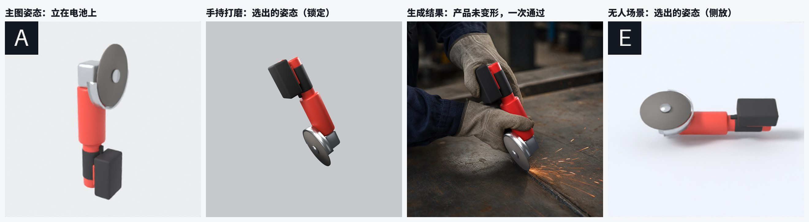

**修复：手部特写不再要求“裁紧画面”。** 这句旧提示会让图像模型放大、重画已经锁定的产品；改为“画面已定，不得重新构图”后，实测一次通过。

实测、耗时和未验证的部分见 [SCENE_POSE_UPDATE.md](SCENE_POSE_UPDATE.md)。

## 产品不变形的 AI 场景图、地面倒影、组件随项目上传 v30

**AI 场景图里的产品不再变形。** 以前图像模型拿着参考图把产品重新画一遍，零件常常弯了、少了，有手握着时更明显。现在按场景相机渲染出真实的产品，先放进画面并用遮罩保护，图像模型只画周围的场景、手和影子。生成后程序测量产品是否被移动、改画或挡住，视觉模型再把渲染图和生成图并排比对；不合格就带着具体问题重画。实测手部特写一次通过，用时 88 秒。

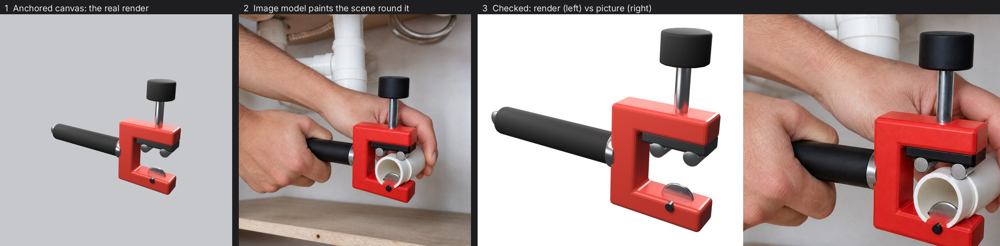

**所有渲染图都有地面倒影。** 白底、灰底、深色底都有，套图里的抠图也有；白底仍是纯白。

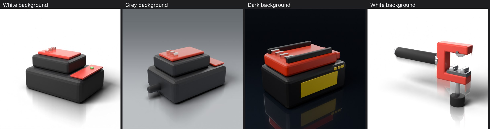

**组件在新建项目时一起上传。** 电池、充电器、工具箱等在上传窗口里和主模型一起选好；套图主图把产品和组件放进同一个 Blender 场景一起渲染，光影一致。

**「图文」换成「套图」。** 逐镜头的图文编辑器已删除，右侧面板的这个标签现在显示套图的概况和入口。

**套图更接近示例。** 逐张看了用户上传的角磨机套图，改了四处：明显竖长的工具在套图里放平展示；页眉没有品牌信息时显示产品名称；特写页改为整件产品加放大镜；副标题不再被「…」截断。

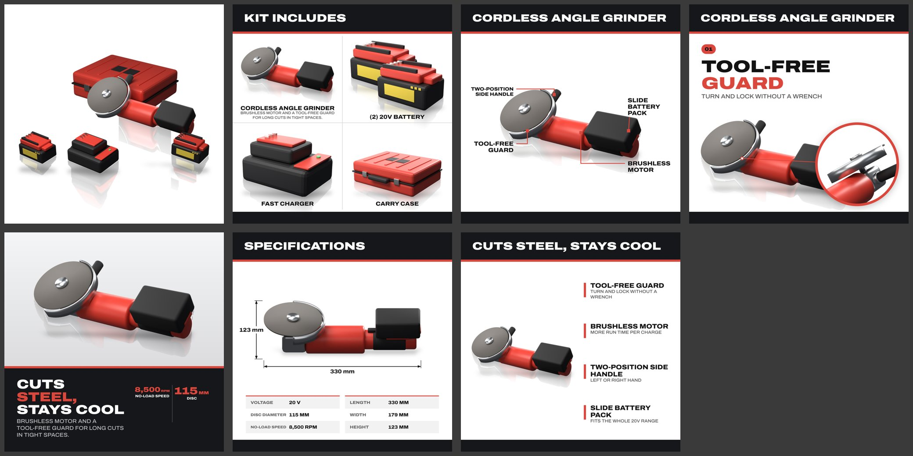

为什么之前的结果不像示例、哪些地方还需要用户提供信息、做不到和未验证的部分，见 [LISTING_V30_UPDATE.md](LISTING_V30_UPDATE.md)。

## 套图：组件、品牌风格与使用场景标注图 v29

**一个产品，一组图。** 顶栏的「套图」把产品、随箱组件和品牌风格排成一组电商图片：主图、套装清单、功能标注、使用场景标注、特写、标题横幅、卖点列表、尺寸规格。依据是对 82 张亚马逊工具类商品图的逐张研究（[LISTING_IMAGE_STUDY.md](LISTING_IMAGE_STUDY.md)）：那些图片大多不是一张产品照片，而是由多张图片、产品信息和一套品牌规范拼成的页面。

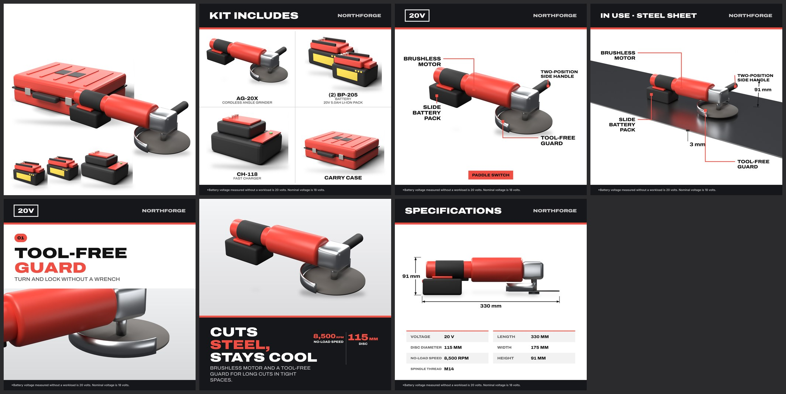

- **组件**：电池、充电器、工具箱等各上传一个模型或一张图片，自动分析、摆正、渲染成抠图；带型号、数量和一行说明。
- **品牌风格**：五种预设（品牌边框、品牌色铺底、深色科技、简洁白底、促销冲击），品牌色默认取自产品本身，全套图片共用同一套字体、引线和边框。系统不内置任何品牌的名称或标志。
- **使用场景标注图**：产品和按尺寸生成的工件渲染在一起，标出尺寸和功能。割管器这类“包住工件”的工具，程序会在模型上找到开口，让工件穿过去。

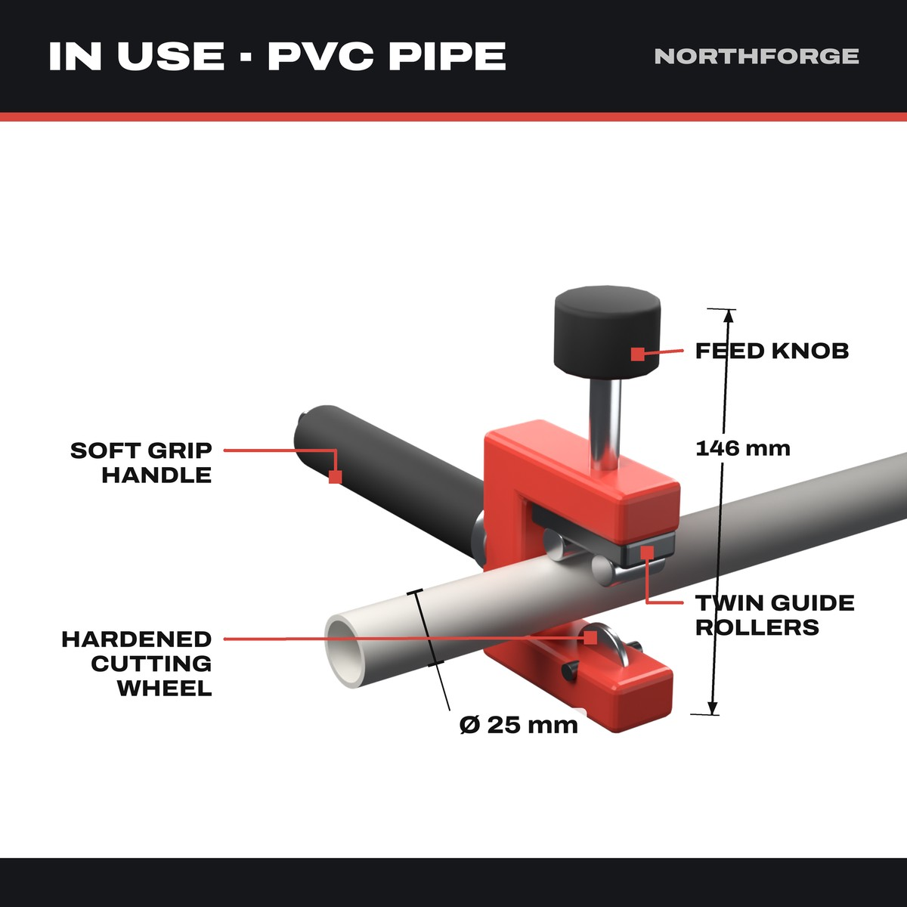

图片上的数字只来自你填写的内容或模型上量出的尺寸。排版在服务端完成，下载的文件就是系统渲染的那一张。

**AI 场景图默认只拍手部。** 画面里需要有人时，默认是手握着产品在操作的特写，不露脸；想看到使用者可以选「包含人物」。

**修复：场景生成时状态栏显示“材质任务未完成”。** 那是上一次自动材质任务留下的文字，现在场景生成显示自己的阶段和百分比。

测试用的是自己搭的角磨机套装和割管器，不是真实产品的模型；做不到的部分和未验证的部分见 [LISTING_SYSTEM_UPDATE.md](LISTING_SYSTEM_UPDATE.md)。

## 姿态判断 agent、进度百分比与耗时分析 v28

**摆正由专门的 agent 判断。** v27 让视觉模型直接选一个字母，在锂电角磨机上把它竖着立在了电池尾端。现在姿态 agent 先说出这类产品应该怎么放（哪个面着地、什么朝上、平放还是竖立），再逐格描述六个候选里是什么着地，最后才选；它还拿到从模型量出的数据：每个姿态下哪些部件着地、有多少平面贴地。改动之前会从四个方向再看一次，不符合就不改。

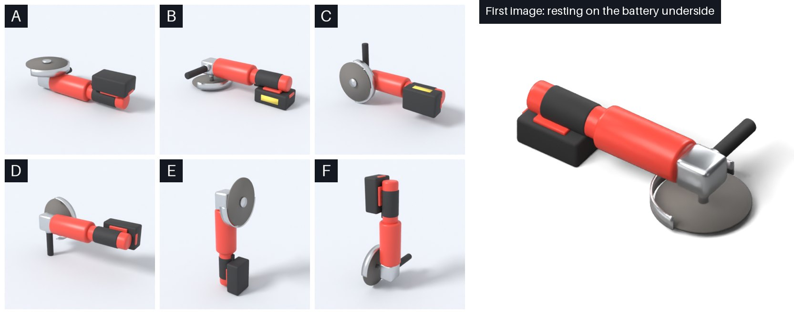

主模型较小时，可以用 `AI_POSE_MODEL` 只为这个 agent 指定更强的模型。实测中，旧判断在角磨机上三次全错；新 agent 用小模型在有部件名称的模型上全对，用 `gpt-6.1-sol` 时 13 个测试例全对。

**状态栏显示百分比。** Blender 5 不再在后台渲染时输出采样计数，进度一直停在 0%。现在渲染脚本自己报告，状态栏在阶段名后显示总进度，场景任务和朝向检查也带上阶段百分比。

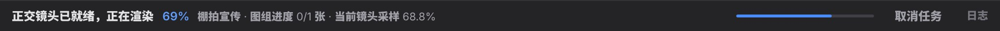

**时间花在哪里。** 在无 GPU 的机器上，从上传到首图 70 秒，其中模型调用占一半以上（姿态判断约 13 秒，预览诊断约 26 秒）；最耗时的是高质量渲染，一张标准质量的 4K 图约 25 分钟（按实测进度推算）。AI 场景图四分之三的时间在渲染三张产品参考图，相近的镜头角度现在共用同一组渲染。

测试模型是自己搭的角磨机，不是你的原模型；逐阶段的计时、判断结果和未验证的部分见 [POSE_AGENT_UPDATE.md](POSE_AGENT_UPDATE.md)。

## 渲染队列、图文版式与图标 v26

**渲染中也能继续提交。** 渲染进行中，「预览」和「渲染 4K」改为「排队预览」「排队渲染」，任务按顺序执行，队列显示在当前任务下方，每项都可以移出。渲染时请求使用场景图也不再被拒绝（以前提示“已有渲染任务开始执行，本次场景未保存，请稍后重试”）：场景照常搭好，等前面可能修改方案的预览结束后再保存。

**图文改为六种版式。** 参照 HOTO、Fanttik、Wera、Bosch Professional 的 12 张品牌图文（[参考包](references/tool-layout-12/README.md)），智能排版改为先留出文字区域，再放产品：左右分区、结构标注、场景叙事、卡片网格、单点卖点、规格清单。每张图只有一个短标题、一个主要视觉、少量说明；产品永远完整，文字不会压在产品上。数字只采用你写下的规格。切换版式时文字不变，也不需要再调用模型。

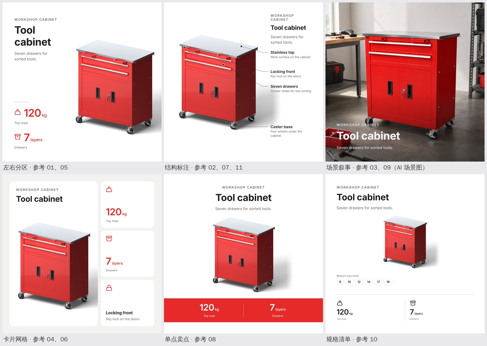

**每一项都有图标。** 图标 agent 先在随应用附带的开源图标库（Lucide、Tabler）中查找，也可以在线查找，只取 MIT、ISC、Apache-2.0 授权的图标；都不合适时由 AI 绘制，并由视觉模型核对。例如“扳手尺寸”配扳手，“台面承重”配秤砣。图标随图层保存，并记录来源与授权；在「图文」面板里可以随时查找、替换或重新绘制。绘制可以用 `AI_ICON_MODEL` 单独指定更强的模型：在 HAI 上，`gpt-6.1-sol` 画出的图标 6 个里有 5 个通过核对。

**文字默认英文，可改中文。** 说明框里可以写中文，AI 会把它译成英文，你写的数字和尺寸原样保留。

**可导出 Photoshop 工程。** PSD 里每段文字都是可编辑的文字图层，图标、引线和色块是矢量形状图层，照片和画布各占一层，并按元素分组。

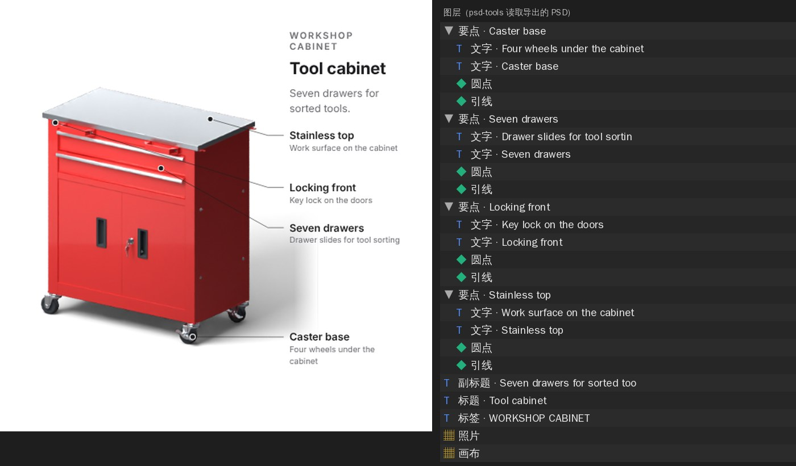

用法、规则、验证范围与未验证的部分见 [TEXT_LAYER_LAYOUT_UPDATE.md](TEXT_LAYER_LAYOUT_UPDATE.md)。
## 画面人物选项与模型自动摆正 v27

**场景图里要不要有人，由你决定。** 「使用场景」新增「画面人物」：自动、包含人物、不含人物。选了之后，策划按它写画面，图像请求里写明“必须有人在使用产品”或“画面里不出现人”，生成后的核对也看这一项，不符就带着纠正重做一次。3D 道具场景里没有人，所以那种方式下不提供「包含人物」。

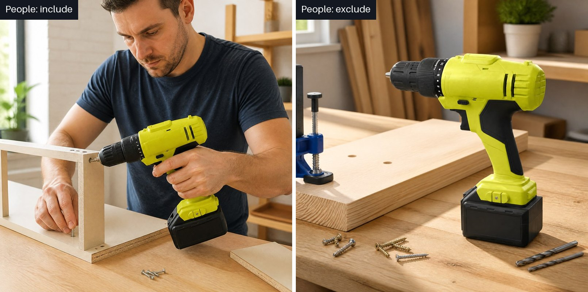

**倒着或躺着的模型，导入时摆正。** 模型文件的坐标轴由导出软件决定，文件是倒的，之前所有图就都是倒的。现在出第一张图之前，应用渲染六个候选姿态，由视觉模型判断哪个是正的（没有视觉模型时看部件名称），有把握才改。

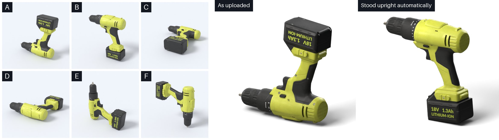

**判断错了一点就改。** 「调整」面板的「摆放朝向」列出六个候选姿态的缩略图，点一下改用；也可以上下翻转、绕竖直方向转 90°，或重新自动摆正。每次都是一个可撤销的版本，并立即预览。

摆正只在一把电钻和一件工具柜上实测过，判断可能出错；没有视觉模型时多数模型需要手动选姿态。做法、接口、验证范围和未验证的部分见 [POSE_AND_PEOPLE_UPDATE.md](POSE_AND_PEOPLE_UPDATE.md)。

## 按人群策划的使用场景图 v25

**场景图先问“给谁看”。** 「使用场景」新增目标人群：应用读入一份参考库（八类工具买家，每类十条已发布画面的文字观察），为当前产品推荐一类人群、一条可借鉴的参考和一张计划中的画面，并说明理由。人群、参考和生成方式都可以改。

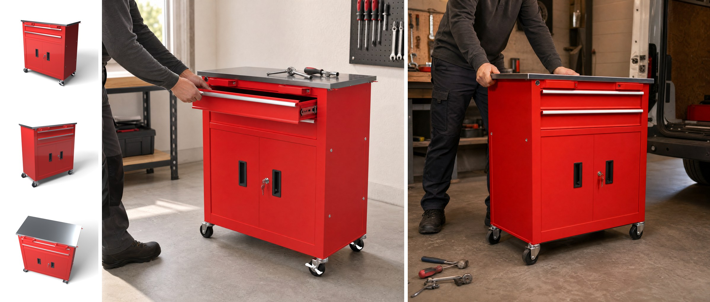

**有人物或真实环境的画面由图像模型生成。** 工地、车辆、草坪和正在操作的人，用几件 3D 道具搭不出来。这类画面交给 HAI 的图像模型（默认 `gpt-image-2`）：先用 Blender 把产品从目标角度、另一侧前角和俯视渲染三张参考图，连同画面描述一起发出；生成后由视觉模型对照参考图核对形状、部件、颜色和多余文字，不一致就带着差异再生成一次。上图左侧是参考图，右侧是据此生成的两张 2048 px 场景图。其余画面仍按 v22 用 CC0 道具在 Blender 中搭建。

**来源清楚，标注清楚。** 参考库只含链接与文字，应用不下载、不显示、不转发其中的图片；发给图像模型的只有本机渲染的产品图。AI 生成的图在界面上标为「AI 生成」，并列出面向的人群、借鉴的参考、核对结论和所用的三张参考图；它不是 Blender 渲染，没有可导出的 3D 工程，修改产品后需要重新生成。

没有配置 AI 时按产品名称推荐人群并搭 3D 道具场景。多角度参考和核对降低产品走样的风险，不能保证；本次只在一件产品（工具柜）上实测。配置方法、流程、费用与时间、验证范围和未验证的部分见 [SCENE_AUDIENCE_UPDATE.md](SCENE_AUDIENCE_UPDATE.md)。
## 真实阴影与遮挡更新

展示布光中的补光、轮廓灯和反射灯现在遵守模型遮挡，避免箱体内部、把手凹槽被无阴影灯照透。使用场景不再叠加无影房间灯和棚拍背景洗光；环境光源带有真实阴影，并跟随主光方向。产品材质、颜色、相机和各画质采样数量不因这次更新改变。

点击预览或渲染时，普通镜头会重新生成旧管线图片；旧图片保留。已有摄影快照（`scene_checkpoints`）继续使用保存的灯光，不会被新预设覆盖。已用工具箱场景在相同相机、材质、512 像素及 24 采样下做真实 A/B 对比，并通过应用生成新的 2K 场景图；白底棚拍通过真实场景回归，玻璃样例完成实际预览检查。更广泛的品类仍需逐项视觉验收。

## 图文图层的设计升级 v24

**图文不再像标注，而像设计过的卖点图。** 标题改用内置的重磅字体（Noto Sans SC Black），字号最大到画面的 10%，产品名里的关键词用主色强调，上方是一枚品类标签；每条标注是一张带投影的圆角卡片，图标放在主色圆形徽章里；指向线的终点是带光晕的主色圆点。主色自动取自产品本身的颜色。

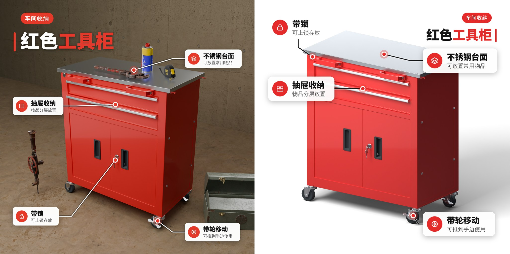

**五种风格，一键切换。** 简洁、醒目、卡片、深色、色块——智能排版按画面自动选一种（白底主图用「醒目」，场景图用「卡片」），也可以在「图文」面板里随时换风格、换主色，位置不变。文字直接压在照片上时带柔影或光晕，不需要加框也能看清。

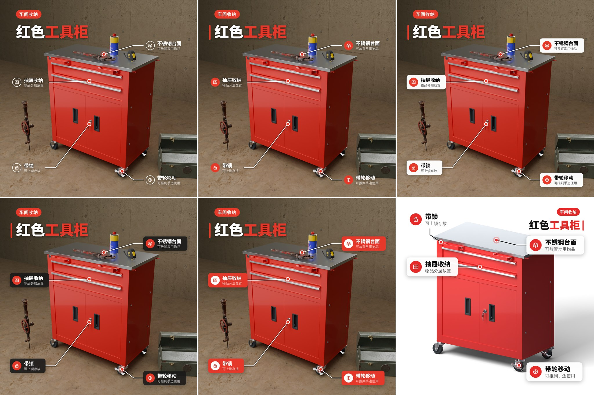

（前五格依次为简洁、醒目、卡片、深色、色块；最后一格是白底主图。）

**AI 路径已在 HAI 接口上实测。** 使用场景的导演与采购（18 秒，放入 5 件道具）和图文要点（每次约 12 秒）都完成了真实调用，请求与返回校验一次通过；图文要点先后跑了三轮，并按真实回复收紧了措辞要求、给图标补了含义。上面两张图的文案就是模型看图写的：品类标签、带强调词的标题，以及全部正确指向部件的 4–5 条要点。文案仍是草稿，发布前请核对。细节、字体许可与验证范围见 [TEXT_LAYER_STYLE_UPDATE.md](TEXT_LAYER_STYLE_UPDATE.md)。

## 图文图层 v23

**在渲染图上直接介绍产品。** 右侧新增「图文」面板：给任意镜头叠加一层可编辑的矢量图文——标题、正文、图标，以及带引线指向部件的标注。点「智能排版关键信息」，应用会提取这件产品值得说的几点（抽屉、脚轮、锁、不锈钢台面……），把标题放到画面最空的一角，把每条标注放在它所指部件的那一侧，用一条短引线连到部件在这张图里真正可见的位置；浅色背景用深色字，深色背景用浅色字，压到产品或杂乱背景时自动加底板。也可以逐行写下自己的要点，由应用来排。

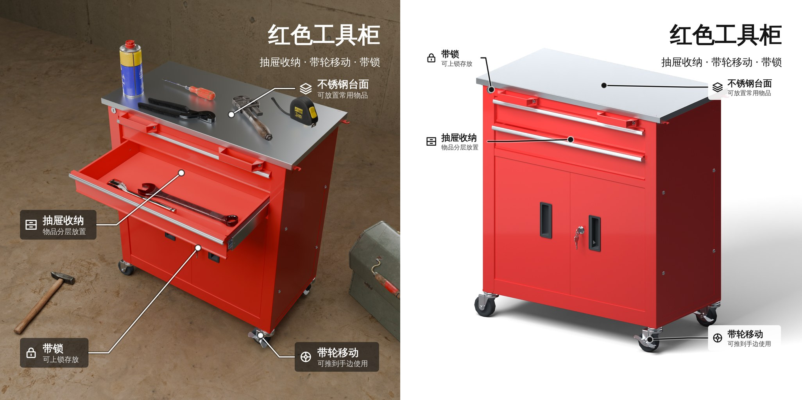

**每一项都能改。** 在画面上拖动、拉角点缩放、连按两下直接改字；标注的圆点可以拖到别的部位。右侧可改文字、大小、粗细、对齐、颜色、底板和图标（内置 38 个线性图标），支持撤销、重做和键盘微调。图层自动保存，按镜头分别存放；它不属于拍摄方案，改图文不会让已有渲染图过期，也不需要重新渲染。

**导出。** PNG / JPG 按渲染图的原始分辨率合成；SVG 内含渲染图，文字仍是文字、图标仍是路径，可在 Illustrator、Figma 等软件里继续编辑；也可以只导出透明的图文层。

智能排版在启用 AI 时由模型看图写要点，未启用时按部件名称的规则提取。两种方式都只描述看得见的东西，不会编造尺寸、承重、认证之类的数字；生成的文案是草稿，发布前请核对。数据格式、排版规则与验证范围见 [TEXT_LAYER_UPDATE.md](TEXT_LAYER_UPDATE.md)。

## 使用场景图 v22

**产品放进它被使用的地方。**「调整」面板新增「生成使用场景图」：应用先判断产品是什么、用在哪里，再从 [Poly Haven](https://polyhaven.com/models) 的 CC0 模型库中搜集合适的现成模型，按真实尺寸布置到产品周围，换上相应的地面与背景，作为一个新的「使用场景」镜头出图。工具柜会拉开一层抽屉，扳手放进抽屉，钳子、卷尺、喷罐摆在台面上，锤子和旧工具箱放在旁边的水泥地上；洗护瓶放在浴室台面上，背后是盆栽；托盘、杯子在厨房的木台面上，旁边是水果和砧板。

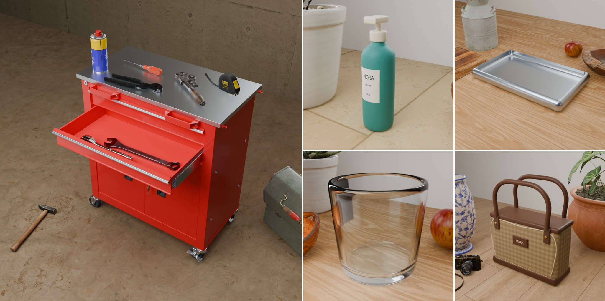

**产品始终是主角。** 镜头只对准产品和放在它上面、里面的东西；旁边与后方的道具在镜头确定后才摆到画面边缘，可以被画框裁掉，不会挡住产品；浅景深对焦在产品上。道具摆在哪里由 Blender 实测决定——台面是量出来的平面，抽屉是量出来的内腔——互不重叠，放不下的不硬塞并记录原因。

**不依赖 AI 也能用。** 已启用 AI 时由模型看图决定场景与道具；未启用或调用失败时，使用内置的八类规则（工具存放、洗护美妆、餐厨、箱包、园艺、数码办公、家具、通用）。场景是方案里一个可撤销的版本，「换一组场景道具」重新摆放，「移除使用场景」恢复原样；白底主图和其他镜头不变。每件道具的来源页面与许可都列在界面和方案中。

生成场景需要能访问 `api.polyhaven.com` 与 `dl.polyhaven.org`；下载过的模型会缓存在 `data/props_cache/`。处理流程、尺寸与摆放规则、道具库的局限和验证范围见 [SCENE_IMAGES_UPDATE.md](SCENE_IMAGES_UPDATE.md)。本次没有在真实的大模型接口上运行。

## 展示级首图与指令智能体 v21

**输入要求后不再卡在“仍需确认”。** 此前像「柜体是红色喷漆金属带反光，钥匙和钥匙孔是不锈钢会反光」这样的要求会被拒绝并请你点选部件，原因是模型自己数的“部件个数”与几何分组对不上——而你并没有说过数量。现在只有你写明数量时才核对数量；模型的定位与修改范围有出入时，由程序按唯一安全的方式修正；应用前由独立的「核对」智能体复查选中的部件，去掉不属于所指部位的（例如把轮子支架也当成轮子）；规划器处理不了的要求，交给专职的「定位」与「质感」智能体继续完成，所有结果仍经过同一套权限、保留条件与范围校验。能执行的直接应用，一步可撤销；确实无法完成的，给出具体原因而不是让你先去点选。

**导入模型后的第一张图。** 只带纯色占位材质的 OBJ 会在分析完成后按材质名与部件名补全质感：金属件是金属，不锈钢台面是拉丝不锈钢，轮子是橡胶，颜色保持不变，每条依据都可查看。新项目使用展示级布光：主光与补光拉开明暗，后侧条形灯与反光板勾出轮廓和金属的渐变，硬边带一条细高光。512 px 草稿出来后，后台自动补渲一张 2048 px 的高清图；这期间可以照常操作，任何操作都会让它让路。

旧项目保持原有画面，可在「参数 → 出图质量 → 布光与质感」切换。规则、处理流程、设置项与验证范围见 [AUTOMATION_UPDATE.md](AUTOMATION_UPDATE.md)。本次没有在真实的大模型接口上运行，说明见该文档的“边界与未验证”。

## 工作台重新设计 v20

界面按专业工具的惯例重排：顶栏放项目名与全局操作（预览、渲染 4K），左侧是镜头栏，中间是尽量大的画面，右侧是「调整 / 材质 / 参数 / 导出」四个紧凑的属性面板。画面下方只有一条信息栏（尺寸、PNG、JPG、工程文件菜单）和一条只在有任务时出现的状态栏。次要操作收进菜单，说明文字改为悬停提示或默认折叠，桌面宽度下整个工作台在一屏内完成。

渲染、接口与数据不变。设计依据、前后对照与验证范围见 [UI_REDESIGN_V20.md](UI_REDESIGN_V20.md)。下文各版本说明中的旧面板名对应关系为：画面调整 → 调整，部件材质 → 材质，摄影方案 → 参数，电商出图 → 导出。

## 电商出图 v19

右侧新增第四个面板「电商出图」：选择销售平台（通用白底、淘宝／天猫、京东、拼多多、抖音电商、小红书、Amazon、Shopify、TikTok Shop、Temu、AliExpress、eBay），应用按该平台的主图要求逐项检查当前镜头的真实渲染图——分辨率、画幅、纯白背景、产品占比、格式与大小——并说明每一项是已通过、导出时自动处理，还是需要先渲染 4K。

点击「导出平台套图」后，后台为每个已出图镜头生成符合平台尺寸和文件大小的 JPG，并打包为 ZIP：主图背景清理为纯白 RGB 255，产品自动居中并构图到平台要求的占比，可保留产品附近的柔和阴影；可附带透明底 PNG；淘宝／天猫、抖音、速卖通另外输出独立的白底图。纯白底与透明底使用 Blender 从该图保存的场景重新渲染的产品蒙版合成，只替换产品以外的背景，不重新渲染也不修饰产品本身。尺寸、文件大小和纯白底结论来自对已写入文件的重新读取，记录在包内 `manifest.json`。

上传时可直接选择销售平台，首张主图即按该平台的画幅与占比构图。分析完成后，应用还会按实测比例选择首图视角：扁平产品抬高到俯视，细高产品降低视角；原因显示在「模型检查与拍摄记录」，角度之后仍可随意修改。

本版同时修复了镜头被重复渲染三次的问题：v17 改为正交镜头后，旧的取景复查仍用包围盒角点判断留白，常常不通过（示例瓶的主图即如此），随后两次“拉远相机重渲染”对正交镜头的画面没有任何影响。现在按真实顶点在实际出图镜头中的投影检查一次，每个镜头只渲染一次——示例瓶的预览任务在 CPU 上从约 25 秒降到约 10 秒，「已达到自动取景修正上限」的误报也随之消失。

平台规则数值、处理方式、接口和验证范围见 [ECOMMERCE_UPDATE.md](ECOMMERCE_UPDATE.md)。平台会调整规则，上传前请以商家后台提示为准。

## 深色工作室界面 v18

界面换用新的深色设计（设计稿「01 首页 · 上传与项目」）。首页不再显示侧栏与参数面板：上方是虚线上传区，可直接拖入模型或点击「选择文件」「选择资源文件夹」，选好后在原有上传窗口核对文件并补充产品信息；下方「我的摄影项目」以卡片显示每个项目最新的白底主图与状态——绿点表示已有 4K 成品，琥珀色进度条表示后台仍在渲染，警示图标表示分析中断可继续；最后一行是示例模型。卡片右上角可删除项目，删除前仍会确认。

打开项目后的工作台沿用同一套深色配色：浅色主按钮、琥珀色表示进行中、绿色表示完成。功能、接口和快捷操作不变。`/api/projects` 为每个项目附带 `active_job`（仅 id、类型、画质、状态、进度、来源），供首页卡片显示后台任务。Inter 字体随应用打包在 `static/vendor/fonts/inter/`（SIL OFL 1.1），中文使用系统字体，仍然没有前端 CDN 依赖。

## 实时主图视口与正交镜头 v17

白底主图默认打开实时 3D 画面。左键拖动旋转、滚轮缩放、右键拖动平移，可以复位或全屏查看。拖动由浏览器本地完成，不调用模型、不创建新版本，也不反复排队 Cycles 渲染。第一次打开会从当前项目准备独立 GLB，准备完成后重复进入可复用缓存。

新镜头默认使用正交投影；旧方案没有投影字段时，后续实时视图和新出图也采用正交投影。缩放使用真实正交取景范围，平移与角度可随镜头保存。预览和 4K 输出使用已采用的当前视角；原先的成图与工程继续按其历史版本查看。需要透视时，可在摄影方案中显式切换。

“实时 3D / 渲染图”保持在同一个画面区域。实时画面用于观察模型与构图，材质、反射和阴影采用 WebGL 近似；Cycles 正式成图与原始复杂材质保留。图片选点、画面诊断和版本对比继续对应明确的已渲染图片。实时查看不需要新 API Key，也没有前端 CDN 依赖。

安装方法、操作说明和验证边界见 [REALTIME_VIEWPORT_V17.md](REALTIME_VIEWPORT_V17.md)。以下版本章节保留各次升级记录。

## 完整语义规划与执行校验分离 v16

在线“画面调整”默认使用新的 `semantic_v2`：完整原句、当前预览、真实部件和可用的场景参数直接交给 LLM。要求如何拆分、目标部件、保留条件、需要调整的控制项及修改之间的依赖由模型理解；程序不再用关键词表提前决定可修改范围，也不再根据关键词补齐材质数值。

执行端只核验可追溯原句、真实目标、参数能力与范围、结构化保留条件、依赖、版本和源文件一致性。互不依赖的可完成项先应用；待处理项与保留条件继续保留。普通在线流程一次模型请求，需要纠正执行数据或读取参考图时最多再请求一次，沿用已有模型配置。

自然语言修改统一到“画面调整”，部件页保留手动材质操作。旧协议仅供兼容接口和明确标注的离线规则使用，在线解析失败不会偷偷切回关键词流程。

安装、验证结果和支持边界见 [SEMANTIC_UPGRADE_V16.md](SEMANTIC_UPGRADE_V16.md)。本节为当前入口行为，以下版本说明保留为历史记录。

## 优化后继续调整材质与灯光 v15

修复“柜体光泽不够，灯光再亮点”被误判为修改范围不一致的问题。后续修改读取当前保存工程的真实材质参数，已定位柜体可据此降低粗糙度，保持原色与原材质类型；灯光继续依据当前镜头调整。首次微调材质的保留标记不再被原生渲染器误当成材质替换。

已通过独立校验的灯光可以先完成，不再被可隔离的材质参数错误一起拦住。修改明细显示实际参数起点；剩余校验问题保留原要求，显示简短原因和“重试调整”，详细信息默认收起。沿用现有模型和最多两次解析／纠错请求的预算。

安装累计更新包、实际柜子连续两轮验证及测试边界见 [FOLLOWUP_INSTRUCTION_FIX_V15.md](FOLLOWUP_INSTRUCTION_FIX_V15.md)。本节保留 v15 的修复记录；在线语言理解已由 v16 替换。

## 高清结果校验与失败任务恢复 v14

修复高清图和工程已经生成后，因候选／高清阶段重复计算取景产生微小浮点差异而误报“场景状态不一致”。高清输出现在直接从已选候选工程渲染；校验区分有界舍入误差与真实场景变化，并记录差异字段。

对已有失败任务，点击“继续 / 重试”会优先核验旧文件与执行记录，证据完整且一致时直接恢复已有高清结果，避免重复模型请求和渲染。安装、恢复条件及验证结果见 [SCENE_CONSISTENCY_FIX_V14.md](SCENE_CONSISTENCY_FIX_V14.md)。

## 自动主图优化 v13

在已有白底主图上点击“自动优化主图”，系统自动读取真实 Blender 场景，结合当前图规划构图、柔光、反射与可编辑的表面参数，生成原场景和候选预览，再比较效果。通过检查后输出默认 2000 × 2000 主图及可独立下载的 `.blend`；后续调整继承优化后的场景，撤销同时恢复原图与原工程。

每次最多两次视觉模型请求，沿用已配置模型，不自动升级费用。任务阶段和渲染进度显示在原有状态卡中，原因与候选默认折叠。安装、实际支持范围、源工程对比和测试边界见 [HERO_WORKFLOW_UPDATE.md](HERO_WORKFLOW_UPDATE.md)。

## 独立场景下载、灯光方向与渲染反馈更新 v12

预览下方可直接下载当前镜头最新的 `.blend` 或 `.c4d`，无需下载项目归档。C4D 尚未生成时单独生成，来源按实际出图记录核对；历史对比图、其他镜头和转换 ZIP 不会误用为最新原生文件。

渲染中的任务在预览内显示动态状态卡、真实采样／图组进度，断连和终态会停止动效。AI 与手动方案可调整当前镜头的主光、补光、轮廓光方位角及俯仰角；读入当前场景确认实际灯位，渲染后再核验 PNG 对应的灯位和保存快照。

定性亮度与背光要求默认追求更明显的变化，保留明确数值、轻微调整和既有保护条件。安装、实际执行前提及测试边界见 [LIGHTING_AND_RENDER_UPDATE.md](LIGHTING_AND_RENDER_UPDATE.md)。

## LLM 语义理解更新 v11

“灯光再亮一些，不要让物体背光”现在会交给 LLM 结合原句、当前方案和预览解释为效果目标，再选择合适的灯光参数；不会因为不认识“不要……”而在模型调用前拒绝。明确的颜色、角度、数值要求仍逐项核验，模型解析出的保留条件也会延续到剩余要求。

语义理解和参数规划共用一次请求，包含纠错仍最多两次，不自动升级模型。沿用自动部分执行与现有简洁界面。安装累计更新包及验证边界见 [LLM_INTENT_UPDATE.md](LLM_INTENT_UPDATE.md)。

## 自动完成可执行项 v10

点击“应用并预览”后，已经核验的独立修改会直接保存并预览，输入框只保留未完成的要求。新流程省去“先应用可完成项”，结果集中为一条简短摘要，原因与参数明细默认折叠。

“钥匙孔、钥匙、轮子的支架都是不锈钢反光的”会按部位继承共同材质要求，已识别部位可以独立完成。“让整个物体更好看”按商品图摄影目标处理，使用现有灯光与镜头参数准备预览；已经完成的灯光不会在重试中重复叠加。安装、具体默认含义及验证边界见 [AUTO_PARTIAL_UPDATE.md](AUTO_PARTIAL_UPDATE.md)。

以下各版本记录说明历次更新；v10 起普通提交使用自动部分执行，旧提案和 API 显式 review 模式继续兼容确认流程。

## 修改决定与材质语义修复 v9

修复“待确认方案不能同时包含直接执行的修改”以及“AI 未给出一致的可执行决定”。模型统一返回逐项修改，服务器核验后决定直接应用或等待确认；重复的旧格式字段只有完全相容时才去重，冲突在原有两次请求预算内纠正。

“上表面是反光的拉丝不锈钢，箱体是红色金属有光泽”保留为两项材质要求。部件定位后核验红色色系，缺失光泽参数使用现有材质预设，防止旧哑光参数残留。返回结构仍失败时保留原文，主按钮显示“重新生成修改”，无需改写要求。安装、执行规则与验证边界见 [DECISION_CONTRACT_UPDATE.md](DECISION_CONTRACT_UPDATE.md)。

## 完整部件定位更新 v8

“四个轮子都要是黑色橡胶”等部位要求会检查当前预览保存的三维场景，生成真实材质表面的独立双视角部件图，让被主图遮挡的表面也能参与识别。数量按实际几何的空间分组核对，避免把拆开的网格数量当作轮胎数量。绑定缺漏进入现有的一次纠错；橡胶替换清除旧金属参数残留。

仍不确定时，点选一个示例部位并点击“用选点继续识别”，原要求与数量完整保留。示例点由服务器重新拾取，不会变成只修改选中轮子的局部操作。新检查不改原场景、项目版本或普通预览列表。安装与实际验证边界见 [SCENE_PARTS_UPDATE.md](SCENE_PARTS_UPDATE.md)。

## 摄影要求误拦截修复 v7

修复“要求中的灯光与镜头未完整包含在修改中”的过度拒绝。整体摄影目标允许按实际需要调整灯光或镜头，并说明未变部分；具体焦距、角度和曝光要求仍必须核验。已有规则可解析的参数缺项按原方案补齐，未完成的明确要求继续保留为原句。参数缺项不再引导用户进入部件点选。详见 [PHOTOGRAPHY_INTENT_FIX.md](PHOTOGRAPHY_INTENT_FIX.md)。

## 逐项调整更新 v6

复合要求按原文拆分核对。“改善材质反光”可使用现有灯光和镜头参数；AI 自己想到的微纹理、真实倒角或独立阴影控制不会被追加成用户必须完成的要求。对仍不能确认的部位，界面在同一输入区说明待确认内容，并列出已通过校验的可执行改动。初次分析只保存提案，不改方案、不增加版本、不启动预览；明确点击“先应用可完成项”后，才应用这份提案并预览。

应用后保留未完成的原始要求，已执行的相对灯光调整不会在下一次提交时被重复执行。确认不再次调用 AI；来源、版本或部件证据已变化时提案失效。不可见的轮胎仍不会靠对象名字猜测为已定位。详见 [COMPOUND_INSTRUCTION_UPDATE.md](COMPOUND_INSTRUCTION_UPDATE.md)。

## 部件理解与低成本模型更新 v5

“画面调整”现在把当前渲染中的真实采样点、对象与材质槽一并提供给模型，允许通过可核验的目标编号解释“轮子”“支架”等中文部位。材质修改必须匹配本次实际目标；旧版本、未知目标和不完整的数量要求会被阻止，原输入保留。完整拾取环境可用时会再次检查采样点；不可见或无法单独编辑的部位仍需补充视图或点选。

已阻止 `gpt-5.5-2026-04-23` 及 GPT-5.5 别名发出请求。AI 设置提供常用低成本与能力均衡的模型配置，独立视觉默认继承主模型，不再预填昂贵型号；不会自动升级到更贵模型。旧配置仍可查看，选择新配置并保存后生效，切换官方平台需要该平台自己的 Key。

模型选择、2026-11-10 官方价格及验证范围见 [MODEL_AND_PARTS_UPDATE.md](MODEL_AND_PARTS_UPDATE.md)。安装累计更新包见 [UX_UPDATE_GUIDE.md](UX_UPDATE_GUIDE.md)。

## 项目操作更新 v4（保留）

新上传的模型完成分析后，后台自动生成白底主图预览，无需再点击预览。主图完成后，其他尚无当前版本图片的镜头会在后台生成长边 256 像素、8 采样的真实渲染缩略图；打开符合条件的旧项目时也会补齐。缩略图用于浏览镜头，正式预览与 4K 成品仍按需生成。退出项目或关闭页面不会停止已提交的后台任务。分析失败或被取消时不生成主图，点击原来的继续／重试即可恢复流程。

左侧项目行可删除项目，删除前显示项目名称和关联文件范围。运行中的分析、渲染、材质或导出任务需要先取消并完成收尾，或等待完成。删除当前项目后返回上传首页；删除其他项目保留当前工作。标题旁“退出项目”返回首页并保留项目，有未保存参数时可选择保存、放弃或继续编辑。

更新说明及验证边界见 [PROJECT_WORKFLOW_UPDATE.md](PROJECT_WORKFLOW_UPDATE.md)。

## 智能调整更新 v3

“画面调整 → 应用并预览”现在可结合当前真实预览、当前镜头有效参数、项目资料、近期有效操作与诊断理解要求；明确要求对照参考图时，也会使用上传时保存的参考图。明确的保留要求会约束可修改字段，执行后用实际参数差异显示回执。曝光、柔光与灯光调整限定到当前镜头，相机调整不会连带改其他镜头；留白等共享参数会说明项目级影响。

本轮保留 v2 的精简界面与只读诊断。“重新检查”仍不会修改方案或启动渲染。网络重试使用持久执行回执避免重复应用；没有实际变化就不增加版本或发起预览。自动候选必须通过同源评分与实测退化检查才采用。安装见 [UX_UPDATE_GUIDE.md](UX_UPDATE_GUIDE.md)，能力、边界和验收见 [INTELLIGENCE_UPGRADE.md](INTELLIGENCE_UPGRADE.md)。

先点击“预览当前镜头”检查一张图；勾选镜头决定“渲染 N 张 4K”的范围。“下载项目归档”包含所有已生成图片、历史版本和工程，不跟随镜头勾选。

## 启动

需要 Windows / Python 3.9+ 和能读取当前工程格式的 Blender。原生主图流程使用 Blender 5.0.1 核验用户提供的 5.0 工程；旧格式合成测试使用 Blender 4.3.2。实际验证范围见 v13 更新说明。

```powershell
cd D:\模型渲染
python -m pip install -r requirements.txt
python app.py
```

也可以在 PowerShell 运行 `./start.ps1`。打开 <http://127.0.0.1:8765>。服务只绑定本机回环地址，无需账号。关闭终端即停止服务；再次启动会将未完成任务标为中断，可继续生成尚未完成的镜头。

自动搜索 PATH、`D:\blender\blender.exe` 和常见安装位置。找不到时复制 `.env.example` 为 `.env`，设置 `BLENDER_PATH` 为 Blender 可执行文件的绝对路径。可用 `STUDIO_PORT` 改端口。GPU 驱动需由系统正常安装；GPU 不可用时使用 CPU，任务中显示实际设备。

## 使用流程

1. 上传一个 GLB，或一个 OBJ 连同 MTL 和贴图。推荐把资源目录打成 ZIP，或者选择文件夹，以保持相对路径。不要同时放入多个模型。单次请求上限 512 MB、ZIP 解压上限 1 GB / 2000 个文件。上传时可选填写项目名称、产品类别、真实尺寸（毫米）与材质说明，并附上参考图。
2. 点击“上传并生成主图”，等待 Blender 导入分析。成功后自动生成白底主图预览；可以退出到首页，任务会在后台继续。检查材质、UV、部件和警告。
3. 查看自动生成的 512 像素 Cycles 主图预览，再按需调整浅色柔光或深色棚拍等镜头。主图固定为白底。新项目会在预览之后于后台补渲一张 2048 像素的高清图，完成后自动替换显示；这期间可以继续操作。预览后自动自查；已配置的AI发现需要补充同类材质的表面细节时，自动寻找资源、下载、应用并重新预览，无需另外点击寻找材质。预览旁显示真实进度与结果。画面诊断会展示结果；点击「重新检查」只更新诊断，不改方案或启动任务。参数更改生成新版本，旧图片仍保留并标明版本。
4. 点击产品或「选择部件 / 材质」，多选部件并查看实际渲染材质。勾选要修改的颜色、粗糙度、金属度、透射或预设，点击「应用材质并重新预览」；直接编辑不需要API Key，也可切换「描述所选部件」输入局部修改要求。恢复按钮仅移除所选部件的局部覆盖，全局设置保留。还可调整留白、比例、角度、姿态、纹理方向和灯光；法线与平滑修复为显式选项，可通过撤销回退。普通镜头渲染重新读取原始资产，不累计损坏原件；v13 已采用优化的镜头从保存的场景快照回放受支持的后续调整，保留优化布光。
5. 选择镜头，输出标准或精细 4K。方图 4096 × 4096，横图 4096 × 3072，竖图 3072 × 4096。PNG 与 JPG 来自同一渲染，下载前重新读取校验尺寸和格式。可单张下载或打包，包含 Blender 工程与参数。

精细模式可设置较长单张时间预算；预算是采样阶段的上限，导入、场景构建、降噪和文件写入另需时间。渲染耗时取决于网格、透射、采样、设备与显存，并非保证的完成时间。

工作台以预览为主：中央显示图片与镜头，右侧切换「画面调整」「部件材质」「摄影方案」。全局文字修改只在「画面调整」输入，点击「应用并预览」后保存参数，通常生成本次选定镜头的预览。在白底主图上把背景风格改为浅色柔光或深色时，如项目包含棚拍宣传镜头，执行回执会指定该宣传镜头作为预览目标；白底主图仍保持白底。诊断位于同一面板下方，显示结论，依据和执行记录按需展开；手动「重新检查」只更新诊断。渲染后的自动检查与自动修正仍遵循摄影方案设置。无项目时只显示上传与必要的运行提示。

AI 设置可单独配置视觉模型。新版全局调整在携带当前图或参考图时使用视觉配置；纯文字调整使用文字配置。未单独配置视觉模型时，沿用现有配置的继承规则。HAI 官方 Anthropic 与 OpenAI 路由可使用同一个本机 Access Token；其他域名需要单独填写视觉 Key。点击“保存并测试视觉分析”会发送最近一张真实预览，验证模型能否接收并描述图片。模型返回的修改仍须通过范围与保留要求校验；最终商品图由 Blender 生成。

## AI 和数据

未启用外部AI或未填写Key时，基础渲染与直接材质编辑可离线完成。内置规则支持“反光柔和一点”“换成俯拍”“突出表面纹理”“增加留白”“减少留白”“亮一点”“白底”“深色”等修改；不理解的指令会报出具体提示，不伪造 AI 理解。

右上角「AI 设置」支持现有 Anthropic Messages 与 OpenAI 兼容服务。沿用你的服务地址、模型和凭证；可用性以账户权限和实际连接测试为准。Key 仅存于本机 `.env`，不回传浏览器、不进入应用导出的项目归档。启用后，发送指令、必要模型信息及经裁剪的近期有效操作；有当前版本图片时发送缩小预览，明确要求对照参考图时额外发送该项目参考图。原模型与贴图文件不作为图片上传。结构化参数通过白名单、作用范围与保留要求校验后交给 Blender，不能执行模型返回的代码。参考图用于受限摄影调整的视觉参照，不等同于测量真实 PBR 数值、自动重建几何或无误匹配未命名部件。

预览后自动检查默认开启：无 Key 时只依据实际产品曝光采样和已有构图检查报告；有 Key 时结合真实图片分析灯光层次、反射、纹理、倒角、接地阴影与透射等逼真度因素，列出画面证据、推测、置信度和建议。曝光与光源柔和度最多自动修正两轮并真实重新渲染，保留各轮图片和最佳候选，采用的逐镜头参数写入新方案版本。图组完成后还会检查自动材质需求；材质流程独立最多执行两轮，每轮应用后重新渲染原选中图组。两项上限都受「最大修正次数」0–2控制。正式渲染使用已保存的材质与摄影参数。AI请求失败会明确显示，不能视为视觉检查通过。

「重新检查」读取当前选中图片和已保存参数快照，请求显式指定 diagnostic_only=true，只更新该图诊断记录。部件修改通过真实射线命中的网格与材质槽执行，共享材质先复制；单独调整粗糙度保留颜色与标签，显式改色可能覆盖该槽图案。复杂着色器仍需明确替换为内置预设，或导出工程人工编辑。详见 [AI_FEEDBACK.md](AI_FEEDBACK.md)。

外部 PBR 资源导入需填写来源和许可。内置程序材质不依赖外部下载；原有贴图和标识默认保留。不要对需要精确保留图案的材质盲目替换；先预览检查。

自动材质优化使用已配置的视觉LLM判断需求，再由LLM比较 Poly Haven 官方目录中的实际 CC0 资源。只有图中可见、能真实定位、材质类别已有明确依据的部件才可自动处理；类别未知、仅需调整灯光/数值/纹理尺度或需要建模的问题不会被当作下载需求。自动应用仅补充同类表面的粗糙度与 OpenGL 法线贴图，保留原色、标签、金属度和产品结构；已有外部贴图的部件不反复替换。AI不可用、资源不匹配或下载失败时保留现有材质，显示原因。

每次自动应用保存原方案与图片，并通过真实预览验证。只有同一评分来源、同一服务商和模型、同一评估版本的有效评分才可比较。曝光／灯光候选需评分提高超过 0.02；材质图组需可比较的平均分提高超过 0.02。新增完整产品裁切、适用不透明表面高光剪切明显增加，或丢失已有可靠测量时，即使 AI 分数变高也不自动采用。实际测量警告独立保留，不会被模型的乐观结论覆盖。失败或未改善时保留此前结果，材质流程在方案未被后续操作改动的前提下恢复原方案。0.02 是保守的采用阈值，不是统计显著性或真实感保证。预览旁可取消优化，候选与原因可展开查看。

需要主动指定另一种表面时，可展开「部件材质 → 高级：手动寻找其他材质」，点选部件并描述要求。此可选入口支持明确的关键词匹配作为AI失败后的退路；自动优化不使用这项退路猜测材质。只有手动勾选使用下载材质颜色才会替换颜色输入。来源、许可、文件校验与执行状态都保存在项目中。

首个联网来源限定为 [Poly Haven](https://polyhaven.com/textures)，不是任意网站抓取；[资源许可](https://polyhaven.com/license)与 [API 使用条款](https://github.com/Poly-Haven/Public-API/blob/master/ToS.md)分别记录。当前下载上限为每张贴图16MB，分辨率1K。没有UV的部件使用盒式投影处理适用通道，切线法线会跳过并提示；纹理接缝与重复尺度仍需查看真实预览。不会下载和运行第三方脚本、安装插件或购买素材。

## 实现

支持按已渲染镜头导出场景工程：图片下方点击「导出工程」，选择已渲染的场景版本。可直接下载该版本已有的 Blender 工程，也可选择 Blender 或 Cinema 4D 生成工程包。C4D 原生转换需要本机可用的 c4dpy 授权，未成功时提供明确标注的手动转换包。配置、兼容性与原项目的授权验收记录见 [SCENE_EXPORT.md](SCENE_EXPORT.md)；v13 的原生 Blender 场景验证范围见 [HERO_WORKFLOW_UPDATE.md](HERO_WORKFLOW_UPDATE.md)，未执行真实 C4D 转换验收。

- `app.py`：本地 HTTP API、上传资源、下载与计划版本。
- `studio_store.py`：SQLite WAL 事务存储；持久化项目和任务。
- `planner.py`：固定结构拍摄方案、数值校验、规则指令和可选 AI 服务。
- `instruction_service.py`：验证图片与镜头上下文、方案版本、重复请求、实际变更回执与最近有效意图。
- `target_evidence.py`：当前渲染的可信目标证据、中文部位绑定与提交前复核。
- `material_intent.py`：部件定位后的明确颜色、光泽及粗糙度核验，使用现有材质预设补齐缺项。
- `ai_model_policy.py`：模型停用规则、官方配置预设及请求参数兼容。
- `project_lifecycle.py`：项目操作预约、运行任务检查、删除事务及关联文件清理。
- `intelligence_rules.py`：明确指令、否定约束、可修改范围及有限离线规则。
- `quality_gate.py`：统一候选评分比较、测量退化阻止与本次自动流程的参数保护。
- `engine.py`：单任务队列、真实 Blender 子进程、日志、取消、重试、恢复、结果校验。
- `lookdev.py`：按名称为占位材质推断质感；`blender/worker.py` 中的 `showcase_rig`、`soften_edges`：展示级布光与棱边高光；`engine.schedule_polish`、`engine.yield_to_user`：可随时让路的后台高清图。
- `instruction_agents.py`：核对、定位与质感智能体及其调用预算；`semantic_planner.repair_material_scope`：修改范围的数据修正。
- `info_layer.py`、`blender/layer_probe.py`：套图用到的文案起草（关键信息提取、数字只取你写下的内容），以及按保存场景探测产品与部件在画面中的位置。
- `layer_compose.py`：文案里数字的出处核对。
- `layer_icons.py`、`scripts/vendor_icons.py`、`static/vendor/icons/`：套图卖点的图标查找（随附图标库、在线查找、AI 绘制与核对），以及随附图标库的下载与校验。
- `scene_imagegen.py`、`scene_lock.py`、`scene_pose.py`：AI 场景图：按使用方式选出产品姿态（视觉模型在候选姿态的渲染中挑选），按场景相机渲染产品、放进画布并用遮罩保护，交给图像模型画场景；生成后测量产品是否被移动、改画或挡住，并请视觉模型并排比对。
- `scene_stylist.py`、`scene_props.py`、`scene_set.py`、`blender/scene_layout.py`、`blender/scene_dress.py`：使用场景的导演与采购、Poly Haven 目录检索与下载校验、场景数据约定、无界面布置求解，以及渲染时按记录重建道具、地面、背景墙与景深。
- `components.py`、`blender/stage.py`、`blender/stage_geometry.py`：随项目上传的组件的处理（分析、摆正、渲染抠图、图片抠底），以及透明背景的摆拍渲染：可带工件或整套组件，返回部件轮廓、可见性网格和尺寸线端点；按请求缓存。
- `blender/reflection.py`：地面倒影：深色底的光滑清漆，白底与灰底的逐列镜像合成。
- `brandkit/`、`brandkit_render.py`、`brandkit_set.py`：品牌模板（T01–T12 的 HTML/CSS/SVG 源码与模板记录、共享排版运行时）、无窗口排版与版面测量，以及把产品信息、3D 渲染和 AI 场景图变成模板任务的套图流程。
- `brand_kit.py`、`listing_draw.py`、`listing_elements.py`、`listing.py`、`static/listing.js`：品牌风格与配色、绘图工具、产品信息与套图的规划和生成，以及套图窗口。
- `orientation.py`、`blender/orient.py`：候选姿态的渲染与测量、由视觉模型或部件名称判断哪一面朝上、把姿态写入方案，以及点选、翻转、转向。
- `ecommerce.py`、`ecommerce_platforms.py`、`blender/render_matte.py`：平台主图规则、真实图片的合规检查、产品蒙版、纯白底／透明底合成与平台套图导出。
- `ai_client.py`、`ai_config.py`：AI服务配置、结构化视觉诊断与修改请求；失败时明确退回有限规则检查。
- `material_edit.py`、`blender/pick_surface.py`：已渲染场景的真实部件定位、材质读取及可回退局部编辑。
- `material_agent.py`：预览后的自动材质任务、联网搜索、下载校验、来源许可、局部应用、真实预览比较与回退；保留高级手动入口。
- `blender/worker.py`：资产导入、几何分析、PBR、摄影棚、相机取景、Cycles 和工程打包。
- `static/`：无前端构建步骤、无 CDN 依赖的中文界面。
- `scripts/generate_samples.py`、`samples/`：可重新生成的 CC0 验收资产。
- `tests/`：关键参数、资源路径与任务行为测试。

渲染任务保存不可变方案快照；同一项目只能有一个排队或执行中的任务。重试保留原任务版本，只复用同版本、同画质且文件可校验的完成图片。可使用 `Idempotency-Key` 避免客户端网络重试重复提交。应用重启不会把执行中的任务假装完成。

```powershell
python -m unittest discover -s tests -v
```

`ACCEPTANCE.md` 与原 `validation/` 文件属于原项目的历史验收记录。v3、v4 的说明与验证报告保留为相应版本记录；当前 v5 以 `MODEL_AND_PARTS_UPDATE.md` 与 `MODEL_AND_PARTS_VERIFICATION.json` 为准。本项目定位是本机首版，复杂柔性模拟、自动机械拆解和大型场景不属于当前实现。

开发参考：[Blender 导入 API](https://docs.blender.org/api/current/bpy.ops.import_scene.html)、[Blender Python API](https://docs.blender.org/api/current/)。
