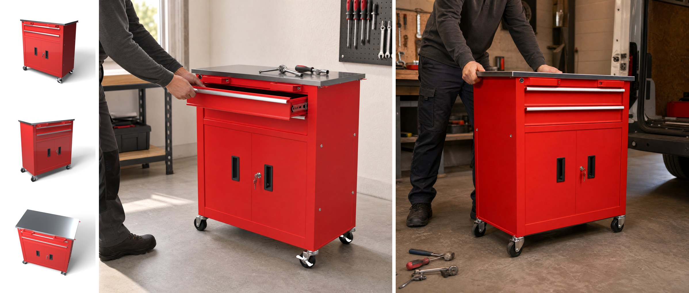
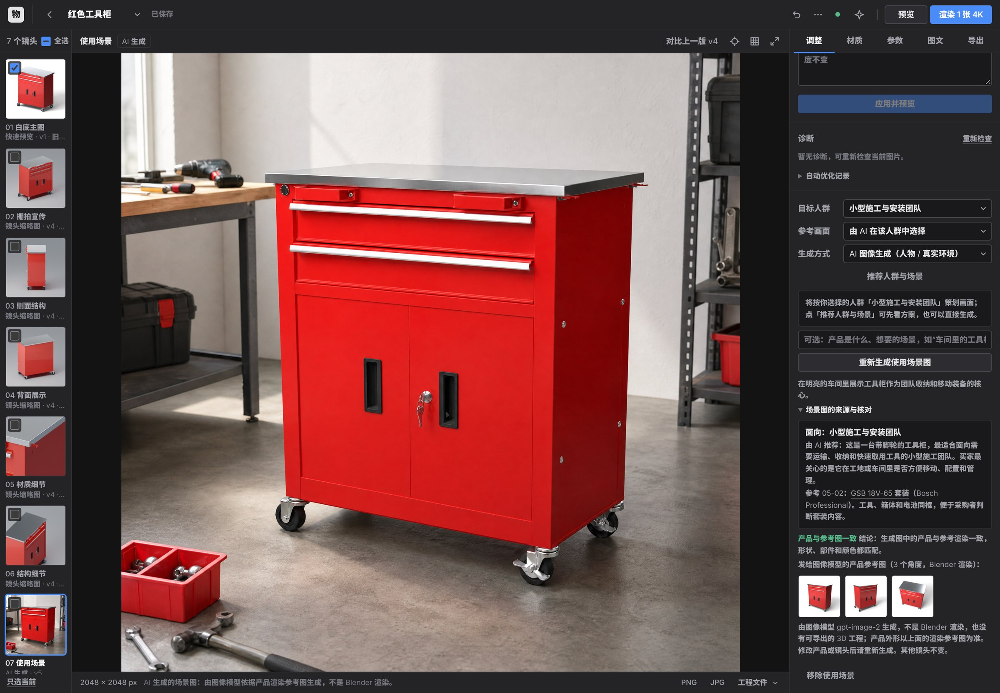

# 按人群策划的使用场景图 v25

日期：2026-11-13。

v22 的使用场景图回答“产品用在哪里”。这次更新先问“这张图给谁看”：应用读入一份参考库（八类工具买家，每类十条已发布画面的文字观察），由策划 agent 为当前产品推荐一类人群、一条可借鉴的参考和一张计划中的画面，你可以改人群、改参考、改生成方式。画面需要人物或真实环境（工地、车辆、草坪）时，交给 HAI 的图像模型生成：先用 Blender 把产品从目标角度渲染三张参考图，和画面描述一起发给图像模型，生成后再由视觉模型对照参考图核对产品有没有被改动。其余画面仍按 v22 用 3D 道具搭建。



左侧三张是 Blender 渲染的产品参考图（目标角度、另一侧前角、俯视），右侧两张是 `gpt-image-2` 生成的 2048 × 2048 场景图：第一张是自动推荐的“小型施工与安装团队”，第二张是手动改选“自雇技工与上门维修者”后重新生成的。两张都由运行中的应用按完整流程生成（通过它的 HTTP 接口提交），没有手工修改，核对结论均为“产品与参考图一致”。下面的界面截图是第三张，在浏览器里点击生成得到。



## 怎么用

「调整」面板下方的「使用场景」多了三个选择：

| 控件 | 作用 |
| --- | --- |
| 目标人群 | 「自动推荐」，或参考库中的八类人群之一 |
| 参考画面 | 选定人群后出现：由 AI 在该人群的十条参考中选，或你指定一条 |
| 生成方式 | 「自动」：画面含人物或需要真实环境时用图像模型，否则搭 3D 道具；也可以指定其中一种 |

1. 点「推荐人群与场景」，几秒后出现一张卡片：推荐的人群和理由、这类买家想知道什么、借鉴的参考（链接到原始页面）、计划的画面、将采用的生成方式。
2. 不满意就在上方改选，再点一次推荐；也可以不看推荐直接生成，应用会在生成时先完成策划。
3. 点「生成使用场景图」。完成后镜头栏多出「使用场景」镜头并自动显示。
4. AI 生成的图在画面上方标为「AI 生成」。「场景图的来源与核对」里列出面向的人群、借鉴的参考、核对结论，以及发给图像模型的三张产品参考图。

写在说明框里的话（“在工地上”“不要出现人”）优先于参考库。

## 处理流程

| 角色 | 负责 | 是否调用模型 |
| --- | --- | --- |
| 策划 | 读参考库的八类人群与八十条参考，判断这件产品的买家是谁，选一条可借鉴的参考，写出计划的画面；判断画面是否需要人物、是否需要真实环境；估计产品真实尺寸和合适的取景角度 | 已启用 AI 时 1 次调用（附产品渲染图）；否则按产品名称与部件名的规则 |
| 导演、采购、布景 | 与 v22 相同，用 3D 道具搭建场景。导演额外得知面向的人群、他们的购买问题和计划的画面 | 与 v22 相同 |
| 参考图渲染 | 用 Blender 把产品按当前材质渲染成 1024 px 白底图：目标角度、另一侧前角、俯视各一张 | 不调用。同一产品外观和角度只渲染一次，之后复用 |
| 图像生成 | 把三张参考图和画面描述发给图像模型，得到一张 2048 px 的场景图 | 1 次；核对不通过时再 1 次 |
| 核对 | 把生成图和三张参考图一起交给视觉模型，逐项比较产品 | 每张生成图 1 次 |

没有配置 AI 时流程照常完成：按规则推荐人群，用 3D 道具搭建场景。

### 什么时候用图像模型

策划给每张计划的画面两个判断：是否需要人或人的手，是否需要地面、一面背景墙和几件散放物品给不出的环境。任一为是，就由图像模型生成；都为否，就用 3D 道具搭建。「生成方式」可以覆盖这个判断。图像模型不可用时，含人物的画面改为 3D 道具场景并在卡片里说明；如果你明确指定了「AI 图像生成」，请求会被拒绝并说明原因。

### 怎样减少产品变形

图像模型每次都是重新画一整张图，所以产品走样是这类方法的主要风险。应用做了三件事：

- **多角度参考图。** 只给一张图时，模型看不到的面只能猜。本次验证中，只给一张参考图并用低画质时，工具柜的不锈钢台面被画成了黑色，背景还多了一块带字的招牌；给三张参考图并用标准画质后，四次生成都没有再出现。
- **固定的要求。** 请求里固定写明：按渲染图原样再现产品的形状、比例、每个部件的数量与位置、颜色与材质；不得重新设计、增减部件；产品上和画面里不得出现任何标志和文字；产品真实尺寸多大（来自你填写的尺寸、模型估计或按模型单位推断，只按品类猜的不写）。
- **生成后核对。** 视觉模型对照参考图检查五项：产品在画面中且只有一件、形状与比例一致、可见部件的数量与位置一致、颜色与表面一致、没有多出文字或标志。任一项不通过，就把具体差异写进请求再生成一次。一次任务最多生成两张；第二张仍不通过时，保留差异较少的一张，并在界面上列出差异，由你决定用不用。

这三件事降低风险，不能保证。核对用的视觉模型也会漏看，细小的文字、孔位的精确数量这类细节尤其如此。没有配置视觉模型或核对调用失败时，图片照常保留并标为「未自动核对」。

### 参考库与版权

参考库在 `references/eu-tool-ecommerce/`，是你提供的三份文件：`references.csv`（数据）、`index.html`（可浏览的索引，卡片里的「浏览参考库」打开它）、`README.md`（使用与版权说明）。

- 库里只有链接和文字观察，没有图片。应用不下载、不显示、不转发其中任何页面上的图片。
- 发给图像模型的图片只有本机渲染的产品图。发给它的文字里，参考库出版方的名称（Bosch、Fluke、STIHL、Husqvarna）会被移除，并要求画面中不出现品牌和文字。
- 策划 agent 能读到参考的标题、定位说明和观察，用来判断构图思路；交给导演的只有观察一句，不含型号。
- 参考库面向工具、工坊、工地与园林设备。其他品类（本次用帆布手提袋试过）会得到“没有对应的人群”，按通用场景处理；你仍可以手动指定一类人群。
- 换一份参考库：替换 `references.csv`，列为 `segment,title,url,locator,attribution,note`，`url` 必须是 `https://` 链接。人群的名称、购买问题、优先画面与表达重点在 `scene_audience.py` 的 `SEGMENTS` 中，`segment` 列要与其中的名称一致。

生成图里的人物是模型虚构的。各平台对 AI 生成图片的标注要求需自行确认；PNG 文件保留了图像模型写入的来源信息（C2PA），JPG 没有。

### 配置、时间与费用

使用 HAI 接口时不需要额外配置：图像模型沿用同一个 Access Token，走网关的 OpenAI 路由（`https://api.hai.network/openai/v1/images/edits`），默认模型 `gpt-image-2`。其他服务在 `.env` 中填写：

```
AI_IMAGE_BASE_URL=   OpenAI Images API 的基础地址
AI_IMAGE_MODEL=      图像模型 ID
AI_IMAGE_API_KEY=    该服务的 Key；只有地址与文字模型相同时才沿用文字模型的 Key
AI_IMAGE_QUALITY=    low / medium / high，默认 medium
AI_IMAGE_ENABLED=0   关闭图像生成
```

一次 AI 生成包含：1 次策划（文字加一张图）、1 到 2 次图像生成、1 到 2 次核对。本次实测的标准画质 2048 × 2048 生成，每张的用量是输入约 3,380 token（其中三张参考图 3,072）、输出 3,878 token；费用按你的服务商计价，应用不显示金额。应用不会自动更换图像模型，也不会在你没有点击生成时调用它。

时间主要花在参考图渲染上：本次验证环境没有 GPU，三张 1024 px 参考图共约 170 秒，图像生成约 40 秒，整个任务 214 秒。同一产品第二次生成复用参考图，整个任务 57 秒。

图像请求以流式方式接收，过程中会先收到草图。这样做是因为有些网关和代理会切断 30 秒内没有任何响应数据的请求（本次验证环境的出口代理就是如此）。

## 方案与输出中的记录

- `plan.scene_brief` 记录这张场景图给谁看、借鉴了哪条参考、怎么生成的；3D 道具场景和 AI 生成的场景都有。它和场景镜头一起保存为一个可撤销的版本。
- AI 生成的图是「使用场景」镜头的一条输出，`quality` 为 `generated`，带 `generated` 记录：模型、画质、尺寸、生成次数、核对结论、完整请求文字、token 用量、三张参考图的地址和角度、被放弃的那张图及其差异。
- 这个镜头不经 Blender 渲染：预览、4K 渲染和后台缩略图会跳过它；只选了它去渲染时，请求被拒绝并说明应在「使用场景」中重新生成。
- 策划和导演看到的始终是产品自己的渲染图，不会是上一张 AI 生成的场景图。

接口见 [API.md](API.md) 的「v25 按人群策划的使用场景图」。

## 边界与未验证

- **结果不可复现。** 同样的输入，图像模型每次给出不同的图，没有随机种子可以固定。
- **AI 生成的图不是渲染。** 没有 `.blend` 工程，不能导出 Blender 或 Cinema 4D 文件，改了镜头角度也不会跟着变。修改产品（材质、朝向、尺寸）之后，旧图仍然显示并注明它基于哪个方案版本，需要重新生成。
- **分辨率是 2048 px，不是 4K。**
- **生成期间修改方案，结果作废。** 与 3D 道具场景相同，任务执行期间方案被修改时任务失败、方案不变；已经发生的图像生成费用不会退回。
- **只在一件产品上试过。** 红色工具柜：摸清接口和验证调用代码时生成过几张，经应用完整流程生成了三张，其中两张含人物。其他形状的产品（细长的手持工具、透明件、带印刷文字的包装）变形风险更高，没有试过。
- **核对后重新生成没有在真实任务中触发。** 应用流程里的三次生成都一次通过。核对本身在两张真实图片上分别试过：台面被改黑的那张被判不通过并指出了台面颜色和多出的文字，正常的那张通过。“不通过后带着差异重做”这一步只由自动测试覆盖。
- **Claude 模型上的策划与核对没有实测。** 本次验证环境保存的 HAI 凭据只能用于网关的 OpenAI 路由，所以策划、导演、采购和核对都用 `gpt-5.4-mini` 实测；应用默认的 Anthropic 路由上，这些请求的格式由脚本代替的模型回复测试。
- **没有测试的组合。** 在 AI 生成的场景图上叠加图文图层（图层的部件引线按 3D 镜头计算，和生成图里产品的位置不一定对应）；把它放进电商导出图集；4:3 和 3:4 画幅经应用流程生成（接口本身试过 2048 × 1536）；GPU 渲染参考图；Windows 与 macOS。
- **参考库只有一份。** 八类人群都是欧洲工具买家，来源集中在四个品牌的英国官网，见参考库自己的 README。
- **推荐会变。** 同一件产品两次请求，策划写出的画面可能不同，有时含人物、有时不含，生成方式也随之不同。卡片显示的就是接下来会执行的那一份。

## 验证

环境：Linux，4 核 CPU，无 GPU；Python 3.13 与 Blender 5.0.1（`bpy` 模块）；HAI 网关为真实联网访问，文字与视觉模型 `gpt-5.4-mini-2026-03-17`，图像模型 `gpt-image-2`。

**自动测试。**

| 范围 | 结果 |
| --- | --- |
| `python -m unittest discover -s tests`，Blender 可用 | 1180 项通过 |
| `tests/test_scene_audience.py`（本次新增 43 项） | 参考库读取与安全过滤、按名称推荐、方案记录校验、图像模型配置与 Key 不跨主机、图像请求的组成与流式/非流式响应解析、错误信息不回显上游内容、取消、核对的三种结论、不通过后带差异重做且最多两次、策划（脚本代替的模型回复、用户选择优先、越界值收敛、失败回退规则）、任务流程（保存为一个版本、输出记录、Blender 跳过该镜头、推荐复用、失败不改方案、移除）、接口 |
| `tests/test_scene_images.py`（原有 35 项，其中 7 项在真实 Blender 中运行） | 通过 |
| `node --test tests/test_ui_state.cjs`（本次新增 4 项，jsdom 31.0.0） | 219 项通过 |
| `node --test tests/test_viewport_math.mjs` | 9 项通过 |

测试在开发中抓到三个真实缺陷，均已修复：取消图像生成被当成“连接中断”报告；参考库接口加载失败时界面不停重试；自动推荐把上一张 AI 生成的场景图当成产品图来看，推荐理由因此被带偏。

**真实流程。** 启动应用，上传 `validation/cabinet-material-check.zip`（项目名“红色工具柜”）：

| 步骤 | 结果 |
| --- | --- |
| 推荐（自动） | 5.8 秒；人群“小型施工与安装团队”，参考 05-02，画面含人物，方式为 AI 图像生成；估计产品最长边 740 mm（模型实测 738） |
| 生成（自动，经 HTTP 接口提交） | 214 秒：渲染三张参考图、生成 1 张、核对通过。保存为方案版本 2，镜头「使用场景」，输出 2048 × 2048 |
| 改选人群为“进阶爱好者与个人工坊用户”，方式指定 3D 道具场景 | 策划按所选人群重新规划；导演与采购由模型完成，放入 5 件道具（台面 2、旁边 2、后方 1）；版本 3，自动出预览 |
| 改选人群为“自雇技工与上门维修者”，方式自动（经 HTTP 接口提交） | 57 秒：参考图复用，生成 1 张，核对通过；版本 4 |
| 浏览器（Chromium）：点「推荐人群与场景」，改选人群与方式 | 推荐 7 秒返回并显示卡片；指定方式后卡片注明“你指定”；改选其他人群后卡片换成“将按你选择的人群策划”的提示，并出现参考画面选择 |
| 浏览器：选“小型施工与安装团队”、方式指定 AI 图像生成，点「重新生成使用场景图」 | 48 秒完成；界面依次显示“图像模型正在生成场景”“已返回草图”“核对产品是否与参考图一致”；完成后自动切到「使用场景」镜头，标为“AI 生成 · v5”，核对通过，三张参考图缩略图和 PNG / JPG 下载可用；控制台无报错 |
| 上传 `samples/canvas-leather-tote.glb` 后推荐 | 5.3 秒；“没有对应的人群”，按通用 3D 场景处理 |

**没有验证的。** 见上一节。
