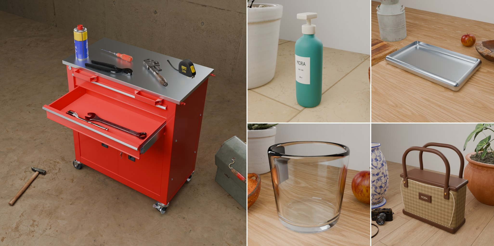
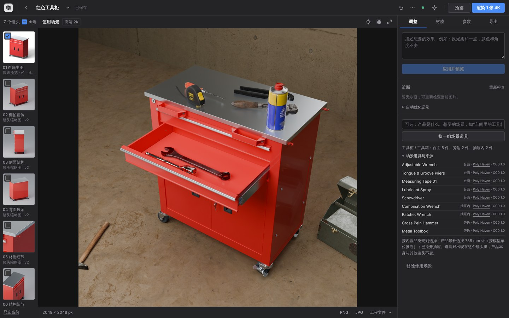

# 使用场景图 v22

日期：2026-11-13。

白底主图说明产品长什么样，使用场景图说明它用在哪里。本次更新让应用自己完成这件事：识别产品是什么，从网上的现成模型库里搜集它在真实使用中会出现的东西（工具柜配扳手、钳子、螺丝刀），按真实尺寸放到台面上、拉开的抽屉里和旁边，换上相应的地面与背景，然后出一张场景图。

五张图都是本次验证中的真实渲染，道具、摆放、镜头全部由程序决定，没有手工调整。左图为 2048 px、160 采样，右侧四张为 512 px 预览。产品模型：`validation/cabinet-material-check.zip` 和 `samples/` 中的四个示例（按压瓶、金属托盘、玻璃杯、手提袋）。工具柜的原尺寸图见 [validation/v22-scene-cabinet-2k.jpg](validation/v22-scene-cabinet-2k.jpg)。

## 怎么用

「调整」面板下方新增一组控件：

1. 可选地写一句说明（“车间里的工具柜”“放在浴室台面上”）。不写也可以，应用会根据项目名称、品类和部件名判断。
2. 点击「生成使用场景图」。几秒到几十秒后，镜头栏里多出一个「使用场景」镜头，并自动出一张预览。
3. 不满意就点「换一组场景道具」，摆放会重新随机；「场景道具与来源」里列出每件道具、它放在哪里、来源链接和许可。「移除使用场景」把它整个拿掉。

场景是方案里的一个普通镜头：可以单独预览、渲染 4K、导出，也可以用「撤销」回到没有场景的版本。白底主图和其他镜头不受影响，道具只出现在「使用场景」这一个镜头里。

## 处理流程

| 角色 | 负责 | 是否调用模型 |
| --- | --- | --- |
| 导演 | 判断产品是什么、用在哪种环境、真实尺寸大约多少，列出 3–9 件想要的道具，以及每件放在台面、抽屉内、旁边还是后方；是否需要拉开抽屉 | 已启用 AI 时 1 次调用（附当前渲染图）；否则使用内置品类规则 |
| 采购 | 为每件道具在 Poly Haven 模型目录中检索候选，只留下与产品真实尺寸相称的，挑出一件 | 导演由 AI 完成时再调用 1 次从候选中选择；否则取检索结果 |
| 布景 | 在 Blender 中导入产品和道具，实测台面与抽屉内腔，拉开抽屉，逐件摆放并保证互不重叠；确定镜头 | 不调用 |
| 记录 | 把放入的道具、未放入的道具及原因、尺寸依据写入方案 | 不调用 |

没有配置 AI 或调用失败时，流程照常完成，只是由规则代替导演与采购。内置规则覆盖八类：

| 品类 | 环境 | 道具 |
| --- | --- | --- |
| 工具柜 / 工具箱 | 车间：水泥地、混凝土墙 | 台面：活动扳手、钳子、卷尺、润滑剂喷罐；抽屉内：螺丝刀、两用扳手、棘轮扳手；旁边：锤子、铁皮工具箱 |
| 洗护 / 美妆 | 浴室：大理石台面 | 后方：盆栽、陶瓷花瓶、藤篮；旁边：木碗 |
| 餐厨用品 | 厨房：橡木台面 | 后方：水壶、砧板、盆栽；旁边：苹果、木碗 |
| 箱包 | 居室：木地板 | 旁边：书、相机；后方：盆栽、花瓶 |
| 园艺 / 户外 | 庭院：地砖、木板墙 | 旁边：洒水壶、盆栽、铲子 |
| 数码 / 办公 | 办公桌：橡木桌面 | 旁边：书、笔记本；后方：盆栽 |
| 家具 | 居室：木地板 | 台面：书、花瓶；后方：盆栽；旁边：藤篮 |
| 其他（通用陈列） | 浅色灰泥 | 后方：盆栽；旁边：书、花瓶 |

品类按项目名称、品类、材质说明和部件名中的词判断，词越长权重越高（“工具柜”压过“柜”）。名称里什么都没写时再看结构：既有抽屉又有脚轮的是工具车，有抽屉或柜门的是家具。

### 道具从哪里来

全部来自 [Poly Haven](https://polyhaven.com/models) 的模型目录，许可为 [CC0](https://polyhaven.com/license)：可商用、无需署名。应用只访问两个地址：`api.polyhaven.com`（目录与文件清单）和 `dl.polyhaven.org`（文件）。本次核对时目录中有 522 个模型，其中手工具 70 个；另有 869 套贴图用于地面与墙面。

下载的每个文件都按目录给出的大小和 MD5 校验；只接受 glTF 及其引用的贴图；文件名不能带路径；单个文件上限 24 MB，一件模型合计 64 MB，面数上限 40 万。下载内容保存在 `data/props_cache/`，同一件道具只下载一次，用到的再复制进项目自己的 `props/` 目录。每件道具在方案中记录资源编号、名称、来源页面和许可。

应用不会下载或执行任何脚本，也不会访问其他网站。

### 尺寸

道具与产品的大小比例对不对，是场景图像不像的关键。Poly Haven 的模型按真实尺寸制作（米），但上传的产品模型单位未知，因此需要先确定产品的真实尺寸，依次取：

1. 你在「参数」中填写的产品尺寸；
2. AI 导演的估计；
3. 按模型自身数值推断：在毫米、厘米、英寸、米四种单位里，取使它落在该品类合理范围内的那一种；
4. 品类的常见尺寸。

采用了哪一种会写在「场景道具与来源」里，例如“产品最长边按 738 mm 计（按模型单位推断）”。数值不对时填写真实尺寸再重新生成即可。

道具按摆放位置限制相对大小：台面和抽屉里的不超过产品最长边的 75%，旁边的不超过 90%，后方的可以比产品高（到 1.8 倍），太小看不见的也不选。

### 摆放

位置不是凭感觉估的，而是在 Blender 里量出来的：

- **台面**：从上往下打一组射线，找到产品顶部最高的一块平面，道具的落脚范围必须整个落在这块平面上。
- **抽屉**：按部件名找到抽屉（需朝向镜头一侧），连同抽屉里的隔板、把手一起向外拉出约 72% 的深度，再用同样的方法量出抽屉内腔的底面。抽屉是实心的或量不到内腔时，不拉开，这件道具改放台面。
- **旁边 / 后方**：放在地面上，位置在镜头确定之后才选（见下节）。
- 每件道具按自身形状决定姿态：手工具平放，瓶罐直立；朝向带一点随机，避免摆得像陈列架。任何两件道具、道具与产品之间都不会重叠。

放不下的道具不会硬塞：原因记为“没有平整台面”“没有可打开的抽屉”“没有合适的位置”等，其余照常完成。

布置只计算一次，结果以每件道具的变换矩阵保存在方案里。之后的预览、4K 渲染、导出工程都按这份记录重建，画面一致。如果之后改了产品的朝向或姿态，旧的摆放不再适用，渲染会忽略场景并提示重新生成。

### 镜头：产品是主角

场景图里产品必须一眼可见，道具只是环境。具体做法：

- 镜头只对准产品，以及放在它上面、里面的东西，留边约 10%。旁边和后方的道具**不参与取景**。
- 地面上的道具在镜头确定之后才摆放，位置选在画面边缘，允许被画框裁掉一部分；每件占画面的比例有上限（约 14%），不得挡住产品，也不得与产品在画面中大面积重叠。找不到这样的位置就不放。
- 拉开抽屉时镜头抬高到约 36°，能看进抽屉里；否则沿用主图的方位，仰角 20–30°。
- 55 mm 透视镜头，浅景深，对焦在产品上：前后的道具和墙面略微虚化。
- 环境光比棚拍主光弱，产品仍由展示级布光照亮，是画面里最亮、最清晰的东西。

## 边界与未验证

- **没有在真实的大模型接口上运行。** 验证环境没有 API Key。AI 导演与采购的请求格式、返回校验和失败回退由脚本代替的模型回复测试；它在真实模型上选得好不好，本次没有证据。离线规则路径是完整验证过的。
- **道具库有限。** Poly Haven 的模型以家居、工具、植物、食物为主。本次核对时目录里没有马克杯、毛巾、鞋这类常见物件；AI 导演想要而目录里没有的，会记为“模型库中没有合适的”并跳过。应用不从其他网站抓取模型。
- **产品识别靠文字。** 离线规则只看项目名称、品类和部件名。名称是 `model_final_v3`、部件名是 `Object_12` 的模型会落入“通用陈列”。写一句说明，或启用 AI，都可以纠正。
- **抽屉靠部件名识别。** 部件名里没有“抽屉 / drawer”的模型不会被拉开；合并成一个网格的模型也无法拉开。门、盖子、翻盖目前不会打开。
- **尺寸推断可能出错。** 模型没有单位信息时，应用在毫米、厘米、英寸、米中选一个让尺寸落在该品类合理范围内的；有多种可能时取最接近范围中间的。品类判断错了，或者产品比同类大得多、小得多时，道具的比例就会不对。填写真实尺寸最可靠。
- **只有一个场景镜头，产品放在地面或台面上。** 不支持挂墙、手持、人物、多个产品同框。
- **验证硬件。** 所有渲染在 4 核 CPU 上以 Blender 5.0.1（`bpy` 模块）完成，没有 GPU。

## 验证

环境：Linux，4 核 CPU，无 GPU；Python 3.13（应用）与 Blender 5.0.1（`bpy` 模块，通过与 `blender` 命令行兼容的启动器调用）；Poly Haven 为真实联网访问。

**自动测试。**

| 范围 | 结果 |
| --- | --- |
| `python -m unittest discover -s tests`，Blender 可用 | 1111 项通过 |
| 同上，不提供 Blender | 1111 项，通过 1031，跳过 80 |
| `tests/test_scene_images.py`（本次新增 35 项） | 目录检索与尺寸筛选、下载地址与文件校验、数据约定、导演与采购（含脚本代替的模型回复与失败回退）、任务流程（版本冲突、重复提交、重新生成、移除、接口与文件位置校验）。其中 7 项在真实 Blender 中对一个合成的带抽屉柜体运行：按名称找到抽屉并朝镜头一侧拉出；道具按真实尺寸落在抽屉内、台面和旁边；实心的“抽屉”不被拉开，工具改放台面；无法导入的道具被记录而其余照常；镜头抬高看进抽屉；渲染按记录重建布置且道具不计入产品；其他镜头不受影响，模型转向后忽略旧布置并给出提示 |
| `node --test tests/test_ui_state.cjs`（本次新增 4 项） | 204 项子测试全部通过。该文件在本次改动之前的 `main` 上就以退出码 1 结束：已有测试 “AI apply first previews the saved live camera…” 结束后仍有异步操作，被 Node 记为文件级失败；与本次改动无关，未在本次处理 |
| `node --test tests/test_viewport_math.mjs` | 9 项通过 |

前端测试在本次开发中抓到一个真实缺陷：场景请求体被编码了两次，服务端会拒绝。已修复，并在下面的真实浏览器流程中确认。

**真实应用流程（浏览器）。** 清空 `data/` 后启动应用，上传 `validation/cabinet-material-check.zip`（项目名“红色工具柜”，未填写说明，未启用 AI），在 Chromium 中打开项目并点击「生成使用场景图」：

| 步骤 | 结果 |
| --- | --- |
| 请求 | `POST /scene` 返回 202；后台高清图任务按设计让路 |
| 场景任务 | 14.8 秒完成，其中包括首次联网下载 9 个模型和 2 套贴图（共约 30 MB）；识别为“工具柜 / 工具箱”，尺寸按模型单位推断为 738 mm |
| 布置 | 台面 5 件、抽屉内 2 件、旁边 2 件，拉开了一层抽屉；9 件全部放入 |
| 方案 | 保存为版本 2，新增镜头「使用场景」，界面自动切换到该镜头 |
| 预览 | 请求后 24.7 秒出图（512 px） |
| 后台高清图 | 预览完成后自动提交，548 秒渲染完成，2048 × 2048，无警告（期间同一台机器上还在运行测试） |
| 移除与撤销 | 点击「移除使用场景」：版本 3，镜头恢复为原来的 6 个，画面回到白底主图；点击撤销：版本 4，场景镜头与 9 件道具恢复 |
| 浏览器控制台 | 无报错 |

**其他产品（规则路径，512 px 预览）。** 直接调用同一套 `scene_stylist.build` 与渲染：

| 产品 | 识别 | 尺寸依据 | 放入 | 未放入 | 布置 / 渲染 |
| --- | --- | --- | --- | --- | --- |
| 哑光按压瓶 | 洗护 / 美妆，浴室 | 品类常见尺寸 150 mm | 盆栽（后方）、木碗（旁边） | 花瓶、藤篮：没有尺寸相称的 | 2.0 秒 / 8.3 秒 |
| 拉丝金属托盘 | 餐厨用品，厨房 | 模型单位 470 mm | 水壶、苹果、砧板、木碗（后方） | 盆栽：没有合适的位置 | 2.3 秒 / 7.2 秒 |
| 厚玻璃杯 | 餐厨用品，厨房 | 模型单位 150 mm | 苹果、盆栽（后方）、木碗（旁边） | 水壶、砧板：没有尺寸相称的 | 1.5 秒 / 14.1 秒 |
| 帆布皮革手提袋 | 箱包，居室 | 模型单位 476 mm | 盆栽、花瓶（后方）、相机（旁边） | 书：没有尺寸相称的 | 2.3 秒 / 8.6 秒 |

这四次运行使用已缓存的道具文件，所以布置时间不含下载。按压瓶的尺寸没有被单位推断采用（示例模型的数值不落在洗护品的范围内），退到了品类常见尺寸；画面比例看起来合理，但这正是“填写真实尺寸最可靠”的情形。按压瓶一图中，放在旁边的木碗被后方的花盆挡住，画面里看不到：道具之间在画面中的相互遮挡目前不检查。

工具柜的 2K 场景图（本页第一张的左图）单独渲染，用时 605 秒。

**没有验证的。** 真实大模型接口（见上节）；GPU 渲染；Windows 与 macOS；4K 画质的场景镜头（流程与 2K 相同，只是分辨率与采样不同，未实际渲染）；带场景的镜头导出为 Cinema 4D 工程。
