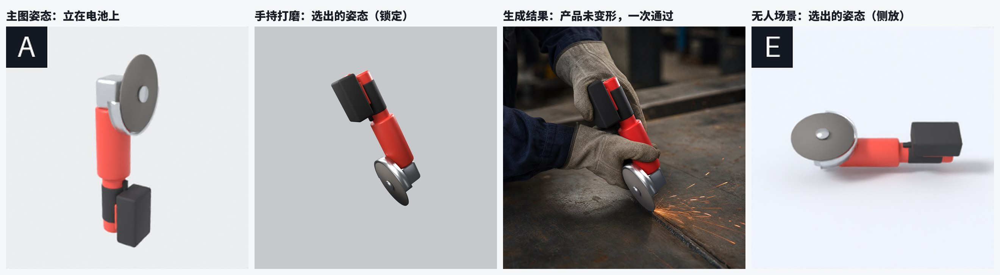
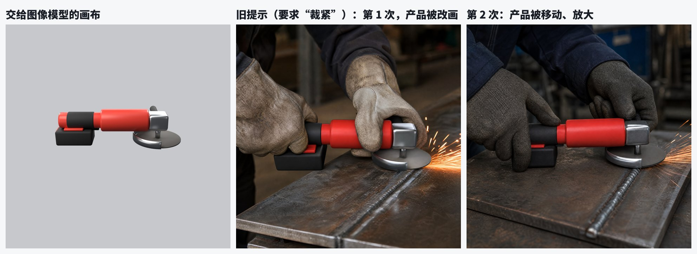

# 使用场景里的产品姿态 v31

| 内容 | 结果 |
| --- | --- |
| AI 生成的使用场景图 | 产品不再沿用主图姿态，而是按画面里的使用方式摆放：手持打磨时倾斜、刀片朝向工件，放在台面上时侧放 |
| 姿态从哪里来 | 由视觉模型在产品模型的真实渲染里挑选，所以一定是模型真正能做出的姿态 |
| 产品会不会变形 | 和 v30 一样：选出的姿态渲染后锁定在画面里，用遮罩保护，生成后测量是否被移动或改画，不合格就重画 |
| 可以关掉 | 场景面板新增「产品姿态」：按使用场景设计（默认）／保持主图姿态 |
| 顺带修好 | 手部特写的提示里有“裁紧画面”，会让图像模型放大、重画产品；已改为“画面已定，不得放大或重新构图” |

## 一、做法

在生成场景图之前，多了一个“设计姿态”的步骤。

**有人手持（手部特写或包含人物）时，分两轮：**

1. **第一轮：哪一面朝上。** 以主图姿态为起点，把产品朝六个方向放（原样、倒置、顶部朝左、顶部朝右、顶部朝向镜头、顶部背向镜头），每个方向再从两侧各看一次，共 12 个候选。每个候选都从场景相机的角度用 Blender 渲染，排成一张带字母的图。
2. **第二轮：微调。** 以第一轮选中的姿态为起点，再给出 10 个小变化：转到另一面、向左右倾斜 25° 和 50°、顶部前倾或后仰 30°、原地左右转 35°。

视觉模型每一轮都要依次说明：

- 产品是什么，哪个部件干活（磨片、钻头、钳口……）；
- 场景里这件产品怎么拿、哪个部件从哪个方向接触工件；
- 每个候选里干活的部件朝向哪里、合不合适；
- 最后才选。

选定后，它还要写一句给图像模型看的姿态说明，以及干活的部件在画面里的位置，例如：

> 磨片在右下方，朝下压在焊缝上。

**无人的场景只有一轮。** 同样的 12 个候选放在地面上渲染，并附上每个候选的测量结果：平放还是竖立、哪些部件着地、会不会倒。产品放下后不会再微调，因为倾斜着放会倒。

**选定之后：**

- **渲染与锁定：** 按这个姿态渲染产品，放进画面、用遮罩保护，和 v30 完全相同。
- **提示词：** 新增「THE POSE」一段，告诉图像模型产品已经摆好，以及它和工件的接触位置。手持时，要求手握在自然的位置；放置时，要求产品稳稳放在台面上、带影子。
- **留出空间：** 工件在产品下方（或左、右、上方）时，产品在画面里往反方向挪 7%，给工件和手留出位置。

**什么时候保持原姿态：**

- 选了「保持主图姿态」；
- 没有配置视觉模型；
- 渲染或视觉模型出错。

这一步出错不会让场景生成失败。

## 二、实测（HAI，gpt-5.4-mini 选姿态，gpt-image-2 medium 生成）

测试用的是自己搭的角磨机（主图姿态是立在电池上）。

| 场景 | 选出的姿态 | 用时 |
| --- | --- | --- |
| 手部特写，打磨钢板上的焊缝（第 1 次） | 第一轮：机身水平、磨片朝下；第二轮：保持 | 姿态 27 秒 |
| 同一场景（第 2 次） | 第一轮同上；第二轮：向左倾斜 25°，磨片在右下方 | 姿态 27 秒（第一轮渲染复用缓存），全程 110 秒 |
| 无人，放在家里的工作台上 | 侧放，磨片朝左 | 15 秒 |

第 2 次的生成结果（上图第三张）一次通过：

- **程序测量：** 产品保持原位（kept），匹配度 0.65，高于 v30 割管器测试的 0.56；
- **视觉核对：** 产品形状、部件、颜色一致，手部特写里没有出现人脸。

两次选出的姿态不同，因为视觉模型每次的回答会有变化；两种都是合理的持握方式。

**第 1 次生成失败了，原因是提示词，不是姿态。** 手部特写的规则里写着“围绕产品、手和工件裁紧画面”。画布上产品的位置和大小已经定好，这句话却让图像模型放大、重新构图：

- 第一次：产品被放大约 24%，侧把手消失，电池变大；
- 第二次：产品被移动。

测量都发现了，状态分别是 changed 和 moved，但两次都不合格。这条规则写于产品锁定之前，现在改为：

> 画面已经确定，不得放大、裁切、扩大或重新构图；手可以握住并遮住产品的一小部分，其余仍在画面中的部分保持原样。

改后再试（即上面的第 2 次）一次通过。

**无人场景最初的做法也改过。** 原本先测量每个方向“会不会倒”，只给视觉模型看稳的方向。但测量只把最低的几个点当作支撑：角磨机侧放时，实际会靠在电池和磨片护罩两处，测量却判为“会倒”。结果只剩原姿态可选，模型只能让它继续立着。

现在 12 个候选都给模型看，测量结果作为说明附上。只有重心远在支撑之外（超过 15°）时才标为“会倒”。改后，模型选择了侧放。

## 三、时间与费用

- **手持场景：** 多两次 Blender 渲染（每张 12 个或 10 个小图，各约 5 到 10 秒）和两次视觉模型调用，共约 25 到 30 秒；
- **无人场景：** 一次渲染和一次视觉调用，约 15 秒；
- **缓存：** 同一产品、同一相机角度的候选渲染会复用；
- **图像生成：** 次数不变。

## 接口

见 [API.md](API.md) 的「v31」一节。

## 验证

- **Python 测试：** 全部通过。新增 `tests/test_scene_pose.py`（13 项），内容包括：
  - 候选姿态在画面里的方向；
  - 两轮选择、放置场景附带测量；
  - 各种退回原姿态的情况；
  - 取消不被吞掉、渲染复用；
  - 产品为工件让位。
- **场景测试新增 4 项：**
  - 姿态写入渲染方案和提示词；
  - 保持原姿态时与以前一致；
  - 姿态选项从请求传到生成；
  - 手部规则不再要求裁紧。
- **界面测试 238 项通过：**
  - 新增「产品姿态」选项的发送、隐藏、锁定；
  - 场景结果里显示姿态说明和候选姿态图链接。
- **真实服务：** 姿态选择 4 次，生成 2 次，见第二节。

## 边界与未验证

- **姿态是离散的候选。** 六个朝向、两侧，再加十种微调；更细的角度做不到，例如“磨片与工件成 15°”。
- **姿态在生成前就定下了。** 图像模型不能让手换个握法去转动产品。产品被锁定，手只能配合它画。
- **视觉模型的选择会有变化。** 不满意可以重新生成，或选「保持主图姿态」。
- **只测了一件产品。** 角磨机（有部件名称的自搭模型）上测了手持和放置两种场景。割管器、扳手、柜子等其他产品没有用真实服务测过。
- **图像模型对遮罩的遵守并不绝对。** 改正提示词后一次通过，但只有这一次样本。产品被改动时仍然靠测量发现、重画；两次都不合格时，仍交付差异最小的一张，并标明问题。
- **3D 道具场景不受影响。** 它仍按方案里的姿态摆放。
