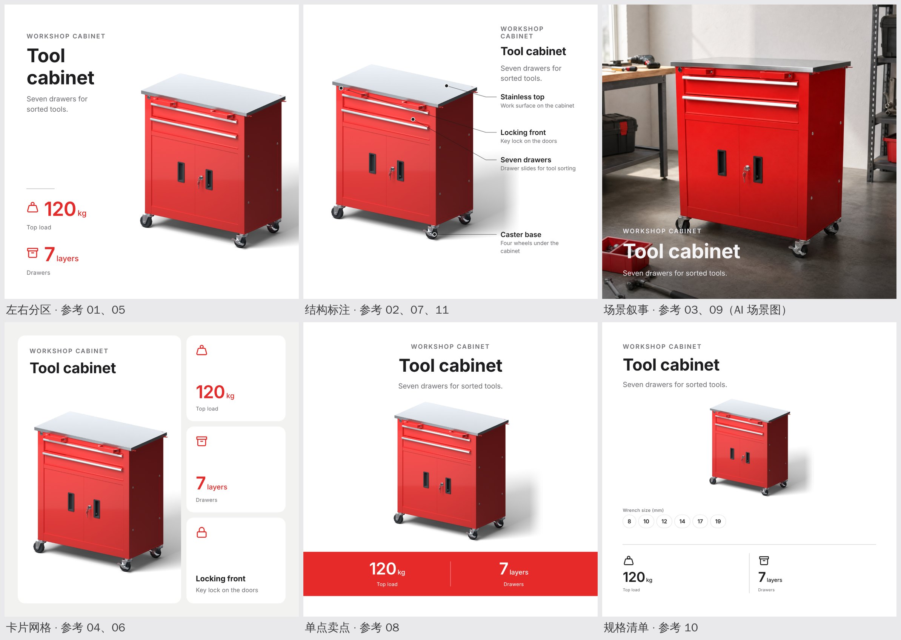
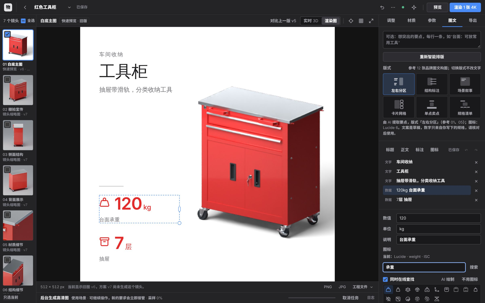
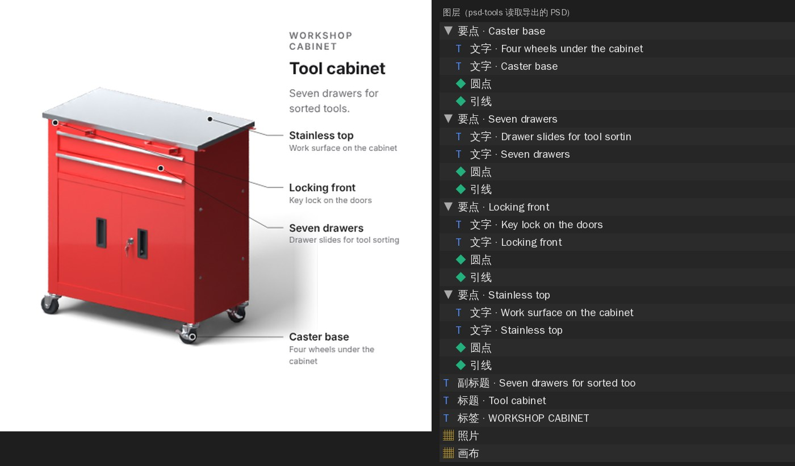
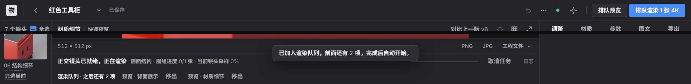
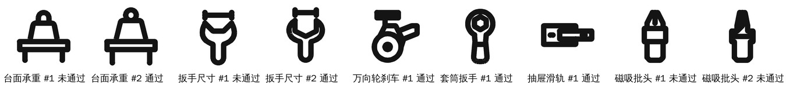

# 渲染队列、图文版式与图标 agent v26

日期：2026-11-14。

这次更新回应三件事。

**渲染队列。** 以前有渲染任务正在执行时请求使用场景图，会得到“已有渲染任务开始执行，本次场景未保存，请稍后重试”，已经搭好的场景随之丢失。现在任务按顺序排队。

**图文改为成套版式。** v23/v24 的图文是把卡片叠在整张渲染图的空处，用户觉得杂乱、档次低。现在改为参照 HOTO、Fanttik、Wera 和 Bosch Professional 的 12 张品牌图文，提供六种版式：先给文字留出位置，再把产品放进剩下的空间。

**图标 agent。** 每个要点、数字和规格都配一个图标。先在随应用附带的开源图标库里查找，必要时在线查找；都没有合适的，由 AI 绘制，再由视觉模型核对。比如“扳手尺寸”配的是扳手，不是尺子。

之后又按反馈补了两点：

- **画面文字默认是英文**，可以改选中文。说明框里可以写中文，AI 会把它译成英文，你写的数字和尺寸列表原样保留。
- **可以导出 Photoshop 工程（PSD）。** 每段文字都是可以编辑的文字图层；图标、引线、圆点、尺寸底和卡片都是矢量形状图层；照片和画布各占一层，并按元素分组。

上图中，五张来自同一张 2048 px 白底主图。英文文字由 AI 看图写成（模型 `gpt-5.4-mini`，经 HAI 接口），说明框里写的是中文；图标由图标 agent 从开源图标库中选出。数字 120 kg、7 层和扳手尺寸 8–19 mm 都来自用户写的规格，没有一个是模型自己给的。「场景叙事」那张用的是 v25 生成的 AI 场景图：标题放在照片最安静的一侧，底部加一层渐变，保证文字可读。

## 怎么用

### 图文

1. 先生成这个镜头的预览或 4K 图，再打开右侧「图文」。说明框里可以逐行写要点和规格，例如“台面承重 120 kg”“扳手尺寸：8、10、12、14、17、19 mm”。只有写在这里的数字（以及项目里已有的尺寸）会出现在图上。
   「文字语言」默认 English，可以改成中文。改选后会记住，下次新建图文时沿用。选英文时，中文要点由 AI 译成英文，数字不变；没有配置 AI 时无法翻译，标题沿用项目名称，你写的中文要点保持原文，状态行会提示你在画面上改成英文。
2. 点「智能排版关键信息」。AI 看图写出标签、标题、要点和数字，推荐一种版式，并给每一项配图标；没有配置 AI 时按部件名称和你写的规格生成。状态行会说明：用了哪种版式、对应哪几张参考、几处指向了部件、图标来自哪里，以及这个版式没有显示的内容。
3. 在「版式」里点另一种版式，同一组文字立刻重新排版。这一步不调用模型，可以撤销。你改过的文字会跟着带到新版式里。
4. 选中画面上的元素后，右侧按类型显示可改的字段：文字；数字的「数值 / 单位 / 说明」；规格行的尺寸列表；要点或数字的「图标」。
5. 「图标」栏里可以输入中文或英文查找（勾选「同时在线查找」时也会在线查找），点一个即可替换。「AI 绘制」会画一个新图标，画好后标出是否通过核对；「不用图标」可以去掉图标。
6. 导出：PNG / JPG 按渲染图的原尺寸合成。SVG 内含画布、照片和矢量文字，文字和图标在设计软件里仍然可以编辑。「仅图层」导出透明的文字层。**PSD** 导出 Photoshop 工程，结构见下一节。

### Photoshop 工程（PSD）

导出的 PSD 从下到上依次是：

- **画布、照片：** 各占一个像素图层。照片层只覆盖它所在的框，可以单独移动、缩放或替换。
- **每个元素一个组：** 组名写着它说的内容，例如「要点 · Stainless top」「数据 · 120 kg Top load」。组里有：
  - **文字图层：** 每段文字一个，可以直接改字。字号、颜色、字距、行距和对齐与画面一致。英文用 Inter，中文用思源黑体（Source Han Sans SC），粗细与画面一致。
  - **形状图层：** 图标、引线、圆点、细线、卡片、色带和尺寸底都是矢量形状，放大不会模糊。图标的形状图层名写着来源与授权，例如「图标 · weight（Lucide · ISC）」。
  - **像素图层：** 只有渐变遮罩是像素图层。
- **合成图：** 文件里存一张合成图，供看图软件和预览使用。它与 PNG 导出逐像素相同。

每个文字图层都附带浏览器渲染的画面，所以在别的看图软件里也能正确显示。由于写入方式所限，Photoshop 打开时会提示更新文字图层，请选「更新」，Photoshop 会用自己的排版引擎重新排版。电脑上没有 Inter 或思源黑体时，Photoshop 会提示替换字体：Inter 可以从 rsms.me/inter 免费下载（SIL OFL）。PSD 由浏览器生成，使用随附的 ag-psd 34.2.0（MIT，`static/vendor/ag-psd/`，由 `scripts/vendor_psd_writer.py` 下载并按 npm 公布的哈希校验）。

旧版（v23/v24）图层没有版式，不能导出 PSD，请先「重新智能排版」。

### 六种版式

| 版式 | 参考 | 画法 |
|---|---|---|
| 左右分区 | 01、05 | 一侧文字栏放标题，下接一到两个大数字或三条要点；另一侧放产品 |
| 结构标注 | 02、07、11 | 产品在一侧，另一侧最多四条说明对齐成一列，用细线连到它所说的部件 |
| 场景叙事 | 03、09 | 标题放在场景照片最安静的一侧；找不到安静区域时，标题单独占上方一条，照片在下方 |
| 卡片网格 | 04、06 | 产品放在大卡片里，最多三张小卡片各写一个数字或要点 |
| 单点卖点 | 08 | 标题、产品，下方一条品牌色带放一到两个关键数字 |
| 规格清单 | 10 | 产品下方是一排尺寸（如扳手 8–19 mm）和一行规格 |

应用会按内容和画面推荐版式：场景照片推荐场景叙事；有两项以上规格，或一组尺寸时推荐规格清单；有关键数字时推荐单点卖点；有两个以上能指向的部件时推荐结构标注；其他情况推荐左右分区。参考 12（系列对照）需要并排比较两组产品，而一张合成图只有一张渲染图，所以没有对应版式。参考链接、构图说明和注意事项见 [references/tool-layout-12/](references/tool-layout-12/README.md)。

### 渲染队列

- 渲染进行中，「预览」和「渲染 4K」按钮仍然可用，文字改为「排队预览」「排队渲染 N 张 4K」。点击后任务加入队列，提示“已加入渲染队列，前面还有 N 项，完成后自动开始”。同样的请求不会重复排队。
- 队列显示在当前任务下方，每项都有「移出」。
- 请求使用场景图时，渲染进行中也会接受。场景照常搭建（或由图像模型生成），搭好后，如果前面还有可能修改方案的任务（预览会在结束时提交自动修正、模型分析、材质检查），就等这些任务结束后再保存，状态显示“场景已就绪，排队等待保存：前面还有 N 项…”。4K 渲染只增加图片，不会让场景等待。保存后场景的预览排在队尾。
- 等待期间方案若有变化（例如你调亮了曝光），场景会合并到最新方案上；你的修改保留，场景只加上它自己的镜头和道具。如果变化会影响 AI 生成的图片（换了材质，或镜头数已到上限），这张图不会被套到改动后的产品上，任务会说明原因。等待中的场景可以取消。

## 版式遵守的规则

- **先排文字，再放产品。** 每个版式先确定文字区域，再把产品放进剩下的空间，所以文字不会压在产品上。结构标注里的说明按所指部件从上到下排列，引线不交叉。
- **产品永远完整。** 照片可以裁切，但不会扩边，也不会裁掉产品的任何部分。照片填不满分配给它的区域时，会作为一张带圆角的图片单独放在画面里。
- **只有平整的影棚背景才无缝延伸。** 无缝延伸的条件是：画面边缘一圈的颜色足够一致（85% 的边缘点与中位亮度相差不到 0.045），背景要么够亮、要么够暗。这时渲染图可以移到同色画布上，边缘做柔化过渡。地面打光造成的渐变（例如本项目的「棚拍宣传」）、带道具的场景和 AI 生成的图都保留硬边，否则会露出一块颜色不同的方框。
- **颜色保证可读。** 小号灰字与画布的对比度至少 4.5:1，彩色数字至少 3:1。默认取产品自身的颜色作强调色；它在画布上读不清时，改用墨色。
- **数字只来自用户。** AI 给出的数字必须出现在你写的说明或项目资料里，否则一律去掉，状态行会写“AI 给出的 N 个数字不在你提供的信息里，已去掉”。你写的规格排在最前面，保留你的原话和完整的尺寸列表。
- **没显示的内容会说明。** 每个版式能放的内容有限（例如左右分区只放数字或要点中的一种）。没有显示的要点、数字和规格会列在状态行里，方便换一种版式。

## 图标 agent

`layer_icons.py`。图标以纯路径数据（`["s"|"f"|"e", d]`：描边、填充、奇偶填充）保存在图层里，同时记录来源与授权。因此保存或导出的图层不依赖图标库或网络，图标数据也带不进任何标签、链接或脚本。

1. **随应用附带的开源图标库**：Lucide 1960 个（ISC）和 Tabler 4962 个（MIT），均为线性图标。`scripts/vendor_icons.py` 从 npm 下载，按 registry 公布的完整性哈希校验后转换；`static/vendor/icons/VENDORED.json` 记录版本和哈希，两套图标的授权全文与图标放在一起。
2. **查找词**：同时用两个来源查找，一是 AI 给出的英文关键词，二是要点自身的文字（常用中文产品词有一张对照表），候选图标两边交替排列。这样即使 AI 给错了关键词（例如给“台面承重”写成 ruler），正确的图标仍在候选里。一个标签里哪个词决定图标：具体的量（承重、扭矩、续航）优先；其次是物体本身；尺寸、数量、层数、材质这类泛称排在最后。所以“台面承重”配秤砣，“扳手尺寸”配扳手，“7层抽屉”配抽屉，“不锈钢台面”配台面。图库里含义容易误解的图标不会出现，例如 Lucide 的 nut 画的是坚果。
3. **视觉模型挑选**：把每个要点最多 8 个候选图标拼成一张对照图交给视觉模型，它可以回答“都不合适”。没有可用的视觉模型时，优先采用要点文字对照出的图标，其次采用关键词的结果。
4. **在线查找**：查找 Iconify 的公开接口时，只接受 MIT、ISC、Apache-2.0 授权的图标库，只发送图标关键词，不发送产品信息。自动配图只有在视觉模型能看到候选时才使用在线结果（搜“socket wrench”也会搜出电源插座）。在面板里勾选「同时在线查找」时，会把在线结果和本地结果一起列出。`AI_ICON_ONLINE=0` 关闭在线查找。
5. **AI 绘制**：参照几个相近的 Lucide 图标，按 Lucide 的规范（24 网格，2 单位描边）画出图标，校验路径，再由视觉模型看大小两种尺寸后核对。核对的问题是：放在标签旁边时，这个图形是否贴切、能否一眼对上，以及它是不是干净的线性图标。不再要求图标脱离标签也能单独看懂，因为“台面承重”这类说法没有哪个图标能单独表达。不合格时把问题告诉模型，最多重画一次；模型回复的格式不对时，也会再画一次。自动排版中，画好的图标通过核对才会使用；没通过就留空，并在状态行说明。在面板里点「AI 绘制」得到的图标总会显示，并标出是否通过核对。
6. **绘制模型**：画图标比写文案吃力。`AI_ICON_MODEL` 可以单独为绘制指定一个更强的模型（同一接口和 Key），核对仍由视觉模型完成。

**HAI 充值后的复测：**

- **挑选：** 12 个要点只调用了一次视觉模型（6.9 秒），每个都选得合适。其中“台面承重”的关键词是模型错给的 `ruler`，仍然选中了秤砣。这次复测发现一个问题：“不锈钢台面”选中的是 Lucide 的 `table-2`，它其实是电子表格图标。现在台面类词语改用 Tabler 的 `desk`，两套图标库里的表格图标都不再出现在候选中。
- **绘制：**
  - 用默认的 `gpt-5.4-mini` 画 6 个图库里没有的概念，全部未通过核对，图形也确实很粗糙。
  - 改用 `AI_ICON_MODEL=gpt-6.1-sol`、按旧的核对标准，4 个里通过 1 个。
  - 按新标准，6 个里通过 5 个：台面承重、扳手尺寸、万向轮刹车、套筒扳手、抽屉滑轨。没通过的“磁吸批头”画得像瓶子，确实不该用。

## 验证

- **自动测试：** Python 1226 项，浏览器界面 229 项，全部通过。其中新增：
  - `tests/test_render_queue.py`：队列、去重、为后台任务让路、等待保存、合并新方案。
  - `tests/test_layer_compose.py`：6 种版式 × 3 种画幅 × 7 种画面 × 中英两种文字逐一检查：都在画布内，文字互不重叠，文字不压产品，产品不被裁切，照片不扩边，引线落在所指部件上；另有数字来源、规格解析、颜色对比度和英文标签换行的检查。
  - `tests/test_ui_state.cjs`：PSD 导出的路径换算（直线、圆弧、平滑曲线、二次曲线、紧写的圆弧标志），每个元素生成的图层，以及交给 ag-psd 的文件内容。
  - `tests/test_layer_icons.py`：图标数据约定、SVG 转换、随附图标库的哈希与授权、中英文查找、在线查找的授权过滤、绘制与核对、接口。
  - `tests/test_info_layer.py`：已按版式重写。
- **真实应用里的检查**（在浏览器中操作运行中的应用，2048 px 白底主图）：
  - 智能排版调用了 HAI 上的视觉模型，推荐「规格清单」，用时 6.7 秒，图标全部来自开源图标库（Lucide 4 个，Tabler 1 个）。
  - 五种版式之间来回切换，没有调用模型。
  - 在图标栏查找“扳手”，本地和在线结果都列出来了。
  - 导出了 2048 × 2048 的 PNG。
  - 同一功能第一次实测用了 33 秒，其中两个图标由 AI 绘制，都没有通过核对，有一个被用作 120 kg 的图标，看起来像一支笔。修正方法见上文「图标 agent」第 2、5 条：同时用关键词和要点文字查找；画不好就留空。
- **队列：**
  - 第一张预览在渲染时，在另一个镜头上点「排队预览」，它进入队列并显示「移出」，两张都完成了。
  - 一个 7 个镜头的预览正在渲染时请求使用场景图：场景 9 秒搭好，等待 34 秒后在预览结束时保存（方案 v6 → v7），它自己的预览随即开始。用户报告的情况已经不再出现。
- **英文（充值后实测）：** 说明框写中文规格，在应用里智能排版得到全英文文案，用时 11–21 秒。翻译后的规格保留了你写的全部尺寸（8、10、12、14、17、19 mm），图标全部来自开源图标库。实测中发现，结构标注里加宽字距的英文标签会折行压到标题上；现在标签按实际字距测量并换行，见上方「结构标注」一图。
- **PSD：** 在浏览器中从运行中的应用导出六种版式的 PSD，再用另一个独立的读取库 psd-tools 打开：
  - 图层种类、名称、文字内容、字体和分组都正确。
  - 文件里存的合成图与 PNG 导出完全一致（平均差 0.00）。
  - psd-tools 按矢量数据重新画出的每个形状，与浏览器画的位置一致；512 px 下 1–2 px 细线的重合度为 0.88–0.96，差别来自抗锯齿。
- **没有验证的部分：**
  - 本环境没有 Photoshop，PSD 没有在 Photoshop 里打开过。上面的检查覆盖了文件结构和矢量数据，但「更新」文字图层后的排版效果没有看到。
  - 只在一件产品（工具柜）上实测过。竖图（3:4）和横图（4:3）只在合成画面上检查过。
  - 画面中的中文仍使用系统字体，各平台的字形可能略有不同；英文与数字使用随附的 Inter 字体。

## 兼容

- v23/v24 保存的图层照常显示和编辑，它们的五种风格仍然可选。对旧图层点「重新智能排版」，得到的是新版式。
- 旧的整图叠加式自动排版已经删除；它的绘制和编辑代码保留，用来显示旧图层。
- `POST …/jobs` 默认行为不变：有任务在运行时仍返回 409；带 `"queue": true` 时排队，界面总是带这个参数。

接口细节见 [API.md](API.md) 的 v26 部分。新设置 `AI_ICON_ONLINE`、`AI_ICON_MODEL` 见 `.env.example`。
