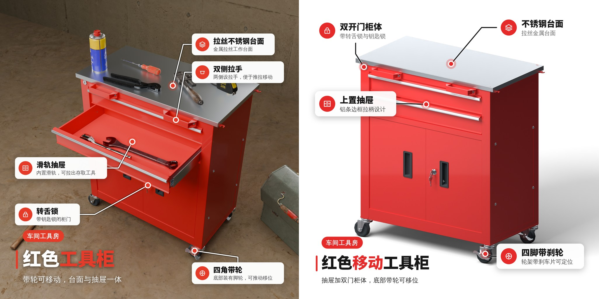
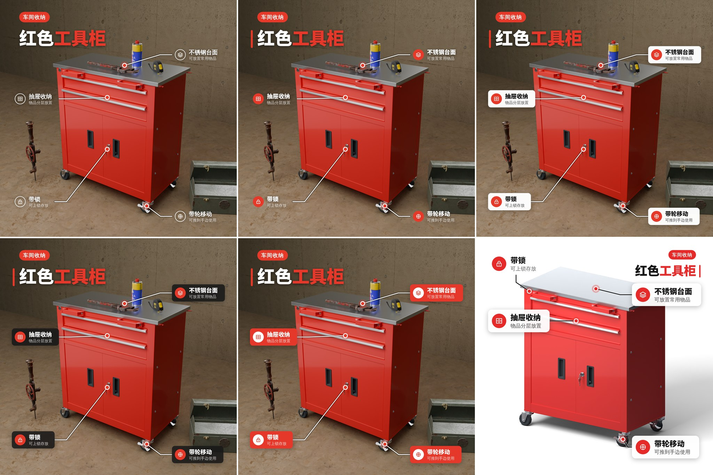
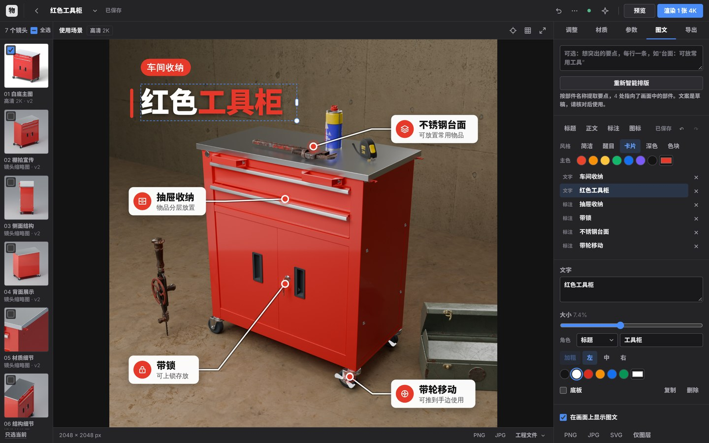

# 图文图层的设计升级与 HAI 实测 v24

日期：2026-11-13。

v23 的图文图层能用，但不好看：系统默认粗体、灰色半透明底板、细线图标，放在图上像标注，不像设计。本次重做了它的视觉：更重的标题字、一个取自产品的主色、带图标徽章的卡片式标注，以及五种可以一键切换的风格。同时按要求接入 HAI 接口，对 AI 路径做了真实调用。

两张都是从应用「图文」面板导出的 2048 px PNG（此处并排缩小），由「智能排版关键信息」一次生成，没有手工调整。左图自动选用了「卡片」风格，右图是「醒目」风格。两张图的文案都由 HAI 上的真实模型看图写出（见“HAI 实测”一节）。

## 变了什么

| | v23 | v24 |
| --- | --- | --- |
| 标题 | 系统粗体，画面短边的 5–6% | 内置的 Noto Sans SC Black（字重 900），最大到 10%；产品名中的关键词用主色强调；标题旁有一条主色竖线 |
| 标题上方 | 无 | 品类标签：主色胶囊，白字（如“车间收纳”） |
| 标注 | 细线图标 + 文字，必要时垫一块灰底 | 主色圆形徽章里放白色图标；标题用 900 字重；卡片为圆角白底并带柔和投影 |
| 指向线 | 细线 + 小圆点 | 线略粗；终点是带白边的主色圆点，外面一圈半透明光晕 |
| 文字直接压在照片上时 | 靠底板保证可读 | 浅色字带深色柔影，深色字带浅色光晕，不必加框 |
| 颜色 | 黑、白 | 黑、白 + 一个主色。主色取产品自身最主要的鲜艳色（红色工具柜取红色）；产品没有明显色彩时，浅背景用朱红，深背景用暖黄 |
| 风格 | 一种 | 五种，一键切换：简洁、醒目、卡片、深色、色块 |
| 副标题 | 规则模式下把几条要点再拼一遍 | 不再重复要点；只有品类说明或 AI 写的副标题才显示 |

从左到右、从上到下：简洁（环形徽章、文字带柔影）、醒目（主色徽章、无卡片）、卡片（白色卡片）、深色（深色卡片）、色块（主色卡片、白色徽章）；最后一格是白底主图在「醒目」风格下的样子。五种风格使用同一套尺寸，切换风格不会移动任何元素。

## 怎么用

「图文」面板在元素列表上方新增两行：

- **风格**：简洁 / 醒目 / 卡片 / 深色 / 色块。智能排版会按画面自动选一种：平静的浅色背景（白底主图）用「醒目」，其余（场景图）用「卡片」。
- **主色**：七个预设色，或用取色器自定义。徽章、标签、强调词、标题竖线和指向点都跟着它变。

选中一段文字后多了「角色」：标题、副标题、标签、正文。标题可以填一个「强调词」，这个词会用主色显示。风格、主色、角色的修改与其他修改一样可以撤销，并随图层保存。

v23 保存的图层没有风格，仍按原来的朴素画法显示，直到你给它选一种风格。

## 标题字体

内置了 Noto Sans SC Black（思源黑体 900 字重的网络字体版本），文件为 `static/vendor/fonts/noto-sans-sc/noto-sans-sc-900.woff2`，1.1 MB，含 7,946 个字形（简体常用字、拉丁字母、数字与标点），取自 npm 包 `@fontsource/noto-sans-sc` 5.3.1。许可为 SIL Open Font License 1.1，可随软件分发与商用，许可全文在同目录的 `OFL.txt`。

- 标题和标注标题（「简洁」风格除外）使用它；说明文字仍用系统字体。
- 字体中没有的生僻字会回退到系统字体显示。
- 导出 PNG / JPG 时字体随图一起绘制，结果与屏幕一致。导出的 SVG 把这款字体内嵌在文件里（因此文件大约增加 1.5 MB），在浏览器中打开效果一致；在 Illustrator、Figma 中打开时，这些软件通常不读取内嵌的网络字体，需要本机安装了 Noto Sans SC / 思源黑体 Heavy 才能保持原样。

## 排版的变化

- 标题块（标签、标题、副标题）整体找位置，字号从 10% 起逐级尝试到 5.2%；越大越好，但只要碰到产品就先扣分，所以不会为了大而压住产品。带着副标题放不下时，先省略副标题，并在结果里说明。
- 标注的标题字号从 3% 提到 3.2%，徽章直径是标题字号的 1.9 倍；空间不够时按 100%、88%、76% 逐级缩小。
- 卡片风格下卡片是不透明的，压到产品的代价更高；压到场景道具的代价也调高了，标签不再盖住锤子这类道具。
- 风格按背景决定：产品与道具之外的区域平均亮度 ≥ 0.75 且起伏不大时用「醒目」，否则用「卡片」。

## HAI 实测

### 第一次：额度用尽之前

按要求把 `api.hai.network` 加入了验证环境的网络放行名单，用你提供的访问令牌配置了应用（只写入本机被 git 忽略的 `.env`，测试后已删除，没有进入仓库、文档或提交记录）。

| 调用 | 结果 |
| --- | --- |
| 应用内「保存并测试连接」 | 通过。`https://api.hai.network/anthropic`，模型 `claude-sonnet-4-6` |
| 上传模型（AI 开启） | 应用原有的自动分析与检查流程正常走完；首图用时 151 秒（未开启 AI 时约 36 秒） |
| 图文要点（v23 的提示词） | 12 秒返回，来源为 AI。标题“红色工具柜”，副标题“移动便捷，收纳有序”，5 条要点：双门柜锁、铝条边框、抽屉储物、不锈钢台面、万向滚轮；5 条全部正确指向了画面中的部件 |
| 使用场景的导演与采购（v22） | 18 秒完成，来源为 AI。判断为车间，估计最长边 900 mm，放入 5 件道具（管钳、润滑喷罐、卷尺在台面，铁皮工具箱在旁边，手摇钻在后方），另有 2 件因模型库中没有而跳过 |
| 之后的调用 | **HTTP 402**：“Your organization has reached its usage limits.” 账户额度用尽，无法继续 |

这解决了此前几个版本一直标注的“没有在真实的大模型接口上运行”：v22 的场景导演与采购、v23 的图文要点，都有了真实调用的结果，请求格式和返回校验一次通过。

### 充值后的补测

账户充值后，令牌改由安全表单保存为云环境的网络密钥，由网络代理在发往 `api.hai.network` 的请求里自动带上；应用的 `.env` 里只有占位值，令牌不在任何文件里。这次上传模型时没有开启 AI，只对图文要点做了真实调用，共三轮、每轮主图与场景图各一次：

| 轮次 | 结果 | 据此做的修改 |
| --- | --- | --- |
| 第一轮（v24 提示词原样） | 两次调用各约 12.5 秒，来源 AI，返回校验一次通过。品类标签、带强调词的标题、副标题与 4–5 条要点俱全，要点全部正确指向部件 | 说明里仍有“拉柄开合顺畅”“抽屉顺滑推拉”“宽敞作业台面”：把顺滑、轻松、宽敞一类也列为禁止。品类标签“车间工具柜”与标题重复：要求标签不得重复标题用词。台面一条选了尺子图标：给每个图标附上含义 |
| 第二轮 | 上述三类问题都没有再出现；台面两次都选了“表面/材质”图标 | 标题块的标签压到了主图的脚轮：改为只要标题块碰到产品，就先省略副标题 |
| 第三轮（最终代码） | 主图 11.5 秒：标签“车间工具房”，标题“红色**移动**工具柜”，4 条要点（双开门柜体、上置抽屉、不锈钢台面、四脚带刹轮）；场景图 12.7 秒：5 条要点（滑轨抽屉、转舌锁、拉丝不锈钢台面、双侧拉手、四角带轮）。全部指向了画面中的部件 | — |

本页第一张图就是第三轮的结果。

关于数字：回复里出现过“180度转舌锁”，这个数字来自模型文件自带的部件名 `180度转舌锁_3`，属于已知事实；“四轮”“双侧”是画面里数得出来的数量。没有出现尺寸、承重、认证一类的数字。

仍需注意：样本只有一件产品的三轮调用；模型偶尔还会写功能性的判断（第二轮出现过“抽屉可完全拉出”）。界面上“文案是草稿，请核对后使用”的提示保留。

**测试隔离。** 补测时发现，本机 `.env` 启用了 AI 的情况下运行 `tests/test_info_layer.py`，其中几项会真的去调用接口（并因返回的是 AI 文案而失败）。现在这个测试文件在模块级别屏蔽了模型配置，需要模型的测试各自提供脚本回复；在启用 AI 的配置下运行已确认不再发出请求。

另外改进了额度不足时的提示：此前 402 只显示“AI 请求失败，请检查服务配置”，现在显示“AI 服务的额度已用尽或账户欠费，请充值或联系管理员后重试”，图文面板也会把这个原因带出来，而不是只说“AI 未返回可用结果”。

## 边界与未验证

- AI 文案只在一件产品上实测过三轮；换一类产品、换一个模型时的表现没有证据。
- 主色取自产品颜色。红色产品配红色徽章是协调的，但徽章压在产品上时对比会变弱，此时可以换一个主色。
- 内置字体只有 900 一个字重，只覆盖简体常用字。
- 仍然只在无界面 Chromium 中验证；未测桌面浏览器与触屏，未在 Illustrator / Figma 中打开导出的 SVG。
- 电商平台套图导出仍不含图文。

## 验证

环境：Linux，4 核 CPU，无 GPU；Python 3.13，Blender 5.0.1（`bpy` 模块）；Chromium 无界面模式（Playwright）；HAI 接口为真实联网调用。

| 范围 | 结果 |
| --- | --- |
| `python -m unittest discover -s tests`，Blender 可用 | 1138 项通过 |
| 同上，不提供 Blender | 1138 项，通过 1056，跳过 82 |
| `tests/test_info_layer.py` | 27 项通过（在本机启用 AI 的配置下运行也不发出请求）。新增与改写的部分覆盖：风格、主色、文字角色与强调词的数据约定；主色取自产品颜色、无色产品回退到默认色；背景平静明亮时选「醒目」、否则选「卡片」；品类标签与强调词的排版；标签避开道具；AI 返回的强调词必须在标题里；发给模型的图标带含义；标题块会碰到产品时先省略副标题；402 的原因进入给用户的说明 |
| `node --test tests/test_ui_state.cjs`（jsdom 31.0.0） | 215 项通过。新增 3 项：有风格的图层按标题字体、强调词、标签胶囊、徽章、卡片绘制，五种风格尺寸一致，无风格的旧图层画法不变；面板里改风格、主色、角色、强调词并保存与撤销；导出的文件内嵌字体与同样的样式 |
| `node --test tests/test_viewport_math.mjs` | 9 项通过 |

**真实浏览器。** 在工具柜的 2048 px 场景图与主图上各走了一遍：智能排版（自动选了「卡片」与「醒目」，主色取到产品的红色）→ 选中标题查看属性 → 切换为「深色」并换主色 → 撤销两次回到原样 → 自动保存 → 导出 PNG、SVG、仅图层 SVG → 刷新页面后风格、主色与 6 个元素原样恢复。标题字体在页面中加载成功；导出的 PNG 为 2048 × 2048（场景图 6.2 MB，主图 2.7 MB），画面与屏幕一致，使用的是内嵌的标题字体；浏览器控制台无报错。

**没有验证的。** 其他品类的产品与其他模型上的 AI 文案；桌面浏览器、触屏、Windows / macOS；导出的 SVG 在 Illustrator / Figma 中的显示；4K 图上的导出。
