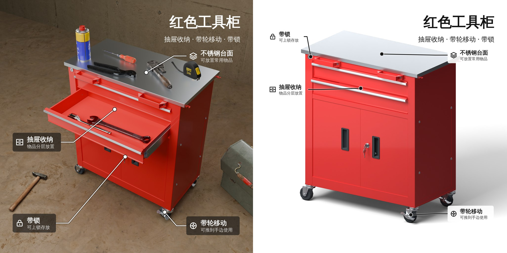
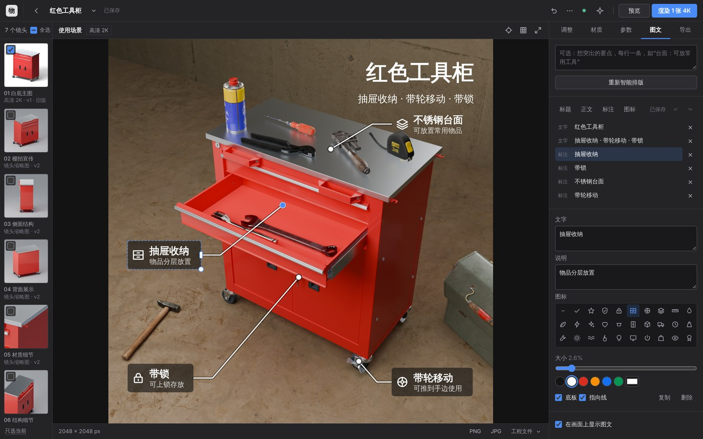

# 图文图层 v23

日期：2026-11-13。

渲染图说明产品长什么样，卖点图还需要说明它好在哪里。本次更新给每个镜头加了一层可编辑的矢量图文：标题、正文、图标，以及带引线指向部件的标注；并且可以由应用自己把产品的关键信息排到画面上合适的位置。

两张图都是本次验证中从应用的「图文」面板导出的 PNG（各 2048 px，此处并排缩小）：左为 v22 的使用场景，右为白底主图。图文由「智能排版关键信息」一次生成，没有手工调整，没有启用 AI。

## 怎么用

右侧面板新增「图文」，位于「参数」和「导出」之间。打开它时，画面显示当前镜头的渲染图（白底主图的实时 3D 视图会让位）。

1. 点「智能排版关键信息」。上方的输入框可以留空，也可以逐行写下想突出的要点，例如“台面：可放常用工具”。
2. 在画面上修改：
   - 拖动任意一项来移动；靠近画面中线或 5% 边距时会吸附并显示参考线，按住 Alt 关闭吸附。
   - 右下角的圆点缩放文字（文字框一起缩放），右侧的条形手柄只改文字框宽度。
   - 标注引线末端的圆点可以拖到别的部位。
   - 在同一项上连按两下，直接在画面上改字；Esc 或 Ctrl+Enter 结束。
   - Delete 删除，方向键微调（Shift 加大步长），Ctrl+D 复制，Ctrl+Z / Ctrl+Shift+Z 撤销与重做。
3. 右侧可以添加「标题 / 正文 / 标注 / 图标」，并修改所选项的文字、说明、图标、大小、粗细、对齐、颜色、底板和是否带指向线。
4. 导出 PNG、JPG、SVG 或仅图层的 SVG。

图层自动保存，每个镜头各有一层。「在画面上显示图文」只影响界面上是否显示，不影响已保存的内容。

## 图层是什么

一层图文是一组纯数据：每一项的类型、文字、位置、大小、颜色。位置是画面宽高的比例，大小是画面短边的比例，所以同一层图文在 512 px 预览和 4K 成品上位置相同、同样清晰。

- **文字**：多行，可设字重、左中右对齐、颜色、底板。
- **图标**：内置 38 个线性图标（对勾、盾牌、锁、抽屉、轮子、尺子、水滴、闪电、货车……），是本项目自己绘制的 SVG 路径，没有使用第三方图标库。
- **标注**：标题加一行说明，可带图标；可以带一条引线，指向画面上的一个位置。

图层保存在项目记录里，**不属于拍摄方案**。改图文不会产生新的方案版本，不会让已有渲染图变成“旧版”，也不需要重新渲染；撤销图文用的是图文自己的撤销，不影响方案的撤销。

## 智能排版怎么决定内容和位置

### 说什么

| 方式 | 何时使用 | 依据 |
| --- | --- | --- |
| AI | 已在「AI 设置」中启用视觉模型且调用成功 | 当前渲染图，加上项目名称、品类、材质说明、用户填写的尺寸、这张图里可见的部件名、质感推断记录；1 次调用 |
| 规则 | 未启用 AI，或调用失败 | 部件名称中的词：抽屉、脚轮、锁、台面、拉手、柜门、泵头、屏幕、按键、口袋、层板等 |

两种方式都受同一条约束：**只说看得见的或已知的事实，不编造数字**。规则生成的文案不含任何数字，只有用户在「参数」里填写了产品尺寸时才会出现“产品尺寸 690 × 380 × 738 mm”这一条；给模型的指令明确禁止尺寸、重量、容量、等级、认证、质保和性能类说法，除非事实中已有。模型返回的部件名必须来自发给它的可见部件列表，否则丢弃。

在输入框里写了要点时：规则模式把每一行当作一条要点，原样保留用户的措辞和数字（“标题：说明”在冒号处分开），再按其中的词找到对应部件；AI 模式把它作为优先要求交给模型。

无论哪种方式，结果都是**草稿**：界面会提示“文案是草稿，请核对后使用”。

### 放哪里

位置不是按固定模板摆的。应用读取这张图渲染时保存的 Blender 场景，从相机向画面打出 96 × 96 条射线，得到每个格子里是产品（以及是哪个部件）、场景道具还是背景；再把渲染图缩到同样的格子，得到各处的明暗与杂乱程度。这一步不渲染，约 1 秒，结果按场景文件缓存。

- **标题与副标题**：在上下各三个位置、四档字号、三种行宽中，选压到产品和道具最少、背景最平整的一处，优先左上；大字号优先。
- **标注**：指向线的终点取该要点对应部件在这张图里**可见部分的最大一块**的中心（四个脚轮不会指向它们的中点，而是指向最显眼的那一个）。标签放在产品左侧或右侧，优先放在部件所在的那一侧；同一侧的标签自上而下的顺序与它们所指部位的顺序一致，引线不会交叉。评分同时考虑：引线长度、引线横穿产品的长度、标签压到产品的面积、压到道具的面积；标签不会盖住任何一条引线的终点。
- **版面紧张时**：依次尝试 100%、86%、74% 三档标签字号，取总评分最好的一档——主图里产品占满画面时，会用小一号的标签贴在产品边上，而不是把标签推到远处再拉一条长线。
- **没有对应部件的要点**（例如用户自己写的“500 ml 大容量”）：排成一列放在标题下方，或在画面上下沿排成一行，取压到产品最少的一种。
- **颜色**：标签下方画面的平均亮度高则用深色字，低则用白色字；背景杂乱、亮度居中或标签压到产品时，加半透明底板。引线带一圈对比色的描边，在任何背景上都看得清。

读不到保存的场景时（旧输出、Blender 不可用），按画面边缘的颜色估计哪里是产品，只排文字、不画指向线，并在结果里说明。

排版时会记下镜头当时的相机参数。之后如果改了机位或画幅，标注可能不再对准，面板会提示“镜头在排版后变过”，可以重新排版或手动拖动圆点。

## 导出

| 格式 | 内容 |
| --- | --- |
| PNG / JPG | 渲染图与图文合成，尺寸等于渲染图本身（2K 的图导出 2K）。由浏览器绘制，与屏幕上看到的一致 |
| SVG | 一个独立文件：渲染图以内嵌图片的形式放在底层，文字是 `<text>`，图标和引线是路径。可在 Illustrator、Figma、Inkscape 中继续编辑 |
| 仅图层 | 同上，但没有底图，背景透明 |

文字使用系统字体（依次为苹方、微软雅黑、思源黑体等）。PNG / JPG 所见即所得；SVG 在另一台电脑上打开时，文字会用那台电脑上的字体显示，字宽可能略有差别。

## 边界与未验证

- **没有在真实的大模型接口上运行。** 验证环境没有 API Key。AI 写要点这条路径只用脚本代替的回复测试了请求内容、返回校验和失败回退；它在真实模型上写得好不好，本次没有证据。规则路径和全部编辑、导出功能是在真实浏览器里验证过的。
- **规则只认名字。** 部件名是 `Object_12` 的模型，规则提取不出要点，只会放一个标题并说明原因。这时可以逐行写下要点，或启用 AI。
- **电商套图导出不含图文。** 「导出」面板的平台套图会重新构图、裁切和抠底，图文层目前不参与；带图文的图片请从「图文」面板导出。导出 Blender / C4D 工程同样不含图文。
- **图层不跟随镜头。** 改了机位之后标注不会自动移动，只会提示。
- **功能范围。** 每个镜头一层；元素不能旋转；不支持上传图片或 Logo、自由形状、渐变和描边文字；字体不可选。
- **下载文件名。** 导出文件以“项目名-镜头名-图文”命名。验证用的无界面浏览器把含中文的文件名替换成了 `download`，这是该环境的行为，没有在桌面浏览器上核对。
- **验证硬件。** 4 核 CPU，Blender 5.0.1（`bpy` 模块），Chromium 无界面模式。

## 验证

环境：Linux，4 核 CPU，无 GPU；Python 3.13，Blender 5.0.1（`bpy` 模块）；Chromium 无界面模式（Playwright）。

**自动测试。**

| 范围 | 结果 |
| --- | --- |
| `python -m unittest discover -s tests`，Blender 可用 | 1135 项通过 |
| 同上，不提供 Blender | 1135 项，通过 1053，跳过 82 |
| `tests/test_info_layer.py`（本次新增 24 项） | 数据约定（未知类型、图标、颜色、控制字符、超量一律拒绝；页面绘制的图标与服务端接受的图标一一对应）；要点提取（规则文案不含数字、尺寸只在用户填写时出现、用户写的要点原样保留并找到部件、AI 只能指向发给它的部件、AI 失败回退）；排版（文字落在空处、标签在部件一侧且顺序一致、引线终点在部件上、画面满时用小号标签加底板、避开道具、3:4 与 16:9 画幅不出界、无场景时不画引线）；存储与接口（不改方案版本、版本冲突 409）。其中 2 项在真实 Blender 中渲染一个合成柜体，再探测其保存的场景：产品、背景、各部件位置正确，结果有缓存 |
| `node --test tests/test_ui_state.cjs`（本次新增 8 项，jsdom 31.0.0） | 212 项通过。新增项覆盖：面板顺序与启用条件；排版结果绘制为真实的 SVG 文字并只保存一次；添加、修改、删除与撤销，连续输入合并为一步；拖动、缩放、移动指向点、吸附、原位改字与键盘操作；导出的 SVG 是完整文件且输入的文字不会变成标记；每个镜头各自保存、切换时不丢修改、冲突不覆盖；镜头变化后的提示 |
| `node --test tests/test_viewport_math.mjs` | 9 项通过 |

**真实应用流程（浏览器）。** 启动应用，上传 `validation/cabinet-material-check.zip`，生成使用场景，然后在 Chromium 中操作「图文」面板：

| 步骤 | 结果 |
| --- | --- |
| 智能排版 | 主图与场景图各约 1 秒返回；6 个元素（标题、副标题、4 条标注），4 条都指向了画面中的部件；未启用 AI |
| 鼠标拖动标题 | 位置按画面比例改变；选中后出现虚线框与手柄 |
| 拖动角点、指向点 | 字号与文字框同比缩放；引线终点移到新位置，标签不动 |
| 连按两下改字 | 画面上出现输入框，输入“车间工具柜”后 Esc，图层文字随之改变 |
| 面板改颜色、图标；添加图标后用 Delete 删除；Ctrl+Z 两次、重做两次 | 均生效 |
| 自动保存 | 上述操作共触发 3 次保存；刷新页面重新打开项目，6 个元素原样恢复，并在其他面板下也显示在画面上 |
| 导出 | 512 px 预览图：PNG、JPG、SVG（含底图）、仅图层 SVG 均成功下载；2048 px 高清图：主图 PNG 2.7 MB、场景图 PNG 6.6 MB，尺寸均为 2048 × 2048 |
| 浏览器控制台 | 无报错 |

**另一种产品。** 示例按压瓶（`samples/matte-pump-bottle.glb`）：不写要点时，规则只识别出“按压泵头”，标题放在左上空白处，标注用引线指向泵杆；写入三行要点（“按压泵头：单手取用”“500 ml 大容量”“哑光瓶身”）后，第一条带引线，后两条没有对应部件，排成一行放在画面下沿。

本次开发中由浏览器实测发现并修复的问题：SVG 元素没有 `hidden` 属性导致图层不显示；画面每次按下都会重绘，浏览器因此不触发双击事件（改为识别同一项上的两次按下）；标签宽度按估算字宽给得太紧，真实字体下意外换行（加了余量）。

**没有验证的。** 真实大模型接口（见上节）；桌面版 Chrome / Safari / Firefox 与触屏设备；Windows 与 macOS 的系统字体下的实际观感；4K 成品图上的导出（与 2K 走同一条路径，未实际执行）；导出的 SVG 在 Illustrator、Figma 中打开的效果（只验证了它是结构完整、文字可选的 SVG）。
